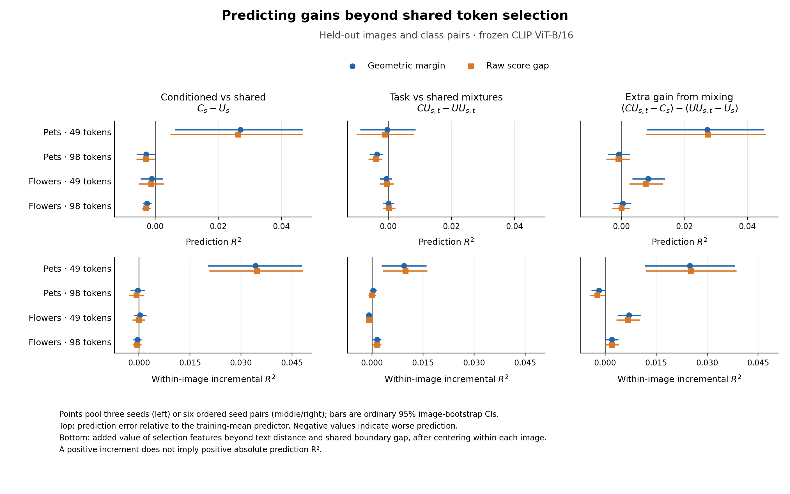
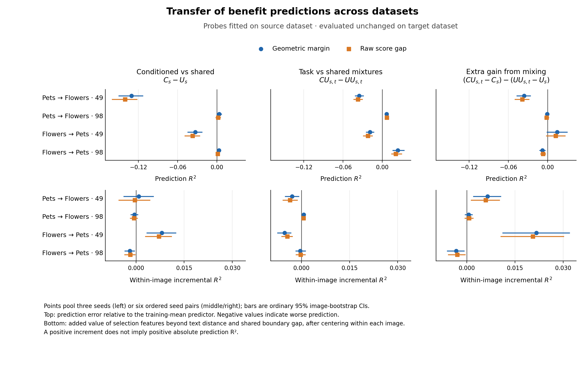

# Can observable selection signals predict conditioning benefits?

Completed 2026-11-04. **The fixed low-dimensional probes find a modest signal on Pets49, but do not produce a reliable rule for choosing conditioning over strong shared selection across settings.** Flowers49 retains its previously measured average hybrid benefit; this analysis does not successfully predict which examples receive that benefit. Offline routing does not establish an improvement over the better fixed strategy.

This is an analysis of existing development outputs, with no new selector training or CLIP inference. It follows I27's conditional/shared complementarity and I29's distinction between score scale and retained-token quality.

## Question and comparisons

Let C be the conditioned selector and U the parameter-matched wide image-only selector. CU mixes a conditioned recipient with an independently trained shared donor; UU uses two shared selectors under the same mixing rule. We predict three signed outcomes:

- **Direct benefit:** C−U, all three fixed training seeds.
- **Final hybrid benefit:** CU−UU, all six ordered distinct-seed pairs.
- **Extra mixing increment:** (CU−C)−(UU−U). This equals final hybrid benefit minus the starting C−U advantage, and is not itself a deployable alternative.

The observable baseline uses candidate-text distance, its reciprocal and U's normalized top-k boundary gap. The selection-aware probe adds C/U set disagreement, C's boundary gap, rank disagreement and its specified interaction; mixture panels also include donor-disagreement excess. All are available before the CLIP suffix and invariant to positive logit scaling. A separate diagnostic adds full-model task difficulty. Both geometric margin and unnormalized cosine-score-gap outcomes are retained.

Every development row is predicted with both its image group and candidate-pair group excluded from fitting. Normalization and ridge coefficients use training rows only. Cross-dataset fits apply source coefficients unchanged to the other dataset at the same token budget. See the [fixed protocol](../../docs/conditioning-benefit-prediction.md).

## Held-image and held-task results

R² below is relative to the training-fold mean predictor. Negative R² means greater prediction error than that mean. Within-image ΔR² compares selection-aware and baseline inputs after centering each image/run's outcomes and predictions. It measures task variation within an image, not overall classification accuracy.

| Setting | Direct R² | Direct within-image ΔR² | Final hybrid R² | Extra mixing increment R² |
|---|---:|---:|---:|---:|
| Pets49 | 0.0271 | 0.0343 | −0.0003 | 0.0273 |
| Pets98 | −0.0029 | −0.0003 | −0.0036 | −0.0007 |
| Flowers49 | −0.0011 | 0.0003 | −0.0007 | 0.0084 |
| Flowers98 | −0.0026 | −0.0005 | 0.0001 | 0.0005 |

Pets49 has a small direct-benefit signal: ordinary 95% CI for R² is [0.0062, 0.0468], while its four-setting-adjusted interval reaches zero [−0.0005, 0.0536]. More specifically, the increment over baseline inputs is 0.0311 [0.0036, 0.0578], within-image ΔR² is 0.0343 [0.0174, 0.0524], and the difficulty-adjusted increment is 0.0345 [0.0065, 0.0619]; these intervals are four-setting adjusted. Raw-gap sensitivity shows the same pattern. The effect therefore includes task variation beyond text distance and full-model difficulty, but explains only a small fraction of variation.

The other direct-benefit settings do not show a comparable signal. In particular, Flowers49's final hybrid R² remains near zero despite its earlier positive average CU−UU margin. **A positive average benefit and a predictable example-level benefit are different empirical properties.** The old average result is unchanged.

Extra mixing increments have positive adjusted R² intervals at 49 tokens: Pets [0.0048, 0.0507] and Flowers [0.0020, 0.0151], with the raw-gap check also positive. This outcome subtracts C−U; predictive success may reflect the starting endpoint as well as mixing behavior. It does not establish a new complementarity mechanism or a rule for predicting final CU−UU performance.

A post-result arithmetic check of saved outputs supports this interpretation: on Pets49, the increment target correlates 0.794 with −(C−U), and its saved prediction correlates 0.911 with the negated direct-benefit prediction (weighted correlations, then averaged over the six pairs). This is consistent with inheriting the starting difference. All four settings and definitions are retained in `increment_decomposition.json`; no extra model was fitted for this check.

## Cross-dataset transfer and routing

At 49 tokens, direct-benefit R² is negative in both transfer directions: Pets→Flowers −0.1306 and Flowers→Pets −0.0331. At 98 tokens, direct R² values are small positive points (0.0033/0.0030), while both within-image direct R² values are negative. These results do not give a consistent cross-dataset rule for task-specific gains. The extra mixing increment retains some within-image signal across datasets at 49 tokens, but its absolute prediction is not reliable in both directions. All transfer results, including their raw-gap sensitivity, remain in the tables and figure.

The offline gate chooses C over U, or CU over UU, when predicted geometric gain is positive. Across the eight within-dataset routing panels, it does not establish a positive geometric-margin improvement over the fixed choice selected from training folds; no positive accuracy improvement is established either. Flowers49's hybrid gate selects CU on 93.9% of weighted rows, essentially retaining the already favorable fixed mixture.

A transfer gate can improve on a **source-selected** fixed strategy while losing to a target fixed endpoint. For example, Pets98→Flowers98 hybrid routing gains +0.245 percentage points of accuracy versus the source choice UU, but its margin remains 0.000104 below always choosing CU (adjusted interval [−0.000184, −0.000029]). All three references are therefore reported: always baseline, always alternative, and training-selected fixed choice. This analysis establishes no adaptive method advantage or measured speedup.

## Research consequence and next step

This extends proposal H1/H3 from average conditioning gains to predicting their variation on new images and candidate combinations. It provides a modest positive finding for Pets49 and a negative result for a broadly useful gate based on these simple signals. It leaves the main explanation of Flowers/Pets differences unresolved. The evidence concerns this specified linear probe and its inputs, not every possible predictor.

The proposed next main-line experiment is a controlled change in pruning depth at 49 tokens on both datasets: compare earlier, current and later pruning with matched C/U capacity and training, then measure C−U and CU−UU. This tests whether the amount of information propagation before selection changes the value of conditioning. Depth also changes representations and compute, so its result should be stated as a depth intervention, not isolated proof of information mixing. The earlier synthetic-object depth pilot did not establish a consistent mechanism; this would test learned selectors on the original images. Direct retained-set learning remains a separate H3 method candidate arising from I28–I29. Neither follow-up started in this round; designs must be fixed before new training.

## Data, checks and cost

- Four settings; Pets has 716 images / 66 candidate pairs / 2,624 rows, Flowers 1,020 images / 204 pairs / 4,080 rows per budget.
- 25 image-group × task-group holdout cells per setting; 1,248 small two-output ridge fits across OOF and transfer. No new neural fits, GPU inference or GPU training.
- Recorded server analysis: 38.11 seconds on one CPU thread. Existing selector outputs account for the computationally expensive work reused here.
- Eight feature/math tests and synthetic end-to-end checks passed. Independent audit verifies all 24 panels, weights, per-run aggregation, within-image centering, routing and fold isolation. Two real probe fits reproduce via a separate weighted least-squares solver. Bootstrap intervals were not independently rerun. See `independent_check.json`.
- Image-bootstrap intervals condition on the fixed trained selectors, candidate pairs and fitted probes. Ordinary intervals appear in the figures; four-setting-adjusted intervals are in every `summary.json`.
- No reserved final-test images or combinations were used.

`predictive_summary.csv`, `routing_summary.csv`, all summaries, folds, fitted coefficients and figures are in Git. The 28 input/prediction arrays are retained locally and on the server and backed up as a GitHub draft-release attachment; see `backup_manifest.json`. Extract that ZIP at the repository root to restore the ignored NPZ files. The source experiment backups remain unchanged.

[Run record](../../docs/experiments/2026-11-04-conditioning-benefit.md) · [Research insights](../../docs/research-insights.md)
