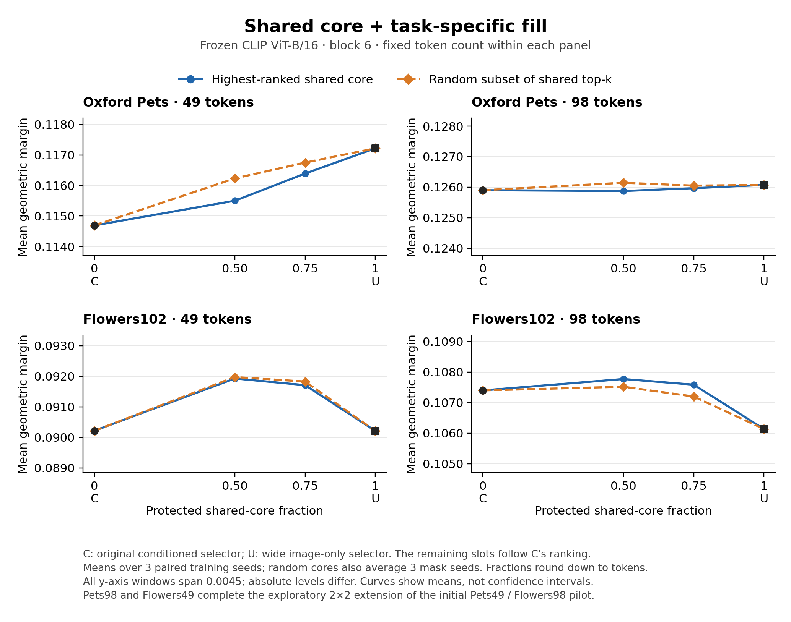

# Core-protection development results

This intervention combines existing frozen selector rankings. At fixed token
count, protect a fraction of the wide image-only selector's selection, then fill
remaining slots from the conditioned ranking. Compare the highest-ranked shared
core with an equally sized random subset of the shared top-k. Both endpoints,
both interior fractions, and all three trained seeds are retained.



The main result is conditional: mixing rankings improves geometric margin over
both original selectors on Flowers49. On Flowers98, the 50% top-ranked core also
improves margin over both endpoints, while the corresponding accuracy gain over
the conditioned endpoint is absent. Pets49 mixtures improve on the conditioned
selector but remain below the stronger wide selector; Pets98 differences from
the endpoints are small. These are margin findings, not a general accuracy or
inference-speed improvement.

| Setting | Top50 − random50 margin | Top75 − random75 margin | Top50 − conditioned margin | Top50 − wide margin |
| --- | ---: | ---: | ---: | ---: |
| Pets49 | −0.000732 | −0.000359 | +0.000808 | −0.001716 |
| Pets98 | −0.000269 | −0.000084 | −0.000027 | −0.000200 |
| Flowers49 | −0.000048 | −0.000118 | +0.001711 | +0.001717 |
| Flowers98 | +0.000253 | +0.000389 | +0.000372 | +0.001636 |

The top-versus-random margin contrasts have the same sign in all three trained
seeds for Pets49 (both fractions), Pets98 (50%), and Flowers98 (both fractions).
The Pets98 75% and Flowers49 top-versus-random margin intervals include zero.
Hybrids retain positive descriptor-exchange margin effects in every setting;
the effects shrink as more shared tokens are protected. Mixing can therefore
preserve task sensitivity without necessarily beating a strong shared selector.

## Interpretation and next control

The highest-ranked shared tokens often already belong to the conditioned
selection. Consequently, protecting the same number of tokens does not replace
the same number of original conditioned tokens:

| Setting | Replacements with top50 | Replacements with random50 |
| --- | ---: | ---: |
| Pets49 | 3.43 | 7.81 |
| Pets98 | 4.73 | 12.93 |
| Flowers49 | 9.33 | 12.68 |
| Flowers98 | 13.52 | 18.41 |

The next discriminating intervention is to fix the **actual replacement count**:
choose equally many new tokens from the shared selection outside the conditioned
selection, compare high shared ranks with random candidates, and remove the same
tail of the conditioned ranking. This separates the value of shared rankings
from how far the selection moves toward the shared endpoint. It has not been run
in this result set.

## Scope and reproducibility

The initial pilot was Pets49 and Flowers98. Their opposite top-versus-random
margin directions motivated adding Pets98 and Flowers49; the full 2×2 comparison
is an exploratory extension. Dataset and budget both affect the observed pattern.
The compact combined summary uses ordinary paired 95% image-bootstrap intervals,
without claiming simultaneous coverage of all eight contrasts. The original
pilot's four-comparison adjustment applies only to its original settings.

Classification averages tasks equally, then class sides equally within each
task. Exchange averages images equally, then within-image task pairs. Random-core
outcomes are averaged across three mask seeds, followed by three training seeds,
before image resampling. Only existing validation images and validation task
combinations are used.

`endpoint-audit.json` independently compares all 24 setting/seed/endpoint
combinations with their earlier development-evaluation artifacts. Every retained
mask and cosine-score array matches exactly; no predictions or margins changed.

Each setting directory contains row-level, per-image, and per-seed classification
and exchange evidence. `four-setting-summary.json` gathers the main estimates;
`core_protection.csv` contains plotted means and ordinary point intervals.
Generate the PNG and PDF from the saved summaries with:

```bash
python3 scripts/plot_core_protection.py
```

The two-selector replay is a diagnostic intervention. It measures predictive
outcomes at fixed token count; no runtime improvement is inferred.
