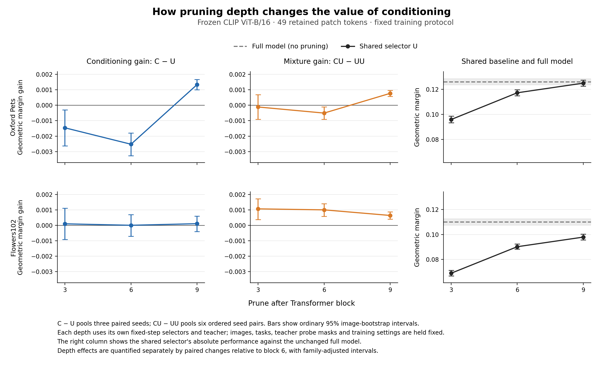
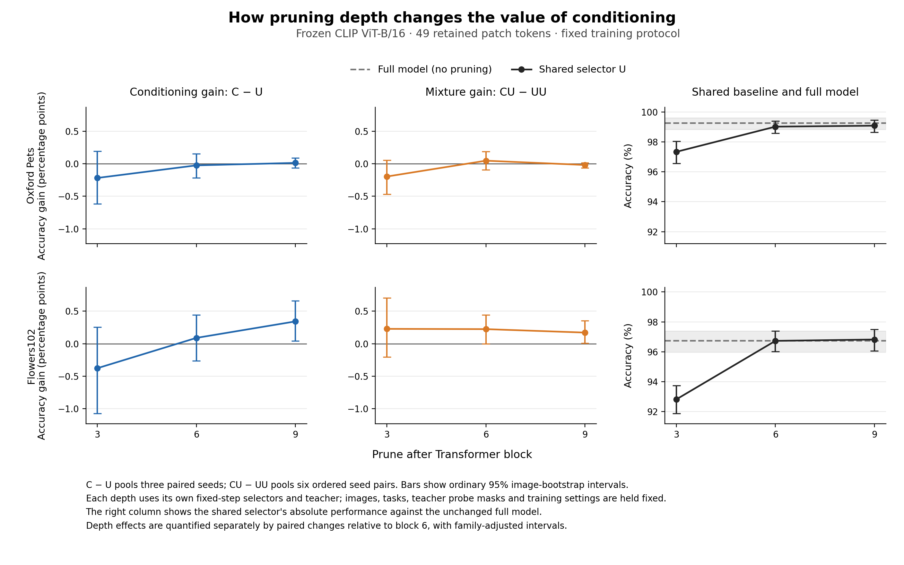

# Does pruning depth change the value of task conditioning?

Completed 2026-11-04. **On Pets, moving selection from block 6 to block 9 reverses the geometric-margin comparison: the conditioned selector changes from worse than the strong shared selector to better. Conditional/shared mixing also changes from worse than shared/shared mixing to better.** The paired depth interactions survive the four-comparison adjustment and have the same direction across all retained seeds or seed pairs. Flowers does not establish the corresponding depth interactions. Depth-related changes in the relative conditioning advantage on accuracy remain inconclusive for both datasets.

This extends the central question of when candidate-class information adds value beyond an equally resourced shared selector. [I27](../../docs/research-insights.md#i27flowers49的条件化互补超出了两个共享选择器的混合收益) established average conditional/shared complementarity on Flowers49; [I30](../conditioning-benefit-v1/README.md) found no reliable cross-setting benefit predictor from simple selection statistics. The present study changes a structural condition directly, using the [protocol fixed before execution](../../docs/pruning-depth-intervention.md).

## Fixed comparison

Frozen CLIP ViT-B/16 retains **49 of 196 patch tokens, plus CLS**, immediately after block 3, 6 or 9. C is the width-128 conditioned selector with 348,033 parameters; U is the width-199 image-only selector with 347,399 parameters. The same images, candidate-pair splits, preprocessing, text prompts, mask bank, ridge setting, KL objective, optimization schedule and seeds 2041/2042/2043 are used across depths. Each new depth receives its own frozen prefixes and teacher responses. Block 6 reuses the existing models and evaluated predictions; blocks 3 and 9 require 24 new selectors in total.

CU combines C from recipient seed s with U from donor seed t. UU combines U from the same recipient seed s with that donor U. All six ordered pairs with s ≠ t are retained. The fixed mixing rule preserves the intersection and replaces half the recipient-only positions, using the donor's highest-ranked exclusive positions. Each method retains exactly 49 patches.

The primary comparison is the change in **C−U** from block 6 to block 3 or 9. The secondary comparison is the corresponding change in **CU−UU**. Each endpoint has four predeclared depth contrasts across the two datasets. Absolute later-pruning gains are reported separately from these conditioning interactions.

## All six settings

Geometric margins below are weighted means. Positive differences favor the task-conditioned endpoint. C/U average the three fixed seeds; CU/UU average all six fixed seed pairs.

| Dataset | Prune after | U margin | C margin | UU margin | CU margin | C−U | CU−UU |
|---|---:|---:|---:|---:|---:|---:|---:|
| Pets | 3 | 0.095888 | 0.094426 | 0.096054 | 0.095940 | −0.001462 | −0.000113 |
| Pets | 6 | 0.117217 | 0.114693 | 0.116923 | 0.116416 | −0.002524 | −0.000508 |
| Pets | 9 | 0.124928 | 0.126259 | 0.124926 | 0.125695 | +0.001331 | +0.000769 |
| Flowers | 3 | 0.069052 | 0.069151 | 0.069810 | 0.070877 | +0.000099 | +0.001067 |
| Flowers | 6 | 0.090209 | 0.090215 | 0.090977 | 0.091980 | +0.000006 | +0.001004 |
| Flowers | 9 | 0.097886 | 0.097995 | 0.098971 | 0.099612 | +0.000108 | +0.000641 |

Accuracy is reported as a percentage; differences are percentage points (pp).

| Dataset | Prune after | U accuracy | C accuracy | UU accuracy | CU accuracy | C−U (pp) | CU−UU (pp) |
|---|---:|---:|---:|---:|---:|---:|---:|
| Pets | 3 | 97.336 | 97.117 | 97.495 | 97.299 | −0.219 | −0.197 |
| Pets | 6 | 99.017 | 98.992 | 98.933 | 98.980 | −0.025 | +0.047 |
| Pets | 9 | 99.082 | 99.094 | 99.074 | 99.055 | +0.013 | −0.019 |
| Flowers | 3 | 92.827 | 92.451 | 93.060 | 93.288 | −0.376 | +0.229 |
| Flowers | 6 | 96.732 | 96.822 | 96.638 | 96.863 | +0.090 | +0.225 |
| Flowers | 9 | 96.822 | 97.165 | 96.867 | 97.038 | +0.343 | +0.172 |

The uncompressed reference is unchanged across depths:

| Dataset | Full-model accuracy (%) | Full-model geometric margin |
|---|---:|---:|
| Pets | 99.264 | 0.126042 |
| Flowers | 96.740 | 0.109970 |

Shared U itself improves with later pruning on both datasets. The result of interest is the **additional change in the C/U or CU/UU gap**, measured directly below. Different pruning positions have different backbone computation; this is a fixed-token-budget depth study, not an equal-latency comparison.

## Paired depth interactions

Intervals below adjust for the four predeclared comparisons separately for each endpoint. The reference is block 6; for example, “9−6” means `(C−U)_9 − (C−U)_6`, not the absolute improvement of C alone.

| Dataset | Depth contrast | Change in C−U margin [adjusted CI] | Change in CU−UU margin [adjusted CI] |
|---|---|---:|---:|
| Pets | 3−6 | +0.001062 [−0.000682, +0.002706] | +0.000394 [−0.000729, +0.001561] |
| Pets | 9−6 | **+0.003855 [+0.002913, +0.004776]** | **+0.001277 [+0.000738, +0.001825]** |
| Flowers | 3−6 | +0.000094 [−0.001350, +0.001486] | +0.000064 [−0.000989, +0.001111] |
| Flowers | 9−6 | +0.000103 [−0.000900, +0.001159] | −0.000362 [−0.000932, +0.000247] |

Pets' direct 9−6 changes are +0.004134, +0.003517 and +0.003915 for seeds 2041, 2042 and 2043. All three C−U margins are negative at block 6 and positive at block 9. All six CU−UU depth changes are positive, ranging from +0.000832 to +0.001639; every pair has a positive CU−UU margin at block 9. Raw signed cosine-gap changes confirm both interactions: +0.003553 [0.002637, 0.004423] for C−U and +0.001195 [0.000699, 0.001716] for CU−UU, with the same four-comparison adjustment.

Flowers' direct margin remains near zero on average. At block 9, seeds 2041/2042 have positive C−U margins (+0.001765/+0.001062), while seed 2043 is negative (−0.002502). CU−UU has a positive average margin at every depth, but its changes relative to block 6 are not established. This extends the earlier Flowers mixing evidence without establishing a common depth pattern across datasets.

No predeclared accuracy depth interaction has an adjusted interval excluding zero. For Pets, the 9−6 C−U accuracy change is +0.038 pp [−0.200, +0.277], and the CU−UU change is −0.066 pp [−0.239, +0.105]. Flowers' block-9 C−U accuracy difference is +0.343 pp with an ordinary pointwise 95% interval [0.041, 0.662], but its change relative to block 6 is +0.253 pp [−0.302, +0.797] after adjustment. These endpoint and interaction questions are kept distinct.

## Training and teacher diagnostics

Diagnostics use fixed final checkpoints and each depth's own teacher. Values below average the three seeds. Top-k recovery is the fraction of the teacher's 49 retained positions recovered by the selector.

| Dataset | Depth | C validation KL | U validation KL | C top-k recovery (%) | U top-k recovery (%) | Teacher utility SD |
|---|---:|---:|---:|---:|---:|---:|
| Pets | 3 | 1.122 | 1.087 | 39.50 | 39.24 | 0.004075 |
| Pets | 6 | 0.499 | 0.566 | 44.10 | 45.22 | 0.005165 |
| Pets | 9 | 0.586 | 0.643 | 54.58 | 53.99 | 0.002857 |
| Flowers | 3 | 1.192 | 1.177 | 33.48 | 32.71 | 0.003282 |
| Flowers | 6 | 0.628 | 0.575 | 35.83 | 35.65 | 0.005171 |
| Flowers | 9 | 0.513 | 0.492 | 44.71 | 44.52 | 0.003219 |

Utility SD is the task-balanced mean development-example standard deviation across patches, before the existing target standardization. No training or development example falls below its 1e-6 normalization floor. Full train/validation diagnostics and seed-level values are in [training_diagnostics.json](training_diagnostics.json).

On Pets, C already has lower validation KL at block 6, despite worse teacher top-k recovery and a negative classification-margin gap. At block 9, C has both better recovery and a positive margin gap. This is consistent with the project's distinction between probability fitting, retained-set quality and classification outcomes; it does not identify one of them as the sole cause of the depth interaction.

## Research consequence

This is an H1/H3 extension: **at a fixed token budget, the stage at which learned selection happens can change whether candidate conditioning improves on a strong shared selector.** Pets demonstrates that the earlier negative block-6 result is not a fixed property of its dataset or candidate tasks. A lightweight conditioned selector can realize a positive margin advantage at block 9 under the same training recipe.

The result identifies depth dependence of the complete recipe. Depth changes the prefix representation, the remaining suffix and the teacher responses together. The experiment does not isolate a pure information-propagation mechanism, and the Pets outcome does not support a simple rule that earlier selection must benefit more from task information. Flowers retains a different pattern. The fixed six-setting matrix is complete; no extra depths, budgets, replacement seeds or new training objective were added in response to the results.

## Evidence, verification and cost

Pets evaluation contains 716 images, 66 candidate pairs and 2,624 image/task rows; Flowers contains 1,020 images, 204 pairs and 4,080 rows. These are the existing development images with unseen validation candidate combinations. Reserved final-test data remains unused.

Statistics preserve equal-task and equal-class-within-task weights. Fixed seed or seed-pair outcomes are averaged within rows before resampling entire images and all their tasks together, using 2,000 draws and seed2361. The four-comparison intervals adjust the two depth changes across two datasets for each endpoint/metric family. Intervals condition on the fixed task panels and trained seeds. Ordinary intervals and every seed/pair estimate remain in [summary.json](summary.json), [Pets results](pets/summary.json) and [Flowers results](flowers/summary.json).

[Independent reconstruction](independent_check.json) passed from raw class scores, token masks and metadata. It verifies cross-depth row alignment, three-seed/six-pair coverage, fixed configuration, 49 unique spatially ordered positions, shared-task invariance, repeated recipient/donor endpoints, actual replacement counts, all point estimates, paired bootstrap intervals, saved arrays and the exported comparison table. Maximum numerical disagreement was 4.33e-15. [Training and archive verification](training_backup_check.json) also passed: all 24 new checkpoints have the prescribed depth, configuration, steps and parameter count; sampling records match across depths and historical arms; all 12 new/reference mask banks agree. CPU selector replay recovers exactly the saved top-49 positions for all 24 models, and block-6 predictions match the historical archive. Both backup archives and all 252 members pass integrity checks.

| New setting | Feature stage (s) | Teacher stage (s) | Optimizer updates (s) | Evaluation process (s) |
|---|---:|---:|---:|---:|
| Pets block3 | 117.91 | 316.56 | 164.96 | 23.97 |
| Pets block9 | 18.54 | 129.11 | 163.13 | 17.30 |
| Flowers block3 | 59.39 | 199.22 | 162.35 | 30.98 |
| Flowers block9 | 13.83 | 103.14 | 163.14 | 25.76 |

The 24 new selectors use **0.182 hours of optimizer-update time** in total. Summed GPU-assigned process wall time is **0.528 hours**, including setup, loading, I/O and diagnostics; it is not measured device-kernel utilization or parallel elapsed time. Block-6 training and original evaluation are reused; its newly measured diagnostics take 20.65 seconds. The fields and complete worker records are retained in [costs.json](costs.json).

Both raw evaluation and training bundles were verified locally, on the server and as GitHub draft-release assets. Local ZIP copies were removed on 2026-11-08 after matching their contents to GitHub; see the [offload manifest](../storage-offload-v1/manifest.json) for retrieval locations. The training asset is named `depth-intervention-training-v1-server.zip` on GitHub. The training bundle contains all 24 new final checkpoints and the depth-specific teacher coefficients. [backup_manifest.json](backup_manifest.json) records upload locations/status and the block-6 dependencies; [training_backup_check.json](training_backup_check.json) records the associated verification. Full prefix caches and raw data remain on the server. Curated summaries, figures, diagnostics, audit records and cost records are retained in the repository.

Implementation: [prepare/train and diagnostics](../../scripts/run_depth_training.py), [evaluate/import block6](../../scripts/evaluate_depth_intervention.py), [paired analysis](../../scripts/analyze_depth_intervention.py), [independent audit](../../scripts/audit_depth_intervention.py), [figures](../../scripts/plot_depth_intervention.py), [archive packaging](../../scripts/package_depth_intervention.py). Full numerical contrasts: [depth_changes.csv](depth_changes.csv).
