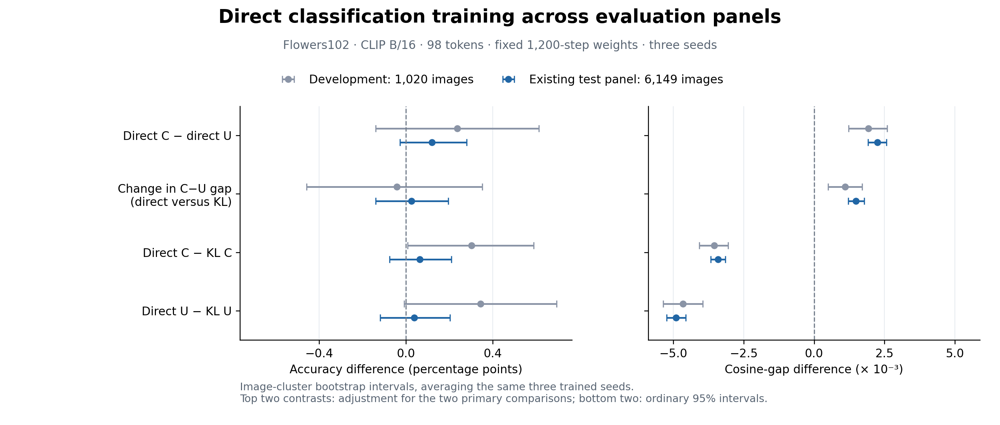
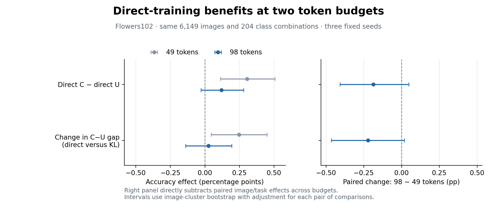

# Direct classification training on the larger Flowers98 panel

Completed 2026-11-10. **At 98 retained patches, direct training gives C a +0.120 pp mean accuracy advantage over strong U, while the change in this advantage relative to KL training is +0.026 pp. Neither comparison has a positive lower interval bound.** The 49-token improvement remains established; the 98-token replication does not establish the same additional accuracy benefit.

## Evaluation

The six endpoints are the initial, KL-continued and directly trained C/U selectors, each with seeds 2041–2043. Continuations use the same recipe as Flowers49 and stop at the fixed 1,200 updates. Only the retained-token budget and its existing warm starts/supervision change. [Training and development results](../direct-classification-98-v1/README.md).

All endpoints use frozen CLIP ViT-B/16, block 6, 98 retained patches, FP32 native token gathering and batch size 32. C has 348,033 parameters and reads the candidate classes; strong U has 347,399 parameters and reads only the image. The evaluation contains 6,149 test images, 204 candidate-class pairs and 24,596 image/task decisions, averaging equally over tasks and their two class sides. This is the same panel used for the 49-token evaluation and earlier model evaluations, separate from training. The continuation endpoints are newly evaluated here.

## Six fixed endpoints

Entries average the three seeds. Lower cross-entropy is better.

| Training | C accuracy (%) | U accuracy (%) | C cross-entropy | U cross-entropy |
| --- | ---: | ---: | ---: | ---: |
| Initial | 97.4801 | 97.3255 | 0.073964 | 0.077341 |
| KL continuation | 97.4749 | 97.3806 | 0.074378 | 0.076199 |
| Direct classification | 97.5386 | 97.4187 | 0.070099 | 0.074553 |

## Paired effects at 98 tokens

The same three trained seeds are averaged before 2,000 image-cluster bootstrap resamples (seed 2717). All tasks of one image stay together. The first two rows use intervals adjusted for the two fixed primary comparisons; the remaining rows use ordinary 95% intervals.

| Comparison | Accuracy difference (pp) | Interval (pp) |
| --- | ---: | ---: |
| Direct C − direct U | +0.1200 | [−0.0280, +0.2794] |
| Change in C−U gap: direct versus KL | +0.0257 | [−0.1395, +0.1948] |
| Direct C − KL C | +0.0638 | [−0.0748, +0.2099] |
| Direct U − KL U | +0.0380 | [−0.1183, +0.2027] |

Direct C−U accuracy is positive for all three seeds: +0.2769, +0.0528 and +0.0303 pp. The objective interaction is +0.0855, +0.0034 and −0.0116 pp. [Per-seed results](per_seed.csv).

The raw cosine-gap comparisons are +0.002245 [+0.001923, +0.002573] for direct C−U and +0.001490 [+0.001216, +0.001777] for its change relative to KL. These support a change in score separation, while the accuracy comparisons remain unresolved. [All metrics](summary.csv).

| Effect | Development, 1,020 images | Existing test panel, 6,149 images |
| --- | ---: | ---: |
| Direct C − direct U accuracy (pp) | +0.2369 | +0.1200 |
| Change in C−U gap: direct versus KL (pp) | −0.0408 | +0.0257 |



## Paired comparison with 49 tokens

The budget comparison aligns every image/task row, weight and trained seed. Its two primary contrasts directly estimate the change from 49 to 98 tokens; they do not compare separate significance labels. Intervals are adjusted for these two accuracy comparisons.

| Effect | 49 tokens (pp) | 98 tokens (pp) | 98 − 49 (pp) | Paired interval (pp) |
| --- | ---: | ---: | ---: | ---: |
| Direct C − direct U | +0.3056 | +0.1200 | −0.1856 | [−0.4072, +0.0489] |
| Change in C−U gap: direct versus KL | +0.2467 | +0.0257 | −0.2210 | [−0.4636, +0.0187] |

Both estimates are smaller at 98 tokens, but these paired accuracy intervals include zero. The experiment supports the Flowers49 result and places a limit on its replication at the larger budget; it does not establish that direct training helps conditioning only at low budgets. [Paired budget analysis](budget-comparison/summary.json).



After seeing these results, we also inspected accuracy versus retained-token count separately for C and U. C's 98−49 advantage falls from +0.3413 pp under KL to −0.0132 pp under direct training, a change of −0.3545 pp [−0.5171, −0.1947]. U's corresponding change is −0.1335 pp [−0.3159, +0.0529]. These are exploratory ordinary 95% image intervals. The near-equal direct-C means at 49 and 98 tokens are useful for describing the observed accuracy/retention tradeoff, but do not establish equivalence or runtime acceleration. [Exploratory table](budget-comparison/budget_tradeoff.csv), [details](budget-comparison/budget_tradeoff.json).

## Interpretation and evidence

This round extends proposal H3 by testing whether the training-objective effect found at 49 tokens persists when compression is weaker. It does not supply another clear accuracy gain. Taken together, the experiments establish a useful direct-training gain at Flowers49 and a substantially smaller estimated extra gain at Flowers98. The next writing decision should present this as a bounded result about the training route, rather than a broadly superior compression method.

All 18 raw-score endpoints passed metric reconstruction. Independent calculations confirmed task/class weights, all six mean accuracies, the primary differences and the alignment of 49/98 outcomes. [Reconstruction](outcome_reconstruction.json), [independent check](independent_audit.json). The evaluation-only loader also exactly replayed the six development smoke endpoints. [Loader replay](development_replay.json).

Cached-prefix GPU evaluation took 308.15 seconds; total wall time was 313.96 seconds, with about 2.64 GB peak allocated GPU memory. These are evaluation costs, not deployment latency. [Execution record](evaluation_summary.json).

Small paired outcomes, tables and figures are retained here. Full native scores and selected positions remain at `/data4/zhao.tong/experiments/direct-classification-98-panel-v1/`. The training records are kept separately with the 98-token continuation run. Archive and release verification are recorded separately when the backup is complete.

```bash
OPENBLAS_NUM_THREADS=1 python scripts/analyze_direct_classification.py --source /data4/zhao.tong/experiments/direct-classification-98-panel-v1 --output /data4/zhao.tong/experiments/direct-classification-98-panel-v1/analysis --keep-count 98 --step 1200 --bootstrap-seed 2717 --replicates 2000
OPENBLAS_NUM_THREADS=1 python scripts/compare_direct_classification_budgets.py --low /data4/zhao.tong/experiments/direct-classification-panel-v1/analysis/paired_outcomes.npz --high /data4/zhao.tong/experiments/direct-classification-98-panel-v1/analysis/paired_outcomes.npz --output /data4/zhao.tong/experiments/direct-classification-98-panel-v1/analysis/budget-comparison --bootstrap-seed 2717 --replicates 2000
python scripts/plot_direct_budget_comparison.py
OPENBLAS_NUM_THREADS=1 python scripts/analyze_direct_budget_tradeoff.py --low results/direct-classification-panel-v1/paired_outcomes.npz --high results/direct-classification-98-panel-v1/paired_outcomes.npz --output results/direct-classification-98-panel-v1/budget-comparison
```
