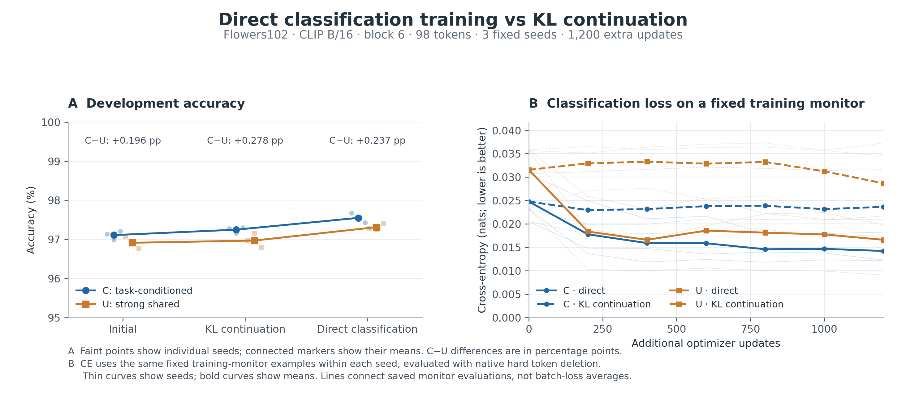

# Direct classification training at 98 tokens

Completed 2026-11-10. This experiment repeats the fixed Flowers49 training recipe at 98 retained patches. The 98-token C and strong U start from their corresponding existing checkpoints; all three seeds receive 1,200 additional updates with either actual classification cross-entropy or the original utility-teacher KL. CLIP ViT-B/16 stays frozen, with one selection stage after block 6.

The data, optimizer, learning rate, batch size, gate temperature and update counts match [the 49-token experiment](../direct-classification-v1/README.md). Training uses 1,020 images; development evaluation uses 1,020 other images, 204 unseen candidate combinations and 4,080 image/task decisions. Native token gathering and FP32 are used consistently across all 18 initial/final endpoints.

## Development results

All entries average seeds 2041–2043 with equal candidate-task/class weighting. Cross-entropy is lower when the true candidate receives more probability.

| Training | C accuracy (%) | U accuracy (%) | C cross-entropy | U cross-entropy |
| --- | ---: | ---: | ---: | ---: |
| Initial | 97.1078 | 96.9118 | 0.087828 | 0.093591 |
| KL continuation | 97.2467 | 96.9690 | 0.086276 | 0.091300 |
| Direct classification | 97.5490 | 97.3121 | 0.080173 | 0.080014 |

| Comparison | Accuracy difference (pp) | Interval (pp) |
| --- | ---: | ---: |
| Direct C − direct U | +0.2369 | [−0.1389, +0.6127] |
| Change in C−U gap: direct versus KL | −0.0408 | [−0.4575, +0.3514] |
| Direct C − KL C | +0.3023 | [+0.0082, +0.5882] |
| Direct U − KL U | +0.3431 | [−0.0082, +0.6944] |

The top two rows use intervals adjusted for the two primary comparisons; other rows use ordinary 95% image-cluster bootstrap intervals (2,000 resamples, seed 2717), averaging the same three trained seeds. Both branches improve in mean development accuracy, while this panel does not establish a change in their accuracy gap. The C−U raw score gap and its change relative to KL are positive; these margin results are reported separately from accuracy. [All metrics](summary.csv), [individual seeds](per_seed.csv), [corrected/new errors](error_transitions.json).



The same fixed weights are evaluated on the larger Flowers panel in [the companion results](../direct-classification-98-panel-v1/README.md). That evaluation also contains the paired 98−49 budget contrasts on matching image/task rows.

## Execution and evidence

All twelve continuations finished at the fixed 1,200-update endpoint. Seeds ran concurrently on three A6000 GPUs, with each seed's C/U and direct/KL arms on the same GPU. Summed optimizer-loop time was 834.87 seconds (0.232 GPU hours); native development and training-monitor evaluations added 52.84 and 14.66 seconds. [Cost record](cost.json), [shard merge](shard_merge.json), [training records](training_records/).

Saved cosine scores reconstruct the reported metrics. [Reconstruction checks](outcome_reconstruction.json) and [paired outcomes](paired_outcomes.npz) accompany the tables. Full checkpoints and raw predictions are stored at `/data4/zhao.tong/experiments/direct-classification-98-v1/`; initial checkpoints and existing prefix/teacher caches are reused.

Three complete archives (447.15 MB) are retained on data4 and in the [GitHub Release](https://github.com/NathanTong0921/ViT-token-compression/releases/tag/direct-classification-98-v1). All twelve final checkpoints loaded from the archive; the recovered analysis package matched the key summaries, paired outcomes, budget comparison and configuration. Local copies contain curated evidence only. [Archive inventory](archive_summary.json), [published assets](release_assets.json), [recovery record](recovery.json).

```bash
PYTHONPATH=src python scripts/run_direct_classification.py --config configs/flowers98_direct_classification.json --output /data4/zhao.tong/experiments/direct-classification-98-v1
OPENBLAS_NUM_THREADS=1 python scripts/analyze_direct_classification.py --source /data4/zhao.tong/experiments/direct-classification-98-v1 --output /data4/zhao.tong/experiments/direct-classification-98-v1/analysis --keep-count 98 --step 1200 --bootstrap-seed 2717 --replicates 2000
python scripts/plot_direct_classification.py --source results/direct-classification-98-v1 --output results/direct-classification-98-v1/figures
```
