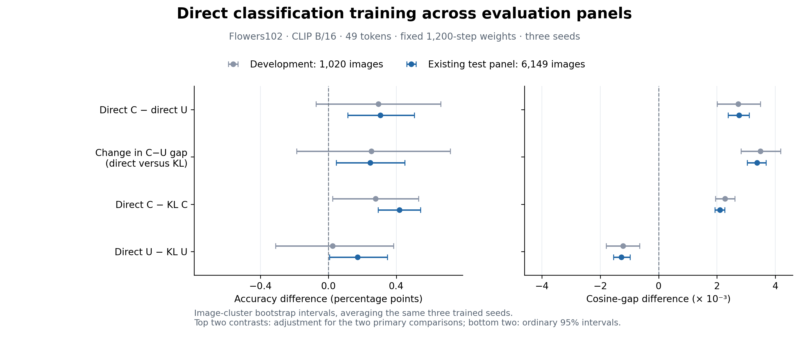

# Direct classification training on the larger Flowers49 panel

Completed 2026-11-10. **The fixed directly trained C exceeds directly trained strong U by 0.306 percentage points, and changing from KL to direct classification training increases the C−U accuracy gap by 0.247 points.** Both paired intervals are positive on this panel. The effect sizes are close to the earlier development estimates; the larger evaluation makes them more precise.

## Evaluation

This round evaluates the existing three-seed initial, KL-continued and directly trained C/U checkpoints from [the training experiment](../direct-classification-v1/README.md). All continuation checkpoints are fixed at 1,200 updates. No model is retrained or selected here.

The panel contains 6,149 Flowers102 test images, 204 candidate-class pairs and 24,596 image/task decisions. These images and pairs are separate from training. The panel had already been evaluated with earlier models in [the original test study](../final-test-v1/README.md); the direct/KL continuation endpoints are newly evaluated here.

Every endpoint uses frozen CLIP ViT-B/16, block 6, 49 retained patches, the same FP32 native token-gathering path and batch size 32. C has 348,033 parameters and reads the candidate classes; strong U has 347,399 parameters and reads the image only. Classification averages equally over candidate tasks and their two class sides. Class sizes differ in this test split, so the principal accuracy is task/class balanced.

## Six fixed endpoints

All entries average seeds 2041–2043. Lower cross-entropy is better.

| Training | C accuracy (%) | U accuracy (%) | C cross-entropy | U cross-entropy |
| --- | ---: | ---: | ---: | ---: |
| Initial | 97.2034 | 97.0513 | 0.081682 | 0.084948 |
| KL continuation | 97.1336 | 97.0748 | 0.080429 | 0.083847 |
| Direct classification | 97.5519 | 97.2463 | 0.070027 | 0.077743 |

## Paired effects

The same three trained seeds are averaged before 2,000 image-cluster bootstrap resamples (seed 2717). All tasks of one image stay together. The first two rows are the fixed primary comparisons and use intervals adjusted for those two comparisons, separately per metric; the other rows use ordinary 95% intervals.

| Comparison | Accuracy difference (pp) | Interval (pp) |
| --- | ---: | ---: |
| Direct C − direct U | +0.3056 | [+0.1139, +0.5069] |
| Change in C−U gap: direct versus KL | +0.2467 | [+0.0460, +0.4499] |
| Direct C − KL C | +0.4183 | [+0.2930, +0.5423] |
| Direct U − KL U | +0.1715 | [+0.0070, +0.3471] |

The direct C−U raw cosine-gap difference is +0.002753 [+0.002382, +0.003106], and the corresponding change relative to KL is +0.003374 [+0.003039, +0.003682]. Geometric margin and cross-entropy also support both primary comparisons. See [all metrics](summary.csv).

Direct C−U accuracy is positive for each seed: +0.4135, +0.1159 and +0.3875 pp. The training-objective interaction is +0.5456, −0.0588 and +0.2534 pp. Thus the average interaction is positive, while its size and sign vary across these three trained pairs. [Per-seed table](per_seed.csv).

## Connection to the development result

| Effect | Development, 1,020 images | Existing test panel, 6,149 images |
| --- | ---: | ---: |
| Direct C − direct U accuracy (pp) | +0.2941 | +0.3056 |
| Change in C−U gap: direct versus KL (pp) | +0.2533 | +0.2467 |

The larger panel preserves the approximate size of both effects. Direct training improves both selectors, with a larger average accuracy gain for C. For Flowers49 and these fixed training settings, the supervision objective changes how much candidate-class information adds beyond a comparably sized image-only selector. This extends proposal H3 from learning useful task dependence to measuring how the training route changes its realized benefit.



## Error changes

| New endpoint versus reference | Corrected decisions (%) | Newly wrong decisions (%) | Net accuracy change (pp) |
| --- | ---: | ---: | ---: |
| Direct C versus direct U | 1.2129 | 0.9073 | +0.3056 |
| Direct C versus KL C | 0.9512 | 0.5330 | +0.4183 |
| Direct U versus KL U | 0.8968 | 0.7253 | +0.1715 |

These percentages use the same task/class weights as the main accuracy. Unweighted counts remain in [the error decomposition](error_transitions.json).

## Computation, evidence and reproduction

Cached-prefix GPU evaluation across all 18 endpoints took 164.58 seconds; total wall time was 170.48 seconds, with about 2.61 GB peak allocated GPU memory. There was no new training. These are evaluation costs, not a deployment-latency benchmark. [Execution record](evaluation_summary.json).

The no-teacher evaluation loader reproduced the old loader exactly on the six development-check endpoints. All expanded-panel metrics were reconstructed from saved cosine scores. A separate calculation confirmed the equal task/class weights, all six mean accuracies and both primary accuracy differences. [Loader replay](development_replay.json), [metric reconstruction](outcome_reconstruction.json), [independent check](independent_audit.json).

Small paired outcomes, tables, figures and checks are retained in this directory. Full native scores and selected positions are stored at `/data4/zhao.tong/experiments/direct-classification-panel-v1/`. The model weights are reused from the preceding direct-training archive.

```bash
PYTHONPATH=src python scripts/evaluate_direct_classification_panel.py --config configs/flowers_direct_classification_panel.json
OPENBLAS_NUM_THREADS=1 python scripts/analyze_direct_classification.py --source /data4/zhao.tong/experiments/direct-classification-panel-v1 --output /data4/zhao.tong/experiments/direct-classification-panel-v1/analysis --step 1200 --bootstrap-seed 2717 --replicates 2000
python scripts/plot_direct_classification_panel.py
```
