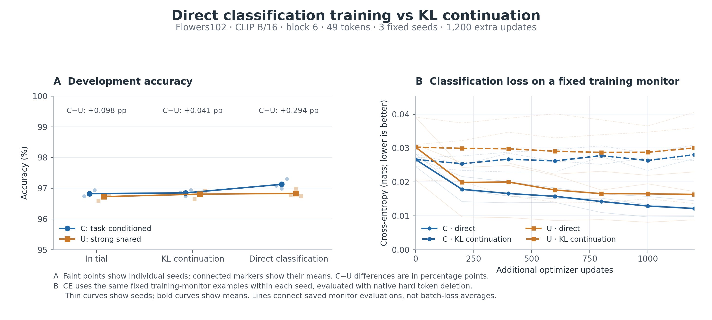

# Training token selection through the actual classifier

Completed 2026-11-08. **Direct classification training improves the conditioned selector by 0.278 percentage points over an equal-length KL continuation, with gains in all three seeds.** It also increases the C−U classification-gap difference. Direct C finishes 0.294 points ahead of the strong shared U on average; that accuracy comparison still has an interval crossing zero.

## Question and setup

Does replacing offline token-utility supervision with the classification loss of the currently retained tokens improve the value of task conditioning?

The experiment uses Flowers102, frozen CLIP ViT-B/16, block 6 and 49 retained patches. The original 1,020 training images and task pairs supply all updates. Evaluation uses the existing development panel: 1,020 other images, 204 unseen class combinations and 4,080 image/task decisions.

C reads the candidate classes; U is the strong image-only selector. Their parameter counts are 348,033 and 347,399. For each seed, both branches start from their existing KL-trained checkpoints and receive 1,200 additional updates, either with the original KL target or with the actual binary cross-entropy after token selection. The four runs share the same image/task stream, batch size 32, AdamW learning rate 1e-5 and weight decay 0.01. Seeds are 2041–2043.

Direct training retains exactly 49 tokens in the forward pass. A fixed-mass sigmoid relaxation with temperature 0.5 supplies a straight-through surrogate gradient through the frozen CLIP suffix. Evaluation physically gathers the selected tokens. Dense hard-mask and native-gather outputs match in the [real-model check](native_policy_audit.json).

## Six endpoints

Accuracy is task/class balanced; CE is lower when the true candidate receives more probability. All entries average the same three seeds.

| Training | C accuracy (%) | U accuracy (%) | C CE | U CE |
| --- | ---: | ---: | ---: | ---: |
| Initial checkpoint | 96.8219 | 96.7239 | 0.092606 | 0.093256 |
| KL continuation, 1,200 updates | 96.8464 | 96.8056 | 0.091802 | 0.091257 |
| Direct classification, 1,200 updates | 97.1242 | 96.8301 | 0.078739 | 0.085093 |

Relative to KL continuation, direct C improves accuracy by +0.2778 pp, ordinary 95% interval [+0.0245, +0.5310], and reduces CE by −0.013063 [−0.019272, −0.007222]. Its per-seed accuracy gains are +0.2206, +0.2451 and +0.3676 pp. U's corresponding mean accuracy change is +0.0245 pp [−0.3105, +0.3840].

## Paired comparisons

The two main comparisons are direct C minus direct U, and the change in the C−U difference between direct training and KL continuation. The latter asks whether changing supervision specifically changes the benefit of candidate-class information. Per-branch direct-minus-KL and direct-minus-initial comparisons measure the effect of the training route on each selector.

Each comparison first averages the same three trained seeds and then resamples image clusters 2,000 times. All tasks from one image stay together. The two main comparisons have an adjustment across the two comparisons, separately for each metric; other intervals are ordinary 95%. Individual seeds remain in the saved tables.

| Main comparison | Accuracy difference (pp) [adjusted interval] | Raw cosine-gap difference [adjusted interval] |
| --- | --- | --- |
| Direct C − direct U | +0.2941 [−0.0736, +0.6618] | +0.002725 [+0.002010, +0.003490] |
| (Direct C − U) − (KL C − U) | +0.2533 [−0.1879, +0.7190] | +0.003491 [+0.002821, +0.004180] |

Geometric-margin differences agree: +0.002864 [+0.002079, +0.003700] for direct C−U and +0.003805 [+0.003056, +0.004565] for the interaction. Both raw-gap contrasts are positive in every seed. The direct C−U accuracy differences are +0.3186, 0 and +0.5637 pp.

The change in supervision therefore produces a clear score-gap advantage and a small accuracy improvement for C over its KL continuation. The accuracy gain over strong U is less settled than the score-gap result. See [all paired estimates](summary.csv) and [individual seeds](per_seed.csv).

## Corrected and newly introduced errors

The saved outcome arrays decompose each accuracy difference into decisions corrected by the new endpoint and decisions it newly gets wrong. Their difference equals the net accuracy change. This decomposition is recorded for direct C versus U and for each branch versus its initial and KL-continuation endpoints.

| New endpoint versus reference | Corrected errors (% of decisions) | Newly wrong decisions (%) | Net accuracy change (pp) |
| --- | ---: | ---: | ---: |
| Direct C versus initial C | 0.9559 | 0.6536 | +0.3023 |
| Direct U versus initial U | 0.9314 | 0.8252 | +0.1062 |
| Direct C versus KL C | 0.9641 | 0.6863 | +0.2778 |
| Direct U versus KL U | 0.8742 | 0.8497 | +0.0245 |
| Direct C versus direct U | 1.3154 | 1.0212 | +0.2941 |

For C versus its KL continuation, the three seeds correct 34/43/41 decisions and introduce 25/33/26 errors, respectively, among 4,080 decisions each. The net gain is 9/10/15 additional correct decisions. Complete decomposition: [error transitions](error_transitions.json).

## What changed during training?

Every 200 updates, the same 256 training-stream examples within each seed are evaluated with native token gathering. The monitor records CE, accuracy and how many retained tokens differ from the initial selection.

| Selector | Initial monitor CE | KL monitor CE | Direct monitor CE | Tokens changed by KL / direct |
| --- | ---: | ---: | ---: | ---: |
| C | 0.026617 | 0.028021 | 0.012137 | 4.69 / 10.94 |
| U | 0.030242 | 0.030015 | 0.016295 | 4.39 / 12.27 |

Direct training lowers the actual classification loss and changes more of the retained set in both selectors. C's development CE and accuracy improve as well; U's training loss reduction translates into a much smaller accuracy change on the development panel. Both selectors change actual retained positions and downstream classification behavior.



The [200-update pilot](pilot-200/summary.json) is retained as an intermediate training check; the final comparison uses the fixed 1,200-update endpoints.

## Cost, evidence and reproduction

The twelve continuations took 1,105.73 seconds in total: 1,054.44 seconds for the six direct runs and 51.29 seconds for the six KL runs, approximately 0.307 single-GPU hours. Native development evaluations took 49.17 seconds and training-monitor evaluations 10.49 seconds. Initial checkpoints and cached CLIP prefixes are reused. The [smoke benchmark](smoke.json) measured approximately 0.14 seconds per direct update and 3.8 GiB peak allocated GPU memory. See [measured costs](cost.json).

All 18 initial/final endpoints were independently reconstructed from their saved native cosine scores. Accuracy matches exactly; the largest CE reconstruction difference is 0.0000167. The [reconstruction record](outcome_reconstruction.json), [real-model forward check](native_policy_audit.json) and saved [training records](training_records/) accompany the results.

Small analysis arrays, tables, figures, numerical checks and training records are retained here and in Git. The server run directory is `runs/direct-classification-v1`; final selector checkpoints and full evaluation arrays will be backed up with the run archive.

```bash
PYTHONPATH=src OPENBLAS_NUM_THREADS=4 OMP_NUM_THREADS=4 python scripts/run_direct_classification.py --config configs/flowers_direct_classification.json --output runs/direct-classification-v1
OPENBLAS_NUM_THREADS=1 python scripts/analyze_direct_classification.py --source runs/direct-classification-v1 --output results/direct-classification-v1 --step 1200
python scripts/plot_direct_classification.py
```
