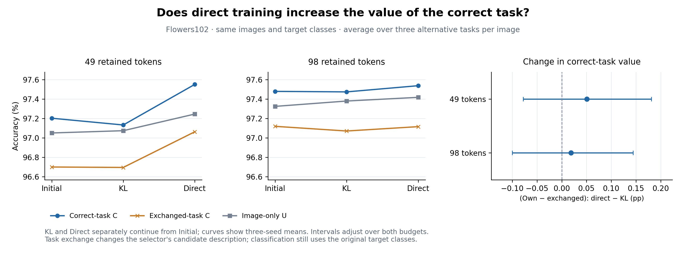

# Task-description exchange after direct classification training

Completed 2026-11-10. **Direct training improves Flowers49 accuracy even when C receives another candidate task for the same image. The additional value of matching the exact competing class changes by only +0.051 pp at 49 tokens and +0.019 pp at 98 tokens; both paired intervals include zero.** The previously observed Flowers49 improvement remains, but this experiment does not explain it through increased competitor-specific accuracy benefits.

## Fixed-image exchange

The experiment reuses the saved outputs of the three-seed initial, KL-continued and directly trained C/U endpoints at 49 and 98 tokens. Models use frozen CLIP ViT-B/16 and block-6 selection; both continuation objectives start separately from the same initial checkpoint and run for 1,200 updates. No new training or image inference is needed.

The existing panel contains 6,149 images, 204 class pairs and 24,596 image/task decisions. Every image has four tasks. For each target task, its own prediction is compared with the three outputs obtained when the selector receives the other tasks for that image. Classification always uses the original target pair. Every donor task still contains the image's true class, but has a different competing class.

Each donor output is scored separately before averaging its accuracy, raw cosine gap, geometric margin and cross-entropy. Averaging donor logits before classification would measure a different predictor. The final aggregation retains the original equal-task/equal-class-side weights, so own-task accuracies reproduce the previous tables exactly.

## Own and exchanged accuracy

Entries are percentages, averaged over seeds 2041–2043. U ignores the task description; its own and exchanged outputs coincide.

| Tokens | Training condition | C own | C exchanged | U own | U exchanged |
| --- | --- | ---: | ---: | ---: | ---: |
| 49 | Initial | 97.2034 | 96.7004 | 97.0513 | 97.0513 |
| 49 | KL | 97.1336 | 96.6959 | 97.0748 | 97.0748 |
| 49 | Direct | 97.5519 | 97.0634 | 97.2463 | 97.2463 |
| 98 | Initial | 97.4801 | 97.1197 | 97.3255 | 97.3255 |
| 98 | KL | 97.4749 | 97.0716 | 97.3806 | 97.3806 |
| 98 | Direct | 97.5386 | 97.1165 | 97.4187 | 97.4187 |

Correct task correspondence helps C under both objectives: at 49 tokens the own-minus-exchanged accuracy gap is +0.4377 pp under KL and +0.4885 pp under Direct; at 98 tokens the gaps are +0.4033 and +0.4221 pp. The main question is whether direct training increases this value.

## Does the correct-task benefit increase?

The two primary accuracy comparisons are `(own − exchanged) Direct − (own − exchanged) KL`, one for each token budget. Intervals use 2,000 image-cluster bootstrap resamples with seed 2717 and adjustment across the two budgets. All tasks of an image remain together; the three trained seeds are averaged within each resample.

| Tokens | Change in correct-task accuracy benefit (pp) | Adjusted interval (pp) |
| --- | ---: | ---: |
| 49 | +0.0508 | [−0.0777, +0.1811] |
| 98 | +0.0188 | [−0.1000, +0.1441] |

The data do not establish an increase in either budget. Reading own and exchanged outcomes separately shows why the larger Flowers49 result is not simply evidence of stronger dependence on the exact rival class:

| Tokens | Direct − KL: C own (pp) | Direct − KL: C exchanged (pp) | Direct − KL: U (pp) |
| --- | ---: | ---: | ---: |
| 49 | +0.4183 [+0.2930, +0.5423] | +0.3675 [+0.2596, +0.4933] | +0.1715 [+0.0070, +0.3471] |
| 98 | +0.0638 [−0.0748, +0.2099] | +0.0449 [−0.0757, +0.1745] | +0.0380 [−0.1183, +0.2027] |

These secondary comparisons use ordinary 95% intervals. At 49 tokens, most of C's observed improvement remains when its description is replaced by another legitimate same-image task. Both own and exchanged C improve; a deterioration of exchanged predictions does not produce the measured result.



## Connection to the C−U improvement

The original improvement in the C−U gap can be written exactly as the change in the own-minus-exchanged effect plus the remaining change after exchange: `change in exchanged C − change in U`.

| Tokens | KL: own C−U (pp) | Direct: own C−U (pp) | Total increment (pp) | Correct-task effect change (pp) | Remaining change after exchange (pp) |
| --- | ---: | ---: | ---: | ---: | ---: |
| 49 | +0.0589 | +0.3056 | +0.2467 | +0.0508 | +0.1959 |
| 98 | +0.0942 | +0.1200 | +0.0257 | +0.0188 | +0.0069 |

This is an arithmetic decomposition of measured predictions. The remaining term describes performance after a particular exchange that still supplies the true class among the candidates; it is not a causal mediation share or a direct measure of general image-processing ability. [Complete contrast table](contrasts.csv).

## Accompanying measurements

The accuracy findings are accompanied by differing score-gap changes across budgets. The raw-gap correct-task effect decreases at 49 tokens by −0.000255 [−0.000343, −0.000164] and increases at 98 tokens by +0.000585 [+0.000496, +0.000679]. Geometric-margin changes have the same respective directions: −0.000272 [−0.000372, −0.000171] and +0.000615 [+0.000515, +0.000718]. These are adjusted intervals for the same two comparisons.

Cross-entropy correct-task-effect changes are +0.000367 [−0.001662, +0.002573] and +0.000215 [−0.002095, +0.002240], respectively; their intervals include zero. Lower CE is better, so its own-minus-exchanged sign has the opposite interpretation to accuracy. [All endpoint metrics](methods.csv), [all contrasts](contrasts.csv).

The retained-set overlap averages the fraction of target-selected tokens also selected under each donor task, then applies the original target weights. It increases under direct training at both budgets:

| Tokens | Initial overlap (%) | KL overlap (%) | Direct overlap (%) |
| --- | ---: | ---: | ---: |
| 49 | 66.15 | 65.57 | 68.36 |
| 98 | 79.37 | 78.56 | 81.37 |

Thus the directly trained selectors share more of their retained positions across the four tasks. [Overlap by seed](selection_overlap.csv).

For the primary accuracy effect change, the three seeds give +0.1208, −0.0044 and +0.0361 pp at 49 tokens, and −0.0188, +0.0913 and −0.0159 pp at 98 tokens. [All per-seed results](per_seed.csv).

## What this adds

This connects the original H1 task-exchange intervention with the H3 training-objective result. Matching the competing class is useful under both KL and direct training, but the Flowers49 accuracy improvement largely persists across the tested same-image task exchanges. The experiment therefore separates an established training gain from one proposed explanation for that gain. It does not establish stronger competitor-specific accuracy sensitivity after direct training.

## Reproduction and retained evidence

Own outcomes match the earlier paired outcomes. Every image has exactly three donors, cross-budget row alignment is exact, and all U same-image cosine scores and retained sets coincide. An independent calculation reconstructs the endpoint means, contrasts and sampled donor decisions from raw outputs. [Analysis checks](audit.json), [independent raw-score check](independent_raw_audit.json), [execution record](execution.json).

This analysis uses CPU re-scoring and adds zero GPU inference or training. Curated paired outcomes, donor mapping, tables and figures are retained here and at `/data4/zhao.tong/experiments/direct-task-exchange-v1/`. Original native predictions remain in the 49/98 expanded-panel archives. Backup and release verification are added separately after completion.

```bash
OPENBLAS_NUM_THREADS=1 python scripts/analyze_direct_task_exchange.py --source49 /data4/zhao.tong/experiments/direct-classification-panel-v1 --source98 /data4/zhao.tong/experiments/direct-classification-98-panel-v1 --output /data4/zhao.tong/experiments/direct-task-exchange-v1 --bootstrap-seed 2717 --replicates 2000
python scripts/plot_direct_task_exchange.py
```
