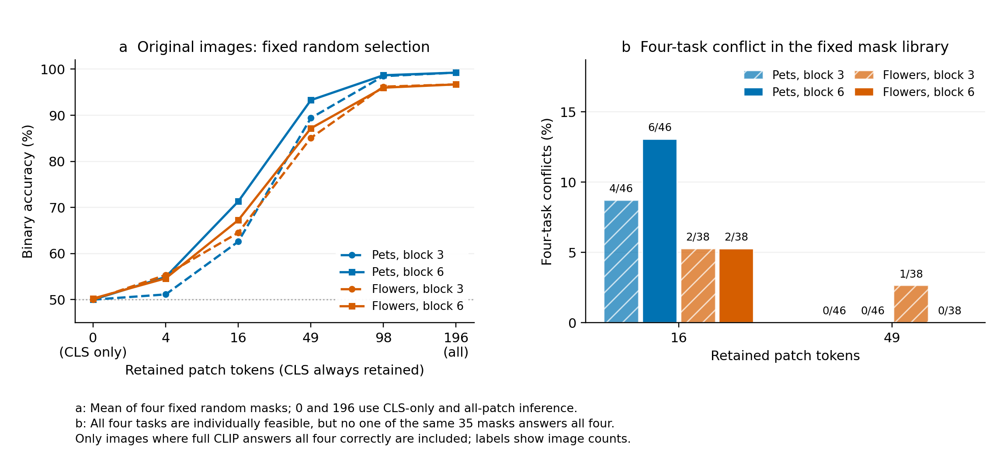

# 任务证据冲突与信息共享：首轮可行性结果

本轮冻结 CLIP ViT-B/16，无 selector 训练，仅使用已有开发图片与开发类别对。原图每类2张；Pets、Flowers各构造64张双对象合成图，每张包含分别询问两个对象的4个二分类任务。实验细节见[设计说明](../../docs/evidence-conflict-pilot.md)。

**结论：合成任务可用；紧预算下出现少量共同选择冲突，但尚未支持“剪枝前的信息共享解释条件化收益”的机制判断。**



## 主要结果

- **完整模型能够回答合成任务。** Pets任务准确率90.63%，46/64张图四题全对；Flowers为85.94%，38/64张图四题全对。横向、纵向布局均可用。
- **保留CLS本身不能直接维持分类。** 原图完整模型的二分类准确率为Pets99.24%、Flowers96.69%；block3/6后仅保留CLS、继续运行原模型后半部，准确率约50%。这项干预没有支持“中层CLS已经足够”的解释，也不等于测量了CLS中所有可解码信息。
- **49-token时共同选择通常足够。** 对完整模型两题均答对的任务对，两数据集、两层的固定mask库均存在共同正确mask。四任务同时满足时也几乎全部可行。

以下“四任务冲突”指：四题各自都能在库中找到正确mask，但没有同一个mask同时答对四题。分母限定为完整模型四题全对的合成图。

| 数据集 | 剪枝层 | 16-token冲突 | 49-token冲突 |
|---|---:|---:|---:|
| Pets | 3 | 4/46（8.70%） | 0/46 |
| Pets | 6 | 6/46（13.04%） | 0/46 |
| Flowers | 3 | 2/38（5.26%） | 1/38（2.63%） |
| Flowers | 6 | 2/38（5.26%） | 0/38 |

**没有一致的深度规律。** 从block3延后至block6，并未稳定降低冲突。不同对象任务的专用／共享margin差距较大，但加入文本方向夹角控制后，16-token的大部分差异消失；49-token保留描述性的正差异，却几乎没有分类可行性冲突。因此当前证据更接近“置信程度的取舍”，尚不足以独立归因于对象证据冲突。

这35个mask包含32个随机mask、空间均匀mask及两个半图mask；同一预算下两层使用完全相同的位置，attention另外保存。库内最佳选择使用标签做诊断，不代表已经训练出相应策略；四任务统计是本轮结果产生后的补充分析。进一步研究应在任务构造时匹配决策方向几何，再检验紧预算下的冲突能否被学习器利用。

## 数据与复现

- [独立复核与四任务精确计数](independent-review.json)：同时保留全部图片及完整模型四题全对的结果。
- `pets/`、`flowers/`：原图汇总、合成图来源与任务、完整预测及mask、任务对诊断、难度／夹角控制。合成PNG留在服务器原始run中。
- [PDF图](evidence_conflict.pdf)：左图选用4个固定随机mask的平均值，以保持曲线清晰；uniform与attention结果均保留在原图CSV中。右图展示上述固定35-mask库的四任务冲突。

```bash
python3 scripts/plot_evidence_conflict.py
```

该命令只读本目录已有CSV／JSON并生成PNG与PDF，无GPU计算。
