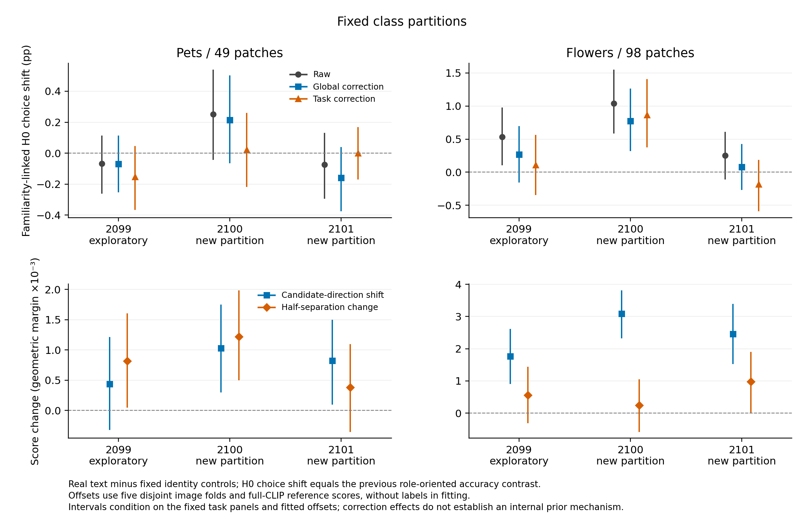

# 熟悉类别偏好与图像判别能力：输出诊断

**六份分析已全部完成并独立核对。** 2099为历史探索划分，2100/2101为预先固定的两个新类别划分。每个数据集在不同划分中沿用同一批开发图片；新增划分检验类别角色改变后的重现性，不是六个独立数据集。所有结果均来自冻结的五折校正规则，没有依据新结果修改估计方式。



## 主要结果

Flowers在三个划分中，真实语义模型相对身份编码模型的分数都整体朝新熟悉的候选类别移动；两个真实类别的图片均朝这一方向移动。两份新划分的中点变化为+0.003087、+0.002461，图片bootstrap区间均为正。Pets在两个新划分中也出现较小的正中点变化，但预测类别频率没有稳定增加。

这不等于图像判别能力没有改变。Flowers2101的半分离度变化也为正；Pets2100同时出现正中点与正半分离度变化。更准确的认识是：**训练熟悉度会改变输出的候选偏好，同时可能改变区分两类图片的程度；二者应分别测量。**

## 此前统计量到底测量什么

固定二分类方向，让正分数表示选择H0（P0中未见、P1中已见的类别）。令`y=+1`表示H0图片，`y=−1`表示H1图片；`A=1`表示模型预测H0。

- 真类margin为`m=yq`，所以此前角色取向的语义margin变化严格等于`Δ(q_real−q_identity)`。
- 二分类正确性为`c=(1−y)/2+yA`，所以此前角色取向的语义准确率变化严格等于`Δ(A_real−A_identity)`。

两者均为逐样本恒等式。此前“seen−held”的准确率变化因此也是**语义模型相对身份编码模型的H0选择频率变化**。它测量训练角色变化后的候选偏好，不能直接当作普通准确率提升或更强图像判别的证据。代数本身不是新发现；下面的实验测量变化大小及其在其他图片上的可预测性。

## 分解分数变化

每个任务分别计算两类图片的平均分数变化a、b；中点变化为`(a+b)/2`，半分离度变化为`(a−b)/2`。下表均为真实语义减去两个固定身份编码对照的均值，再计算P1−P0。单位为几何margin；方括号为固定面板下的95%图片bootstrap区间。

| 设置 | H0图片平均变化 | H1图片平均变化 | 中点变化 | 半分离度变化 |
|---|---:|---:|---:|---:|
| Pets49 / 2099 | +0.001257 | -0.000379 | +0.000439 [-0.000314, +0.001202] | +0.000818 [+0.000056, +0.001596] |
| Pets49 / 2100 | +0.002249 | -0.000193 | +0.001028 [+0.000310, +0.001741] | +0.001221 [+0.000511, +0.001976] |
| Pets49 / 2101 | +0.001208 | +0.000440 | +0.000824 [+0.000109, +0.001488] | +0.000384 [-0.000344, +0.001084] |
| Flowers98 / 2099 | +0.002327 | +0.001205 | +0.001766 [+0.000930, +0.002592] | +0.000561 [-0.000293, +0.001420] |
| Flowers98 / 2100 | +0.003331 | +0.002842 | +0.003087 [+0.002347, +0.003795] | +0.000245 [-0.000563, +0.001031] |
| Flowers98 / 2101 | +0.003438 | +0.001484 | +0.002461 [+0.001544, +0.003369] | +0.000977 [+0.000030, +0.001886] |

半分离度的**变化**接近零，不等于任一阶段不存在语义判别收益。因此同时保留普通任务／类别均衡准确率与原始任务内AUC：

| 设置 | P0普通准确率：真实−身份（pp） | P1普通准确率：真实−身份（pp） | P0任务AUC：真实−身份 | P1任务AUC：真实−身份 |
|---|---:|---:|---:|---:|
| Pets49 / 2099 | +0.0766 | +0.0239 | +0.000215 | -0.000110 |
| Pets49 / 2100 | -0.0260 | +0.0082 | +0.000108 | +0.000490 |
| Pets49 / 2101 | +0.0503 | +0.1626 | -0.000001 | +0.000633 |
| Flowers98 / 2099 | +0.4313 | +0.0877 | +0.000249 | +0.000556 |
| Flowers98 / 2100 | -0.2479 | +0.1997 | -0.001143 | +0.000165 |
| Flowers98 / 2101 | -0.0841 | +0.2446 | -0.000092 | +0.000933 |

这些普通准确率与AUC是固定面板的点估计，不将上述候选偏好置信区间用于它们。真实语义并未在每个阶段都优于身份编码。

## 用不同图片估计加性偏移

固定五折图片划分（种子2301）。每个模型在其余四折上，不使用真类标签或类别权重，拟合`q_pruned−q_full`的全局均值或逐任务均值；再校正未参与拟合的图片。任务方向由候选类别与训练组身份决定，分数直接由已保存图像特征和原始CLIP文本重建。这里需要完整模型作为参照，是诊断校正。

| 设置 | 原始H0选择频率变化（pp） | 全局校正后 | 逐任务校正后 | 全局校正造成的配对变化（pp） |
|---|---:|---:|---:|---:|
| Pets49 / 2099 | -0.068 [-0.257, +0.110] | -0.070 [-0.248, +0.110] | -0.153 [-0.363, +0.042] | -0.002 [-0.092, +0.082] |
| Pets49 / 2100 | +0.251 [-0.039, +0.535] | +0.214 [-0.061, +0.499] | +0.021 [-0.214, +0.255] | -0.037 [-0.138, +0.063] |
| Pets49 / 2101 | -0.075 [-0.290, +0.126] | -0.159 [-0.371, +0.035] | +0.001 [-0.166, +0.163] | -0.084 [-0.183, +0.010] |
| Flowers98 / 2099 | +0.534 [+0.116, +0.970] | +0.270 [-0.146, +0.689] | +0.110 [-0.334, +0.553] | -0.263 [-0.475, -0.068] |
| Flowers98 / 2100 | +1.040 [+0.597, +1.539] | +0.771 [+0.327, +1.254] | +0.868 [+0.383, +1.395] | -0.269 [-0.450, -0.097] |
| Flowers98 / 2101 | +0.252 [-0.100, +0.600] | +0.076 [-0.257, +0.414] | -0.183 [-0.581, +0.175] | -0.176 [-0.343, -0.030] |

Flowers三个划分的全局校正均降低了H0选择频率变化，但校正并未一致提高普通准确率。以下为真实语义模型本身的准确率和校正产生的变化，均以百分点计：

| 设置 | P0原始准确率（%） | P1原始准确率（%） | 全局校正P0变化 | 全局校正P1变化 | 逐任务校正P0变化 | 逐任务校正P1变化 |
|---|---:|---:|---:|---:|---:|---:|
| Pets49 / 2099 | 99.387 | 99.304 | +0.028 | +0.001 | -0.240 | -0.115 |
| Pets49 / 2100 | 98.709 | 98.460 | -0.001 | +0.093 | -0.065 | +0.284 |
| Pets49 / 2101 | 99.137 | 99.068 | +0.009 | +0.019 | +0.206 | +0.256 |
| Flowers98 / 2099 | 97.091 | 96.126 | -0.263 | +0.132 | -0.936 | -0.351 |
| Flowers98 / 2100 | 95.840 | 96.515 | -0.041 | -0.055 | -0.179 | -0.386 |
| Flowers98 / 2101 | 95.734 | 96.116 | +0.076 | -0.138 | -0.245 | -0.459 |

我们还直接用其他图片上学到的偏移预测逐图片分数变化。相对零变化预测，MSE降低比例为：

| 设置 | 全局偏移MSE降低（%） | 逐任务偏移MSE降低（%） |
|---|---:|---:|
| Pets49 / 2099 | +0.014 | +1.025 |
| Pets49 / 2100 | +0.005 | +1.853 |
| Pets49 / 2101 | +0.210 | +0.465 |
| Flowers98 / 2099 | +0.629 | -0.834 |
| Flowers98 / 2100 | +1.893 | +0.012 |
| Flowers98 / 2101 | +0.808 | -0.556 |

Flowers全局偏移在三个划分均有小幅、配对区间为正的MSE改善；新增两份为1.89%／0.81%。Pets全局改善更小且区间均跨零。逐任务偏移没有一致改善Flowers的MSE，并降低三个划分两个阶段的真实语义准确率。**结果支持一个可预测但较小的加性变化成分；不支持“大部分变化都是类别先验”，也不支持将此校正当作可靠的准确率改进。**

平均margin在减去拟合均值后可能部分由代数关系趋近零，这不作为校正成功的证据。校正前的任务内AUC对一个任务常数偏移不变；不同折使用不同估计偏移，因此不声称校正后的跨折AUC也不变。置信区间按图片配对bootstrap，条件于固定折、已拟合偏移和模型；不在每次重采样内重新拟合偏移，也不将跨划分重复图片作为独立样本合并。

## 证据与复现

- [分析协议](../../docs/familiarity-prior-diagnostic.md)：包含固定估计规则、两个精确恒等式与解释范围。
- 六个`{dataset}-p{partition}/`目录：完整汇总、图片折、任务级分解及小型逐例分数数组。全量逐折偏移保留在服务器raw run中。
- `verification.json`：独立重建全部图片分折、加性偏移、margin分解及准确率／选择频率恒等式。六份分析共144个源预测核对全部一致，偏移重建误差为0；此前margin估计精确重现。
- [PDF图](familiarity_prior.pdf)、`plot_data.csv`；图中区分探索划分与新划分。

```bash
python3 scripts/audit_familiarity_prior.py --require-all
python3 scripts/plot_familiarity_prior.py
python3 -m unittest discover -s tests -p test_familiarity_prior.py
```

此输出分析没有额外GPU计算，没有访问正式测试图片或类别组合。
