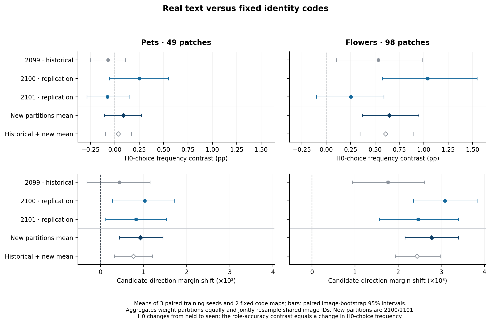
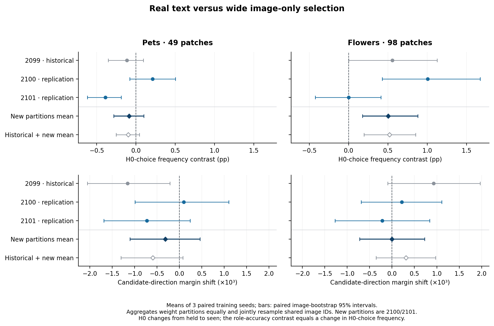

# 类别熟悉度交换：两个预先固定的新划分

**96个新模型的训练与评估已完成，六个设置的数值汇总和图已取回／重建。** 两个新划分2100、2101继续支持Flowers的熟悉候选偏好：真实语义相对身份编码的H0选择频率平均变化为 **+0.646个百分点 [0.371, 0.948]**。Pets的预测频率变化较小，区间跨零，但两份新划分均出现正的连续分数偏移。

这里H0指原训练中被留出、交换后参加训练的类别。**上述频率变化不是普通准确率提升。** 它测量同一图片、同一任务在训练熟悉度交换后，真实语义相对对照更倾向选择哪个候选类别。普通准确率、任务AUC及偏移分解见[配套诊断](../familiarity-prior-v1/README.md)。



## 两份新划分的结果

两个新划分等权平均；置信区间按图片共同重采样，跨划分重复出现的图片不当作新的独立图片。

| 设置 | 真实文本−身份编码：H0选择频率（pp） | 真实文本−身份编码：方向margin | 真实文本−加宽图像基线：频率（pp） | 真实文本−加宽图像基线：方向margin |
|---|---:|---:|---:|---:|
| Pets49 | +0.088 [−0.105, +0.272] | +0.000926 [+0.000435, +0.001448] | −0.087 [−0.284, +0.099] | −0.000313 [−0.001102, +0.000460] |
| Flowers98 | +0.646 [+0.371, +0.948] | +0.002774 [+0.002156, +0.003395] | +0.503 [+0.178, +0.880] | −0.00000003 [−0.000725, +0.000727] |

两份新划分的平均频率变化按训练种子2041／2042／2043分别为：

- Flowers真实−身份：+0.586／+0.676／+0.676pp；每个划分的三个种子也均为正。
- Flowers真实−加宽：+0.423／+0.390／+0.695pp；单独2101划分平均接近零。
- Pets真实−身份：+0.147／+0.256／−0.140pp；并未形成稳定的预测频率改变。

真实文本相对身份编码的方向margin，在两数据集的新划分中均为正。然而Flowers相对加宽图像基线的方向margin平均几乎为零，说明**“真实语义相对身份编码的偏好变化”与“比通用图像选择产生更大的同向分数变化”并不是同一结论**。共享基线的选择频率变化与平均margin变化也可能不同，因为只有越过决策边界的图片才改变预测。

## 所有固定划分逐项保留

2099为先前探索划分；2100、2101为结果出现前确定的新划分。下面均为真实文本相对两个身份编码的平均效果。

| 设置 | 划分 | H0选择频率变化（pp） | 候选方向margin变化 |
|---|---:|---:|---:|
| Pets49 | 2099 | −0.068 [−0.250, +0.107] | +0.000439 [−0.000314, +0.001147] |
| Pets49 | 2100 | +0.251 [−0.055, +0.549] | +0.001028 [+0.000273, +0.001722] |
| Pets49 | 2101 | −0.075 [−0.286, +0.146] | +0.000824 [+0.000121, +0.001530] |
| Flowers98 | 2099 | +0.534 [+0.103, +0.988] | +0.001766 [+0.000936, +0.002614] |
| Flowers98 | 2100 | +1.040 [+0.574, +1.546] | +0.003087 [+0.002349, +0.003828] |
| Flowers98 | 2101 | +0.252 [−0.099, +0.589] | +0.002461 [+0.001565, +0.003392] |

历史与新增三个划分的等权平均另存于`summary.json`：Flowers频率+0.609pp [0.345, 0.889]，Pets+0.036pp [−0.096, 0.170]。主复现判断使用两份新划分；不以混入探索结果后的平均替代它。



## 固定设计与覆盖

- CLIP ViT-B/16冻结；Pets保留49个patch，Flowers保留98个patch。
- 每个划分的H0／H1为等长、不相交类别块；两阶段交换其训练熟悉度，R始终参加训练。
- 真实文本、两个固定身份编码、加宽图像基线，在两阶段均重新训练；三个训练种子2041–2043。两数据集、两个新划分共96个新模型。
- 身份编码种子2097／2098在H0／H1／R内分别置换，跨阶段保持相同；最终CLIP分类文本始终正确。
- 两阶段在相同图片、相同H0×H1任务上评估；这些任务未进入任一阶段的训练。未访问正式测试图片或正式测试任务。

| 设置 | 划分 | 共同评估类别对 | 图片数 | 图片／任务行数 |
|---|---:|---:|---:|---:|
| Pets49 | 2099 | 89 | 396 | 3525 |
| Pets49 | 2100 | 91 | 397 | 3612 |
| Pets49 | 2101 | 89 | 399 | 3550 |
| Flowers98 | 2099 | 114 | 520 | 2280 |
| Flowers98 | 2100 | 121 | 520 | 2420 |
| Flowers98 | 2101 | 109 | 520 | 2180 |

每个划分内各任务、各真类侧等权；先平均三个训练种子和两个身份编码，再对划分等权平均。沿用冻结方案的2000次图片bootstrap：单划分种子2100，跨划分共同重采样种子2102。区间描述固定类别划分、已训练模型与任务面板下的图片不确定性；逐训练种子、逐划分结果同时保留。

## 输入来源、独立核对与过程记录

服务器四个训练／评估任务均成功结束，随后SSH连接间歇性超时。本次先使用[偏好诊断目录](../familiarity-prior-v1/)中已独立核对的六份小型方向分数数组恢复统计：这些数组与144份源预测逐项一致，包含相同图片ID、任务ID、权重和模型分数。恢复真类margin与正确性后，直接复用原角色统计和冻结的跨划分bootstrap。连接恢复后，又直接读取原始预测重新计算；两个来源的所有汇总数值完全相同，没有重训。

- `summary.json`记录实际输入路径、六份重建一致性检查、全部划分和种子结果。
- `verification_inputs.json`记录本地输入重建、历史2099原汇总和原始预测汇总的独立数值比较；历史300个数值及新旧全部汇总比较误差均为0。
- **96个新增检查点的独立审计全部通过**，保存于`verification_2100.json`／`verification_2101.json`：训练图片与任务无重叠、留出类别未参加训练、编码跨阶段一致、任务与真类侧权重均衡、完整CLIP结果和主统计独立重建。
- 四份轻量训练计划、训练记录、映射与抽样审计、共同任务清单及评估汇总均已取回，保存在`{pets,flowers}/p{2100,2101}/`。固定协议见[实验设计](../../docs/familiarity-replications.md)。完整原始数据由项目归档流程备份。
- `summary_from_source.json`为服务器直接读取原预测计算的汇总；`summary.json`为本地方向分数重建，二者的统计结果逐项完全相同。

复现本地汇总和图：

```bash
PYTHONPATH=src python3 scripts/analyze_familiarity_replications_from_prior.py
python3 scripts/audit_familiarity_replication_exports.py
python3 scripts/plot_familiarity_replications.py
```

服务器原始检查点核对与源预测交叉验证命令：

```bash
python scripts/audit_familiarity_switch.py --runs-root runs --partition-seed 2100
python scripts/audit_familiarity_switch.py --runs-root runs --partition-seed 2101
python scripts/analyze_familiarity_replications.py --runs-root runs \
  --output /tmp/familiarity_replication_from_source.json
```

原始目录为`runs/{pets,flowers}-familiarity-switch-partition-{2100,2101}-{training,evaluation}-v1/`。两幅PNG、对应PDF与`plot_data.csv`保存所有预先固定划分，包括效果较弱的结果。
