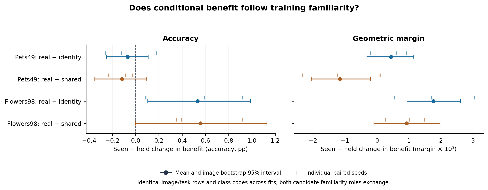

# 同图同任务的熟悉度角色交换

**Flowers98 的语义相对身份编码收益，确实随训练熟悉度状态发生变化；Pets49 未显示同类证据。** 这把此前的分组关联推进到固定图片、固定任务、固定类别编码下的训练干预。

## 实验与核查

固定 seed 2099 的类别排列：H0为原留出类别，H1为后续等长且不相交的类别块，R始终参加训练。P0训练H1+R，P1训练H0+R。两套随机身份编码分别在H0、H1、R内部置换，在P0/P1之间完全相同。

P0复用原真实文本及加宽图像模型，重新训练两套身份控制；P1训练全部四个模型。两数据集共36个新模型、12个精确复用检查点；全部使用既定三个种子与原更新次数。共同面板只含H0×H1类别对，全部未进入任一模型的训练：

| 设置 | 共同类别对 | 图片—任务行 | 不同图片 | 来源：原train／val类别对 |
|---|---:|---:|---:|---:|
| Pets，49 patches | 89 | 3,525 | 396 | 81／8 |
| Flowers，98 patches | 114 | 2,280 | 520 | 93／21 |

独立CPU核查通过：12个复用检查点逐张量完全一致；两阶段类别编码一致；训练与评估图片、任务无交集；每个任务及其两侧权重均衡；全部逐例预测共用相同行数和顺序；完整CLIP结果由原验证缓存重新计算一致。还直接从逐例预测重算了主要点估计和DID。没有访问正式测试。详见 `verification.json` 与 `scripts/audit_familiarity_switch.py`。

## 主要结果：相同图片任务上的 seen−held 收益变化

先计算真实文本相对两套身份编码均值的收益，再对同一个图片／任务比较其真实类别参加训练与被留出时的变化。下表是三个种子平均及配对图片 bootstrap 95%区间。

| 设置 | 准确率收益变化（pp） | 几何margin收益变化 |
|---|---:|---:|
| Pets49 | −0.068 [−0.250, 0.107] | +0.000439 [−0.000314, 0.001147] |
| Flowers98 | **+0.534 [0.103, 0.988]** | **+0.001766 [0.000936, 0.002614]** |

Flowers的准确率种子结果分别为+0.592、+0.088、+0.921 pp，全部为正。分别对两套身份映射，效果为+0.468 [0.042, 0.913]和+0.599 [0.058, 1.141] pp；六个种子—映射配对中五个为正、一个为零。六个margin配对全部为正。

这项结果描述的是**同一组样本在角色变化后的收益变化**。Flowers的准确率细分如下：

| 固定真实类别组 | P0的真实文本−身份编码 | P1的真实文本−身份编码 | P0→P1变化 |
|---|---:|---:|---:|
| H0：held→seen | −0.234 pp | −0.044 pp | +0.190 pp |
| H1：seen→held | +1.096 pp | +0.219 pp | −0.877 pp |

因此并非P1中已知组的绝对收益超过未知组，也不是完全反转；证据来自H0改善、H1下降的同样本对比。两组变化之差DID为+1.067 pp；按两侧等权取向平均的主估计为其一半，即+0.534 pp。每个任务中，另一个候选类别的熟悉度也同时反向变化，训练类别池随之交换。

## 与强共享选择器的关系

Flowers的真实文本相对加宽图像版的seen−held变化为+0.556 pp [约0, 1.127]、margin为+0.000929 [−0.000097, 0.001969]。点估计同向，但这里的区间证据弱于真实语义对身份编码的比较。Pets对应准确率为−0.116 pp [−0.352, 0.095]，margin为−0.001155 [−0.002053, −0.000209]。

本轮最明确的推进，是在Flowers98设置下证明语义相对稳定身份编码的收益与训练角色有联系；整体是否超过强共享模型仍需要分别查看任务条件。区间条件于固定两种训练划分、模型与任务面板；Pets49与Flowers98同时改变数据集和预算，保留两者完整结果。

## 结果文件



`pets/` 与 `flowers/` 各保留冻结计划、两阶段训练记录与映射、共同任务清单、评估记录及完整汇总。`evaluation/summary.json` 包含两套映射、各个种子、DID和组别变化。图提供PNG/PDF版本，数字位于 `plot_data.csv`。本目录仅保留轻量JSON/CSV与图；完整检查点、面板数组和逐例特征另行归档。

```bash
python scripts/plot_familiarity_switch.py --results-root results/familiarity-switch-v1
```
