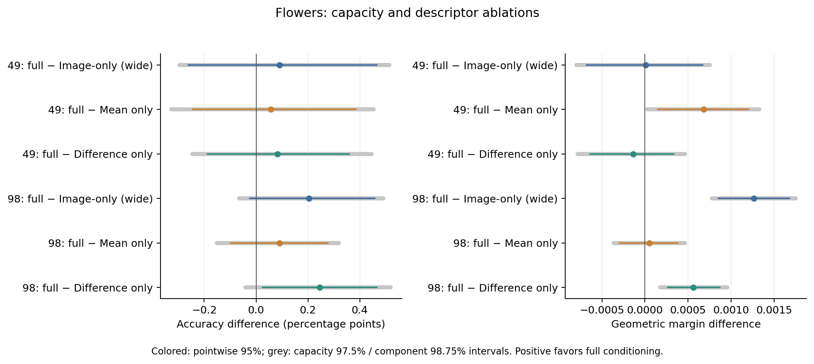
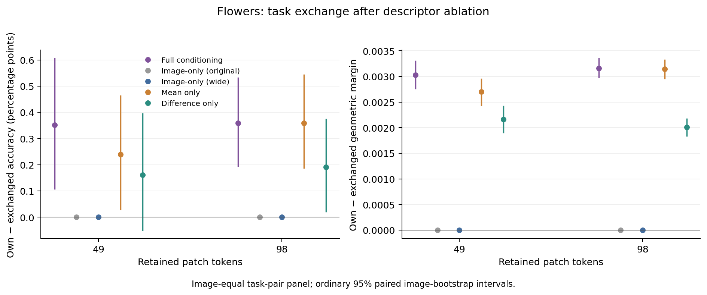

# Flowers102：图像版容量与任务描述成分消融

**98-token 下，完整条件化对加宽图像版仍有明确的分类间隔优势；49-token 下，加宽图像版追平了原先的间隔领先。** 描述成分也有不同表现：49-token 的完整描述优于仅均值，98-token 优于仅差异；仅均值在 98-token 下保留了接近完整描述的任务交换效应。

## 设置

冻结 CLIP ViT-B/16，在 block 6 后保留 49／98 个 patch。复用原 KL 教师与完整条件化、原图像版权重；新增加宽图像版、仅均值、仅绝对差异三个变体，各保留 2041／2042／2043 三个种子，共 18 个新模型。每模型使用全部 1,020 张训练图片、相同采样规则和 3,978 次更新。

加宽图像版移除固定文本分支，宽度为 199，共 347,399 个参数；其余四种网络宽度为 128，共 348,033 个参数。成分消融以训练类别对的均值替换缺失的 512 维描述半块，保留原网络结构。见[预先固定的协议](../../docs/selector-component-ablations.md)。

分类评估使用 1,020 张开发图片、204 个未见类别组合、4,080 个图片／任务样本。先平均三个种子的逐例指标，再按任务等权、任务内类别等权汇总。配对图片 bootstrap 为 2,000 次，seed 2091。容量比较的单项调整区间为 97.5%；成分比较按两成分 × 两预算调整，单项区间为 98.75%。预留测试未使用。

## 五种方法的分类表现

| 方法 | 49-token 准确率（%） | 49-token margin | 98-token 准确率（%） | 98-token margin |
| --- | ---: | ---: | ---: | ---: |
| 完整条件化 | 96.8219 | 0.090215 | 97.1160 | 0.107399 |
| 原图像版 | 96.5931 | 0.089037 | 96.8382 | 0.106036 |
| 加宽图像版 | 96.7320 | 0.090209 | 96.9118 | 0.106136 |
| 仅均值 | 96.7647 | 0.089531 | 97.0261 | 0.107350 |
| 仅差异 | 96.7402 | 0.090351 | 96.8709 | 0.106837 |

下表为**完整条件化减对应对照**；正值表示完整条件化更好。准确率单位为百分点，margin 为归一化几何间隔。

| 预算／对照 | margin 差 [调整区间] | 准确率差 [调整区间，百分点] |
| --- | --- | --- |
| 49／加宽图像版 | +0.000006 [−0.000799, +0.000753] | +0.0899 [−0.2942, +0.5147] |
| 49／仅均值 | +0.000684 [+0.000028, +0.001326] | +0.0572 [−0.3268, +0.4535] |
| 49／仅差异 | −0.000136 [−0.000780, +0.000463] | +0.0817 [−0.2451, +0.4453] |
| 98／加宽图像版 | +0.001263 [+0.000780, +0.001750] | +0.2042 [−0.0655, +0.4902] |
| 98／仅均值 | +0.000049 [−0.000365, +0.000464] | +0.0899 [−0.1512, +0.3186] |
| 98／仅差异 | +0.000562 [+0.000178, +0.000956] | +0.2451 [−0.0408, +0.5188] |

49-token 的加宽图像版相对原图像版提高 margin +0.001172，辅助 95% 区间 [+0.000558, +0.001783]；完整条件化相对它的差距接近零。98-token 的加宽图像版相对原图像版变化较小，完整条件化仍领先 +0.001263，三个种子方向一致。六项主准确率差的调整区间均包含零。

成分消融中，49-token 的“完整减仅均值”和 98-token 的“完整减仅差异”margin 差均为正，且各自三个种子同方向。98-token 的完整描述与仅均值没有观察到明确的分类间隔差异。跨预算效应的变化另见[直接配对比较](../selector-ablations-v1/budget_component_interactions.json)。

## 任务交换：98-token 的仅均值保留了完整描述的主要交换效应

固定图片及实际分类任务，只交换 selector 接收的候选类别组合。各变体共用 1,020 张图片、6,120 对任务，先平均三个种子及同图任务对，再使图片等权。交换分析使用 seed 2092、2,000 次图片 bootstrap 和普通 95% 区间。

| 预算／任务输入 | 正确 − 交换描述 margin [95% 区间] | 正确 − 交换描述准确率（百分点） |
| --- | --- | ---: |
| 49／完整描述 | +0.003031 [+0.002766, +0.003299] | +0.3513 |
| 49／仅均值 | +0.002699 [+0.002441, +0.002953] | +0.2397 |
| 49／仅差异 | +0.002163 [+0.001908, +0.002419] | +0.1607 |
| 98／完整描述 | +0.003163 [+0.002982, +0.003347] | +0.3595 |
| 98／仅均值 | +0.003145 [+0.002967, +0.003321] | +0.3595 |
| 98／仅差异 | +0.002009 [+0.001842, +0.002169] | +0.1906 |

所有任务输入变体在两预算下都有正向交换 margin 效应。完整描述相对单一成分的配对交换效应差如下：

| 预算／对照 | 完整描述的额外交换 margin 效应 [95% 区间] |
| --- | --- |
| 49／仅均值 | +0.000332 [+0.000090, +0.000579] |
| 49／仅差异 | +0.000868 [+0.000621, +0.001107] |
| 98／仅均值 | +0.000018 [−0.000145, +0.000186] |
| 98／仅差异 | +0.001154 [+0.000987, +0.001323] |

98-token 的仅均值在分类 margin 与任务交换效应上都接近完整描述，保留均值输入的作用得到两种测量支持。49-token 则是完整描述比仅均值同时获得更好的分类 margin 和更大的交换效应。两种图像版的选择及得分均不随任务描述改变，交换效应严格为零。

## 证据与 proposal 的推进

本轮补强 H3：Flowers98 的间隔收益经更强图像版对照后仍成立，而 Flowers49 的领先被该对照吸收。描述成分实验进一步明确了不同输入在哪些设置下有贡献，并与 H2 的任务几何分析形成联系。

完整数值、全部种子及区间在 [analysis.json](analysis.json)；[49-token](budget_49/) 和 [98-token](budget_98/) 保留分类与交换逐例 CSV／NPZ。[训练与执行记录](execution/)包含采样、训练曲线、最终训练／验证 KL 和推理记录；[独立数值审计](scientific_audit.json)通过。两张图均保存 PNG／PDF 并完成视觉检查。
