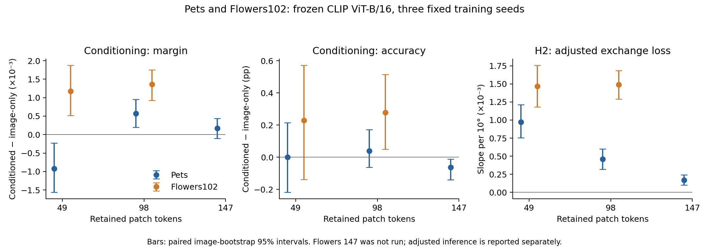
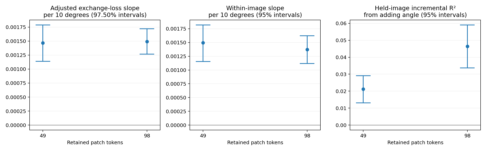

# Flowers102：49／98-token 与 H2 外部验证

**H2 在另一个数据集上得到支持；98-token 条件化选择出现小幅准确率优势，但 Pets 的“49 不利、98 有利”模式没有复现。** Flowers 的两个预算都有正的平均分类间隔收益，98 相对 49 的收益差异区间跨零。因此，任务信息可以有用，而哪个预算更受益仍取决于当前研究设置。

本轮按照预测产生前提交的 [固定方案](../../docs/flowers-targeted-validation.md)执行，独立复算通过。它是在 Flowers 上重新训练并检验结论，不是将 Pets 训练好的模型直接迁移过来。Pets 的 147-token 结果完整保留；本轮按事先确定的范围验证 49／98，不对 Flowers 147 作推断。

## 数据与比较条件

- 使用官方 Flowers102 划分：训练 1,020 张、验证 1,020 张，各类别每个划分十张图片；6,149 张测试图片未用于训练或预测。官方类别缩略图编号与标签逐一对应，未把按字母排列的名称当作标签顺序。
- 训练组合 612 对、验证组合 204 对，覆盖全部 102 类且彼此不重合。验证主面板为 **1,020 张新图片、4,080 个图片／任务样本**；同图交换为 **6,120 个任务对**。这里的泛化指已知类别的未见组合。
- 冻结 OpenAI CLIP ViT-B/16，在 block 6 后保留 49 或 98／196 个 patch，始终保留 CLS。全部 2,040 张训练／验证图的原始 CLIP 与保留全部 token 的特征、预测完全一致。
- 两种 selector 均为 348,033 参数、hidden width 128；每预算使用三个固定种子 2041／2042／2043，配对初始化与采样。各训练 3,978 步、batch 128、AdamW 学习率 0.0003、weight decay 0.01，取最终步权重。
- 每预算独立生成 512-mask、ridge 0.01 的软重要性监督。验证图的教师仅用于诊断。训练步数与 Pets 的 3,990 相差 0.3%，以保持 Flowers 每个任务／类别侧恰好呈现 416 次。两数据集的训练图片数、类别数和任务图不同，不能把跨数据集的差异归因于单一因素。

主指标为任务等权、任务内类别等权的准确率与 signed geometric margin；先平均三个训练种子，再对整张图片进行 2,000 次配对 bootstrap。每个指标分别对两个预算报告 97.5% 调整区间；这不构成所有指标与辅助分析的联合校正。完整普通 95% 区间、已见组合、逐种子及错误变化见 [analysis.json](analysis.json)。当前推断以固定任务图与训练种子为条件，最终测试仍待进行。

## 主结果：未见类别组合

| 方法 | 49 tokens：准确率 / 间隔 | 98 tokens：准确率 / 间隔 |
| --- | ---: | ---: |
| 未剪枝 CLIP | 96.7402% / 0.109970 | 96.7402% / 0.109970 |
| 随机选择（三个 mask seed） | 87.6634% / 0.061078 | 95.9314% / 0.096301 |
| Attention | 94.2647% / 0.071966 | 96.0784% / 0.096638 |
| 图像版 selector | 96.5931% / 0.089037 | 96.8382% / 0.106036 |
| 条件化 selector | 96.8219% / 0.090215 | 97.1160% / 0.107399 |
| 使用标签的离线教师 | 99.7794% / 0.132132 | 99.7549% / 0.147461 |

未剪枝 CLIP 是共同参考，主要检验是条件化减图像版。离线教师知道真实标签，不是可部署预测器。本轮没有重复 Pets 的完整共同候选库搜索；同容量、同训练条件的图像版是主要共享基线。

| token 数 | 条件化 − 图像版 | 均值 | 两预算调整后区间（97.5%） |
| --- | --- | ---: | ---: |
| 49 | 准确率（百分点） | +0.2288 | [−0.1879, +0.6209] |
| 49 | 分类间隔 | +0.001178 | [+0.000427, +0.001964] |
| 98 | 准确率（百分点） | +0.2778 | [+0.0082, +0.5474] |
| 98 | 分类间隔 | +0.001363 | [+0.000870, +0.001800] |

98-token 的三个种子准确率差分别为 +0.3676、+0.1471、+0.3186 个百分点，间隔差也均为正。49-token 的三个准确率差均为正，但总体区间跨零；其间隔差分别为 +0.001960、+0.001583、−0.000009，不能称为逐种子全部同向。

**预先指定的预算复现检验没有通过：**`D98−D49` 的间隔差为 +0.000185，95% 区间 [−0.000540, +0.000861]。Flowers 两个预算均有正间隔收益，故也没有复现 Pets 的负／正符号模式。这不是证明两预算等效，也不是证明 98 没有收益；它表明现有证据不足以确认 98 的条件化收益大于 49。见 [复现判断](replication_summary.json)。

图中统一使用普通 95% 区间，调整后的推断以上表为准。Pets 147 的已有结果保留；Flowers 147 未运行。

## 交换任务描述与 H2

固定图片、模型及实际分类任务，只交换 selector 接收的另一个有效候选类别组合。每个图片／任务对内先平均种子，每张图等权；Flowers 的平衡任务图使这一主面板的均值与上面的主权重一致。

| token 数 | 正确描述 − 交换描述：间隔（95% 区间） | 准确率差：百分点（95% 区间） | 选择集合重合率 |
| --- | ---: | ---: | ---: |
| 49 | +0.003031 [+0.002769, +0.003297] | +0.3513 [+0.1089, +0.5801] | 65.23% |
| 98 | +0.003163 [+0.002981, +0.003348] | +0.3595 [+0.1934, +0.5338] | 79.01% |

两个预算中，正确描述均优于交换描述；图像版的交换效应严格为零。集合重合率是辅助诊断，支持有用任务依赖的直接证据来自实际间隔与准确率变化。[完整交换结果](exchange_analysis.json)

H2 沿用 Pets 的难度控制：两个未压缩有符号间隔的较小值、较大值、各自平方及乘积，再加入每 10° 的文本分隔方向夹角。图片聚类 bootstrap 使用 2,000 次重采样。

| token 数 | 夹角每增加 10° 的调整后交换损失斜率 | 两预算调整后区间（97.5%） | 留出图片的 ΔR²（95% 区间） |
| --- | ---: | ---: | ---: |
| 49 | +0.001469 | [+0.001141, +0.001790] | +0.0212 [+0.0131, +0.0291] |
| 98 | +0.001491 | [+0.001266, +0.001719] | +0.0464 [+0.0337, +0.0590] |

图片固定效应斜率分别为 +0.001497、+0.001371，普通 95% 区间均为正；六个逐种子斜率也均为正。五折预测按图片分组，所有预处理和拟合仅用训练折。ΔR² 表示加入角度的额外预测信息，区间来自固定折外预测的图片重采样，并未重拟合每次 bootstrap。它检验的是固定验证任务集合中的留出图片预测。

**H2 的条件关联在 Flowers 得到复现。** 额外解释力仍有限，不能据此宣称夹角是交换损失的全部原因或已建立因果机制。几何恒等式 `L = ||z_A−z_B|| sin(θ/2) cos(φ)` 的误差小于 6×10⁻¹⁷。去除显式位移／角度尺度后的探索性对齐斜率也为正：49 为 +0.010263／10°，98 为 +0.015766／10°，普通 95% 区间及图片内检查方向一致。两个预定小位移阈值均未排除样本；恒等式与对齐诊断仍需与经验发现区分。[完整几何结果](geometry/analysis.json)

## 教师拟合与下游结果并不等价

| token 数 | selector | 最终训练 KL | 最终验证 KL |
| --- | --- | ---: | ---: |
| 49 | 条件化 | 0.1232 | 0.6285 |
| 49 | 图像版 | 0.3296 | 0.5804 |
| 98 | 条件化 | 0.2403 | 0.8902 |
| 98 | 图像版 | 0.4110 | 0.8112 |

以上为三个固定种子的均值。十二次训练均完成全部更新，训练与验证损失相对初始化都有明显下降。条件化版在训练图片上更贴近教师，但验证 KL 较高；与此同时，两个预算的分类间隔均改善，98 的准确率也获得正向支持。这延续 I2／I3／I6 的认识：模仿目标的拟合程度与实际 top-k 选择效用不能互换。该观察没有单独证明数据量、过拟合或某种内部机制导致了分类差异。

## 成本、核验与证据

一张 RTX A6000，七个使用 GPU 的阶段进程时间合计 **1,016.40 秒，约 0.282 小时**；加两项 CPU 统计阶段为 **1,047.90 秒（17.47 分钟）**。这些时间包含阶段内 CPU、读取和保存，不是利用率加权的 GPU 时间，也不是部署延迟；下载、传输、归档与独立复算另计。服务器为共享环境。[逐阶段执行记录](execution/pipeline_status.json)

[独立科学核验](scientific_audit.json)从原始 102 类分数重算主效应、配对区间和预算差值，并独立重算 H2 与图片固定效应系数、折外预测指标和十二次训练记录。H2 bootstrap 区间检查了预算调整、秩与决策一致性，没有重复整个 bootstrap。实验本身没有因复核而重跑或更改。

原始监督、预测、全部十二个模型与运行记录保留在服务器、本地仓库外 `../artifacts/flowers-selector-budgets-v1/`，并通过 [版本归档](https://github.com/NathanTong0921/ViT-token-compression/releases/tag/flowers-selector-budgets-v1)备份。可重算的前缀张量只保留在服务器。小型统计、图表、划分与核验记录进入 Git；资料清单及恢复情况见本目录的归档记录。

## 对 proposal 的推进

- **H1／任务专用性：**正确候选描述在两个预算中都改善交换后的实际分类表现，外部数据提供了进一步支持。
- **H2：**难度控制后的角度关联、图片内检查和留出图片预测在两个预算上复现，是本轮最清晰的跨数据集进展。
- **H3：**98-token 在未见组合中出现小幅准确率及间隔收益；49 有间隔收益，准确率仍不明确。支持可学习的条件化价值，但不是所有设置都领先。
- **从 Pets 延伸的新认识：**预算本身不足以决定条件化收益的方向；Pets 的具体符号模式不能直接推广。教师拟合与实际分类效用之间的差异也得到新的实例。

本轮对项目目标是正面的：它增加了外部 H2 证据和实际准确率收益，同时明确了预算结论的适用范围。下一步完成必做的 ViT-L/14 定向验证与实际推理延迟，再冻结最终方案进行预留测试确认。
