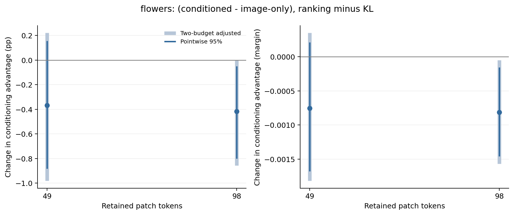

# Flowers102：监督目标干预的外部验证

**Pets49 的正向间隔交互没有在 Flowers 复现。98-token 中，ranking 反而缩小了条件化相对图像版的间隔优势。** 两预算的准确率交互都没有通过预定的两预算调整。该结果支持“监督目标的影响依赖研究条件”，不支持将 ranking 作为通用改进。

## 比较范围

本轮沿用[预测产生前确定的方案](../../docs/conditioning-objective-followup.md)，在 Flowers 重新训练，检验 [Pets 的同类干预](../pets-selector-objectives-v1/README.md)，并非直接迁移 Pets 的 selector。原有 KL 权重保持不变，新增 teacher top-k 边界排序目标；teacher、候选输入、selector 架构与配对采样不变。

- 冻结 CLIP ViT-B/16，block 6 后保留 49 或 98／196 个 patch；selector 为 348,033 参数。
- 全部 1,020 张训练图，3,978 次更新，batch 128；与原有 KL 使用相同学习率、权重衰减、初始化和采样流，取最终步权重。
- 三个固定种子 2041／2042／2043，每预算新增六次训练。
- 未见验证组合：1,020 张图片、204 个二分类任务、4,080 个图片／任务样本。泛化指已知类别的未见组合，预留测试未使用。

主效应为 `[(条件化−图像版)_ranking − (条件化−图像版)_KL]`。相同图片／任务／种子逐行配对，先平均三个种子，再按任务等权、任务内类别等权汇总。图片聚类 bootstrap 为 2,000 次、seed 2085；主效应区间为每个指标分别对两预算调整后的 97.5%，并非全部指标的联合校正。辅助比较为普通 95%；完整表、逐种子效应及诊断见 [analysis.json](analysis.json)。这些区间以固定任务与训练种子为条件。

## 主结果

| 保留 token | KL：条件化−图像版间隔 | Ranking：条件化−图像版间隔 | 间隔交互效应与调整区间 |
| --- | ---: | ---: | ---: |
| 49 | +0.001178 | +0.000425 | −0.000753 [−0.001816, +0.000349] |
| 98 | +0.001363 | +0.000552 | **−0.000812 [−0.001569, −0.000051]** |

| 保留 token | KL：条件化−图像版准确率（百分点） | Ranking：条件化−图像版准确率（百分点） | 准确率交互效应与调整区间（百分点） |
| --- | ---: | ---: | ---: |
| 49 | +0.2288 | −0.1389 | −0.3676 [−0.9805, +0.2207] |
| 98 | +0.2778 | −0.1389 | −0.4167 [−0.8578, 0.0000] |

98-token 的准确率普通 95% 区间为 [−0.8007, −0.0490] 个百分点，但调整后上界触及零，不能称为通过预定校正的负效应。间隔交互在三个种子均为负，分别为 −0.000069、−0.000999、−0.001366；准确率交互并非逐种子同向。

98-token 中，两种 selector 的绝对间隔都下降：条件化版 −0.003180、图像版 −0.002368。准确率变化则为条件化版 −0.0327、图像版 +0.3840 个百分点，因此负准确率交互主要体现图像版获益更多。49-token 的条件化版准确率与间隔均下降，而交互区间仍跨零。间隔与准确率不能互相替代。

浅色为两预算调整区间，深色为普通 95% 区间。四条件绝对表现见 [performance 图](objective_performance.png)；该图为点估计，配对推断以上述交互分析为准。

## 共同 teacher 诊断与训练表现

| Token | 监督／selector | 验证 teacher KL | Top-k overlap（%） | Utility regret |
| --- | --- | ---: | ---: | ---: |
| 49 | KL／条件化 | 0.6285 | 35.8332 | 0.159140 |
| 49 | KL／图像版 | 0.5804 | 35.7106 | 0.162233 |
| 49 | Ranking／条件化 | 2.8179 | 33.7890 | 0.168990 |
| 49 | Ranking／图像版 | 3.2956 | 33.4626 | 0.169364 |
| 98 | KL／条件化 | 0.8902 | 53.4979 | 0.129357 |
| 98 | KL／图像版 | 0.8112 | 53.1769 | 0.130851 |
| 98 | Ranking／条件化 | 3.7586 | 52.4018 | 0.135228 |
| 98 | Ranking／图像版 | 3.7306 | 52.0880 | 0.136441 |

两预算、两种 selector 的 ranking 验证 overlap 都低于 KL，teacher KL 与加性 utility regret 都更高。98-token 中，overlap 的条件化优势几乎不变：+0.3210 → +0.3138 个百分点，交互 95% 区间跨零；实际分类间隔优势却缩小。因此，单看 teacher 集合重合度不足以说明下游变化。Utility regret 使用 teacher 的加性效用，也不等于实际 CLIP 分类收益。

所有 ranking 运行的训练损失都从约 0.694 明显下降：49-token 最终为 0.225–0.283，98-token 为 0.291–0.354；验证 ranking 损失却分别升至 1.176–1.344 与 1.232–1.413。训练 overlap 已达约 68–71%／77–80%，验证仅约 33–34%／52%。这显示了显著训练／验证差距，与排名监督在验证端的劣化一致；尚不能把实际分类变化归因于唯一的过拟合机制。KL 与 ranking 原始损失不直接比较。

初始八个 minibatch 的 ranking／KL 梯度 L2 比值为 49-token 的 0.081–0.089、98-token 的 0.091–0.105；同预算两种 selector 尺度接近。本轮按固定方案没有重缩放损失或调学习率，所以结论属于该训练方案下的目标敏感性，不是分别调优后两类目标的能力上限。

## 保存与对 proposal 的推进

[49-token 配对样本](budget_49/paired_cases.csv)、[98-token 配对样本](budget_98/paired_cases.csv)和同目录 NPZ 保存三种子结果、四条件预测、主效应及共同诊断。独立按 CSV 权重复算的主效应与 JSON 一致，最大绝对差小于 5×10⁻¹⁸；两张科学图已生成 PNG／PDF 并检查。

这是 H3 及“潜在专用选择能否转化为实际收益”的延伸。**本轮没有增强 ranking 方法的普适性，却提供了与 Pets49 不同方向的受控证据：换训练目标能改变条件化优势，其方向不跨数据集统一。** 它增加了项目对收益边界的理解，下一步的中心主张应结合两数据集，并在预留测试上确认，而不是把 Pets 的单个有利设置当成最终结论。
