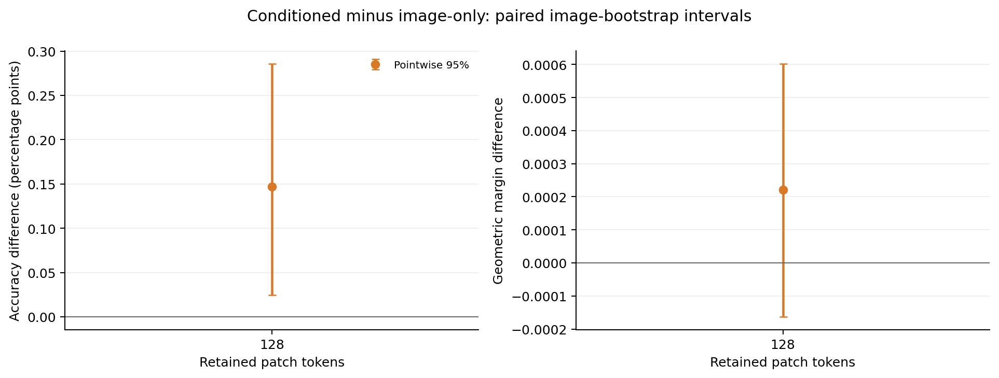
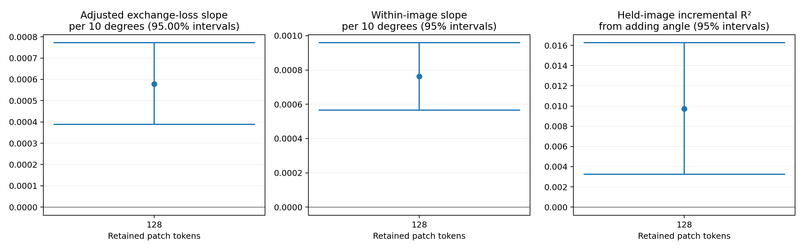

# Flowers102：ViT-L/14 的 50% patch 定向验证

**H2 的正向关联和小幅准确率优势在 ViT-L/14 上得到复现；条件化相对图像版的平均分类间隔差尚不明确。** 三个种子的准确率差均为正，但间隔差方向不一致。正确任务描述相对交换描述同时改善了间隔与准确率。

本轮遵循预测产生前固定的[验证方案](../../docs/vitl-and-latency-validation.md)，在 Flowers 上重新训练 L/14 的 selector。官方测试图片及保留测试组合仍未用于训练和预测。

## 范围与核验

- 冻结 OpenAI CLIP ViT-L/14，输入 224×224，在第 12／24 个 block 后保留 128／256 个 patch，始终保留 CLS；视觉宽度 1,024，输出维度 768。
- 沿用官方训练／验证划分，各 1,020 张图片；训练组合 612 对、验证组合 204 对，覆盖全部 102 类。未见组合主面板为 4,080 个图片／任务样本，同图交换为 6,120 个无序任务对。
- 全部 2,040 张训练／验证图片的 keep-all 路径与原始 CLIP 特征完全一致，预测分歧为零。[特征准备记录](execution/features.json)
- 两种 selector 均为 480,641 参数，使用三个配对种子 2041／2042／2043，各训练 3,978 步，batch 128，hidden width 128，取最终步权重。监督使用每图 512 个固定预算 mask、ridge 0.01。[监督记录](execution/prepare.json)／[训练记录](execution/train.json)
- 主指标按任务等权、任务内类别等权计算；先平均三个训练种子，再进行 2,000 次图像聚类 bootstrap。这里只验证一个预定预算，使用普通 95% 区间，条件为固定任务图和三个训练种子。

## 未见类别组合

| 方法 | 准确率 | 平均有符号分类间隔 |
| --- | ---: | ---: |
| 未剪枝 CLIP | 98.7745% | 0.124221 |
| 随机选择 | 98.7990% | 0.114986 |
| Attention | 98.6029% | 0.114354 |
| 图像版 selector | 98.8644% | 0.124139 |
| 条件化 selector | 99.0114% | 0.124361 |
| 使用真实标签的离线教师 | 99.9265% | 0.163611 |

离线教师仅用于诊断。主要比较为条件化减图像版：

| 指标 | 均值 | 95% 区间 |
| --- | ---: | ---: |
| 准确率差（百分点） | +0.1471 | [+0.0245, +0.2859] |
| 分类间隔差 | +0.000222 | [−0.000163, +0.000603] |

| 训练种子 | 准确率差（百分点） | 分类间隔差 |
| --- | ---: | ---: |
| 2041 | +0.2206 | −0.000803 |
| 2042 | +0.0980 | +0.002255 |
| 2043 | +0.1225 | −0.000787 |

总体准确率区间为正；平均间隔的正点估计主要来自种子 2042，另外两个种子为负，不能将其描述为稳定间隔收益。[完整主结果、已见组合及逐种子结果](analysis.json)

## 任务交换与 H2

正确描述相对交换描述的间隔收益为 **+0.001138**，95% 区间 **[+0.001003, +0.001272]**；准确率差为 **+0.1498 个百分点**，区间 **[+0.0408, +0.2805]**。选择集合平均重合率为 76.57%；图像版的交换效应严格为零。交换统计按图片等权、图片内任务对等权。[交换结果](exchange_analysis.json)

| H2 检验 | 估计 | 95% 区间 |
| --- | ---: | ---: |
| 难度控制后，角度每增加 10° 的交换损失斜率 | +0.000579 | [+0.000389, +0.000771] |
| 图片固定效应斜率／10° | +0.000763 | [+0.000565, +0.000958] |
| 五折留出图片的增量 R² | +0.009725 | [+0.003262, +0.016250] |

三个种子的难度调整斜率分别为 +0.000596、+0.000796、+0.000344，普通 95% 区间均为正。768 维特征上的交换恒等式误差小于 5×10⁻¹⁷。留出图片的预处理和拟合仅用训练折；R² 区间重采样固定折外预测，不包含重新拟合的变异。[完整几何结果](geometry/analysis.json)

## 训练拟合与 B/16 结果的关系

| selector | 最终训练 KL（三种子均值） | 最终验证 KL（三种子均值） |
| --- | ---: | ---: |
| 条件化 | 0.2139 | 1.1141 |
| 图像版 | 0.4750 | 0.9457 |

六次训练均完成固定更新，训练和验证损失都低于初始化。条件化版训练 KL 更低、验证 KL 更高，但其分类准确率更高；教师模仿损失与实际 top-k 分类效用的排序并不相同。[完整训练曲线](execution/training_history.csv)

B/16、98／196 patch 曾出现 +0.2778 个百分点的准确率差和 +0.001363 的间隔差，原两预算调整后区间均为正。L/14、128／256 patch **复现了小幅准确率优势、正向描述交换效应和 H2 关联，但未明确复现正间隔优势**。两个 backbone 同时改变了 patch 大小、深度、宽度、文本表示及 selector 输入维度；上述结果不单独识别模型大小的因果作用，也没有检验两个 backbone 的收益差是否显著。

[独立科学核验](scientific_audit.json)已从原始预测重新计算主效应与图像 bootstrap 区间、完整特征交换关系、H2 点估计和留出图片拟合；H2 区间核对了水平与判断一致性，没有重新执行斜率 bootstrap。小型结果、图表及执行摘要保存在本目录；大型原始证据由本轮统一归档管理。实际推理延迟单独测量，不使用训练／缓存评估时间代替。
