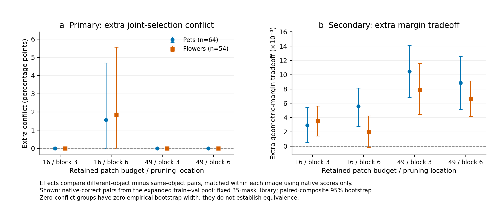

# 几何与难度匹配：扩大的开发任务池

**主要结果：匹配任务方向与完整模型难度后，不同对象并未带来普遍的二分类选择冲突；但更大的margin取舍仍然存在。** 这进一步区分了“专用选择可以提高判别余量”和“共享选择无法同时答对”。



## 设计与覆盖

第一阶段仅使用val类别对，几何支持不足。因此在查看新匹配的压缩结果前，另行固定本阶段：使用全部预先划分的train+val类别对，继续排除test类别对，保持同一批合成图、5°／0.015阈值、每图最多一组匹配与确定性选择规则。冻结设计提交后才读取压缩结果。本阶段是机制诊断，不是未见类别组合泛化评估。[完整协议](../../docs/geometry-matched-conflict.md)

Pets匹配64/64张图；Flowers匹配56/64张，限定双方完整模型均正确时为54/64张。原模型正确面板的方向夹角平均绝对差分别为0.18°／1.23°，两个margin的平均绝对差分别约为Pets0.00041／0.00042、Flowers0.00233／0.00231。

## 共同正确选择：主结果

以下分母为双方两个任务均被完整模型答对的匹配图。冲突定义为各题分别存在正确mask，却没有同一个mask同时答对两题；不是普通分类错误率。库包含35个固定mask，在相同预算下两个剪枝层的位置完全相同。

| 数据集 | 层／预算 | 同对象冲突 | 不同对象冲突 | 配对差值（百分点，95%bootstrap） |
|---|---|---:|---:|---:|
| Pets | 3／16 | 0/64 | 0/64 | 0；零事件 |
| Pets | 6／16 | 0/64 | 1/64 | +1.56［0，4.69］ |
| Pets | 3／49、6／49 | 0/64 | 0/64 | 0；零事件 |
| Flowers | 3／16 | 0/54 | 0/54 | 0；零事件 |
| Flowers | 6／16 | 0/54 | 1/54 | +1.85［0，5.56］ |
| Flowers | 3／49、6／49 | 0/54 | 0/54 | 0；零事件 |

找到共同正确mask是明确的可实现性证据；未找到只表示在这35个mask中未找到，不证明所有可能选择都无解。49-token时，同对象与不同对象组的每张匹配图都有共同正确mask。16-token时也大多可行，例如block6下分别为Pets63/64与61/64、Flowers52/54与53/54。无法在库中分别答对的情况也保留，未误计为冲突。

不限制原模型正确性时结论相近：Pets仅block6/16出现1个不同对象冲突；Flowers在block3/49出现1个不同对象冲突，block6/16同对象1个、不同对象2个，其他设置为0。全部条件见CSV和JSON。

## Margin取舍：次要结果

“各任务分别优化的平均margin”减去“同一mask优化的平均margin”定义了取舍幅度。其非负性由定义保证；这里检验的是**经过匹配后，不同对象与同对象之间的差异**。

| 数据集 | 3／16 | 6／16 | 3／49 | 6／49 |
|---|---:|---:|---:|---:|
| Pets：不同对象减同对象 | +0.00292 | +0.00559 | +0.01043 | +0.00887 |
| Flowers：不同对象减同对象 | +0.00350 | +0.00195 | +0.00791 | +0.00664 |

八个开发条件的点估计均为正，七个配对bootstrap区间在零以上；Flowers block6/16区间为［−0.00018，0.00424］。49-token下该差异在两个数据集、两层均出现，却没有共同正确选择冲突。没有一致的“更晚剪枝减少取舍”的趋势。

**对研究的推进：**较精确的几何／难度匹配仍保留margin层面的对象差异，同时没有支持广泛的准确率必要性。这是对条件化可能带来何种收益的定位；尚未展示可学习、可部署的条件化优势。

## 数据与复现

- `matched_design.json`、`coverage.json`、`matching_balance.json`：冻结任务、失败原因、匹配与来源图信息。
- `paired_outcomes.csv`、`summary.json`：全部配对结果与2,000次bootstrap（种子2111）。
- [PDF图](geometry_matched_conflict.pdf)。
- [设计与评估核对](design_evaluation_audit.json)：两阶段匹配文件与冻结提交完全一致，选定任务全部符合划分／阈值要求，35-mask库在两个剪枝层的位置与顺序完全相同。

统计条件于既有类别与来源面板；Pets有10张来源图被复用（最多2次），Flowers有5张（最多3次）。零事件产生的零宽经验bootstrap区间不能证明等效；库内标签辅助选择不代表已经学到相应策略。[较小val任务池结果](../geometry-matched-conflict-v1/README.md)同样保留。

```bash
python3 scripts/analyze_geometry_matched_conflict.py \
  --evaluate-only --output results/geometry-matched-conflict-devpool-v1
python3 scripts/plot_geometry_matched_conflict.py
```

两个命令均只读取已有数据，无GPU工作。
