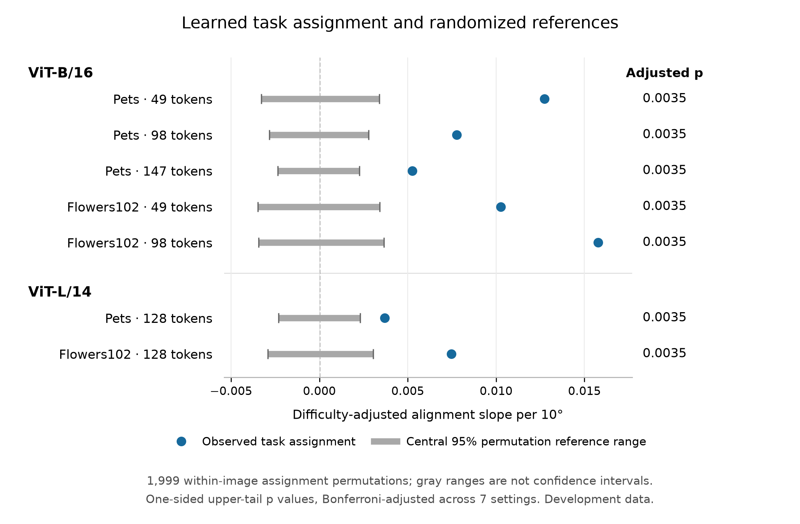

# 真实任务对应是否解释几何对齐规律？

**七个已有设置都得到同一结果：控制原始任务难度后，真实任务对应下的“方向夹角—归一化对齐”斜率高于 1,999 次图内打乱参考，七项比较调整后仍成立。** 这一轮加强 proposal H2 的解释证据，分类性能结果保持不变。

## 本轮做了什么

此前发现，交换两个任务的 token 选择会造成分类间隔损失，而且损失与任务文本方向的夹角有关。交换损失可分解为 `L = ||Δz|| sin(θ/2) cos(φ)`；其中角度因子本身来自公式。现在分析去掉显式长度与角度因子的 `cos(φ)`，进一步检验其中的规律是否依赖真实的任务对应。

保留同一张图片、同一批任务和同一批选择后图像特征，只把“这个任务对应哪份特征”重新分配。任务方向、角度和未压缩分类间隔保持固定；每张图的完整任务对集合也保证特征差异长度的总体分布不变。每个设置生成 1,999 次参考分配，使用相同的三个训练种子 2041／2042／2043，无新增训练或图像推理。

主统计量为归一化对齐对文本方向夹角的回归斜率，单位是每 10°；控制两个未压缩几何间隔及其对称二次项，每张图片等权。主分析先平均三个种子的归一化图像特征，再计算差异，不再次归一化。协议在产生打乱结果前固定，见[完整设计](../../docs/geometry-permutation.md)。

## 主结果

| 数据集 · 模型 · 保留 patch 数 | 真实对应斜率 / 10° | 打乱参考的中央 95% 范围 | 达到或超过真实值的次数 | 七项调整后参考尾值 |
| --- | ---: | ---: | ---: | ---: |
| Pets · ViT-B/16 · 49 | +0.01274 | [-0.00330, +0.00338] | 0 / 1,999 | 0.0035 |
| Pets · ViT-B/16 · 98 | +0.00777 | [-0.00284, +0.00279] | 0 / 1,999 | 0.0035 |
| Pets · ViT-B/16 · 147 | +0.00525 | [-0.00235, +0.00226] | 0 / 1,999 | 0.0035 |
| Flowers102 · ViT-B/16 · 49 | +0.01026 | [-0.00347, +0.00340] | 0 / 1,999 | 0.0035 |
| Flowers102 · ViT-B/16 · 98 | +0.01577 | [-0.00345, +0.00365] | 0 / 1,999 | 0.0035 |
| Pets · ViT-L/14 · 128 | +0.00369 | [-0.00230, +0.00232] | 0 / 1,999 | 0.0035 |
| Flowers102 · ViT-L/14 · 128 | +0.00747 | [-0.00293, +0.00304] | 0 / 1,999 | 0.0035 |

所有设置的原始参考尾值均为 `(1+0)/(1999+1)=0.0005`，Bonferroni 七项调整后为 `0.0035`。参考范围描述打乱分配的分布，不是观测斜率的置信区间；有限抽样下不能把零次超过写成概率为零。

Pets 每个设置为 616 张可构成任务对的图片、4,315 对任务；Flowers102 为 1,020 张图片、6,120 对任务。相同数据集在各预算和模型间复用相同任务与随机映射。

## 补充结果与解释

- 加入图片固定效应后，七个观测斜率仍为正，且高于全部对应参考；图像等权平均对齐也为正。这两项是预先列出的描述性补充，不替代主统计量。
- 三个种子单独计算的 21 个观测斜率均为正。Pets49 的 seed 2042 有一对完全相同特征，其余弦对齐未定义；只在该辅助统计中排除并重算权重。主分析的种子均值中全部任务对有效，七个主分析总体均未排除任务对。
- **对 H2 的推进是正面的。** 去掉公式里的显式角度因子后，对齐与角度的关系仍超过图内随机对应参考，说明观测规律包含任务与选择后表示之间的对应结构。它是在已有 H2 分解和归一化对齐结果上的延伸。
- 该结论来自已经分析过的开发数据，是针对指定打乱参考的进一步诊断。它不改变完整条件化与加宽图像基线的准确率比较，也不把角度关联改写为因果关系。下一步固定最终确认方案，再用预留数据确认核心发现。

## 验证、复现和保存

独立实现从原始预测和划分文件重建输入，复算所有七个设置的 1,999 次参考及三项统计，核对几何恒等式、任务方向、全部任务对长度分布和跨设置映射，均通过。服务器相关测试共 194 项通过。全部使用开发图片及未见开发类别组合，未使用预留测试数据。

- [主分析 JSON](analysis.json)、[独立复核](scientific_audit.json)、[执行日志](execution/)、[图表 CSV](primary_alignment_reference.csv)、[PDF 图](primary_alignment_reference.pdf)。各设置子目录保存逐对观测 CSV／NPZ 及全部参考统计。
- [实验记录](../../docs/experiments/2026-11-03-geometry-permutation.md)、[成本明细](experiment_costs.json)。主分析约 63 秒、独立复核约 60 秒，均在 CPU 上执行；新增 GPU 用量为零。
- [GitHub Release](https://github.com/NathanTong0921/ViT-token-compression/releases/tag/geometry-permutation-v1) 保存七份可复算的精确特征面板与执行记录；同一归档保留在本地 `../artifacts/geometry-permutation-v1/`，服务器保留原始预测和面板。
- [备份清单](artifact_inventory.json) 和 [归档验证](archive_verification.json) 记录恢复所需文件。复算入口为 `scripts/analyze_geometry_permutation.py --from-panels`，配置为 `configs/geometry_permutation.json`。
