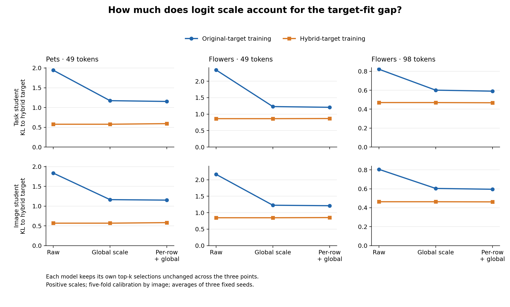

# How much of the hybrid-target KL gap can scaling remove?

Completed 2026-11-04, using existing development predictions only. **Rank-preserving global scale calibration removes 53.0–75.2% of the original-to-hybrid training KL difference across the six setting/arm comparisons.** Per-example amplitude normalization followed by calibration raises this range to 55.1–77.0%. The hybrid-trained models retain a lower KL in every comparison after either adjustment.

Thus, a large part of the raw target-fit difference can be obtained without changing a model's selected tokens. It is not the whole difference, and it does not mean the original and hybrid-trained models have identical rankings.



## Paired results

All KL values use the **same saved hybrid mask target** within a seed. Old means the original-utility-trained residual; new means the hybrid-mask-trained residual. Each entry averages all three fixed seeds with the original task/class weights. The percentage columns are ratios of aggregate differences, not confidence intervals or causal fractions of training dynamics.

| Setting | Arm | Old raw KL | New raw KL | Old calibrated KL | New calibrated KL | Global-scale removable gap | With per-row normalization |
|---|---|---:|---:|---:|---:|---:|---:|
| Pets 49 | task | 1.943 | 0.577 | 1.173 | 0.577 | 56.3% | 58.9% |
| Pets 49 | image | 1.835 | 0.568 | 1.163 | 0.568 | 53.0% | 55.1% |
| Flowers 49 | task | 2.341 | 0.862 | 1.229 | 0.862 | 75.2% | 77.0% |
| Flowers 49 | image | 2.165 | 0.846 | 1.227 | 0.846 | 71.1% | 72.7% |
| Flowers 98 | task | 0.822 | 0.470 | 0.601 | 0.470 | 62.7% | 65.3% |
| Flowers 98 | image | 0.806 | 0.463 | 0.604 | 0.463 | 59.0% | 61.1% |

The clearest example is the Flowers49 task branch: its old-model KL falls from **2.341 to 1.229** by changing only a scalar. The new model is **0.862** before calibration and **0.862** after it. This accounts for 75.2% of the raw gap while preserving every selected token for each model. Its remaining calibrated gap is 0.367 [0.361, 0.374] under the six-comparison adjustment. Removing per-row amplitude leaves a gap of 0.341 [0.334, 0.347].

All six remaining-gap adjusted intervals are positive. A global scale mismatch therefore explains a substantial portion, while relative score patterns beyond that scale still improve target fitting. Remaining KL is not a pure ranking measure: within-vector score spacing also affects probabilities.

## What happens to token selection?

Every positive rescaling and standardization preserves that model's saved top-k mask exactly. Consequently these operations cannot change the existing CLIP classification results. The old and new trained models themselves do select different masks: their average mutual overlap ranges from 77.7% to 86.0%.

The Flowers49 discrepancy survives the scale diagnosis. The new task/image models have lower calibrated KL, but their hybrid-target mask overlap decreases relative to the old models by 0.264/0.761 percentage points. On Flowers98 overlap increases by 1.123/1.331 points. Pets49 improves by 2.276 points for the task arm and is nearly unchanged for the image arm. These results preserve all settings rather than turning the Flowers49 case into a universal failure of ranking improvement.

The frozen U reference is also evaluated. It retains higher hybrid-mask overlap than either new student in all three settings, despite worse raw and calibrated KL. Full reference values and seed-level effects are in each `summary.json`.

## Fixed design and numerical checks

- 45 saved model outputs: 18 old students, 18 new students and nine shared bases. No new model fitting or CLIP inference.
- Five image-disjoint folds; calibration uses four folds and evaluation the remaining fold. All tasks for an image stay together. Both Flowers budgets have identical image folds.
- One strictly positive global scale per model/fold; the secondary variant first centers and standardizes each row. Both preserve rankings. All 450 calibration solutions are inside the declared bounds.
- The old models' mean global scales are about 0.37–0.48; the new models are near 1.00–1.01. These characterize compatibility with this particular hybrid target, not classification confidence calibration.
- Original KL and mask overlap reproduce saved diagnostic values; the maximum KL difference is 2.98e-7. The decomposition identity is checked row by row and all transformed masks equal their originals.
- Five mathematical tests pass. An independent check rebuilds weighted means, per-seed effects, percentage ratios and all reported bootstrap endpoints from saved row metrics and source metadata. See `independent_check.json` for its scope.
- Image-bootstrap intervals average the fixed seeds before resampling and condition on the cross-fitted scales. Final test data remains unused.

## Research consequence

This completes the scale-diagnostic step proposed after I28. It strengthens the explanation of why lower KL was insufficient evidence of better token selection. It gives a concrete reason to evaluate retained-set/ranking objectives by mask recovery and actual classification, rather than selecting them because their soft distribution loss falls.

No new objective or selector training was started. The next main research priority remains explaining **when task conditioning adds value beyond strong shared selection**. A targeted ranking/set-training comparison can be a parallel follow-up when its design is ready; this diagnostic does not itself answer why Flowers and Pets differ.

## Files, cost and recovery

The server ran the three settings on one CPU thread in 32.35 seconds of recorded setting-level analysis, using zero GPU inference or training. The complete process, including startup, took about 36 seconds. Existing input archives were read directly, without extraction or a new intermediate dataset.

- `summary.csv/json`: all six comparisons and the reference results.
- `*/row_metrics.npz`: every image/task/seed loss, fitted fold scale, standard deviation and overlap.
- `*/calibration_fits.csv`, `*/image_folds.csv`: all 450 fits and image splits.
- `logit_scale.png/.pdf`: the six-panel figure.
- `backup_manifest.json`: existing source backups and current derived-data locations.

[Fixed protocol](../../docs/hybrid-logit-scale.md) · [Run record](../../docs/experiments/2026-11-04-logit-scale.md)

From the repository root:

```bash
OPENBLAS_NUM_THREADS=1 OMP_NUM_THREADS=1 MKL_NUM_THREADS=1 PYTHONPATH=src:scripts \
python3 scripts/diagnose_hybrid_logit_scale.py \
  --new-archive ../artifacts/hybrid-followup-v1/hybrid-distillation-v1.zip \
  --old-archive ../artifacts/familiarity-residual-v1/shared-residual-and-prior-v1.zip \
  --output runs/hybrid-logit-scale-v1
python3 scripts/plot_logit_scale.py
```
