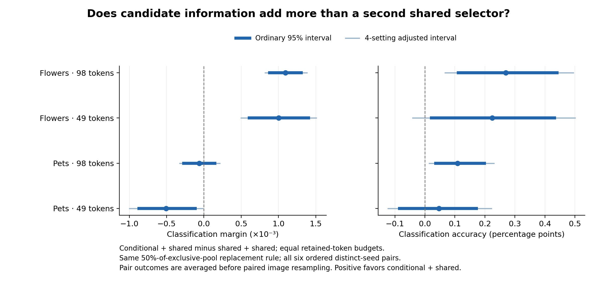

# Conditional/shared mixing versus two independent shared selectors

Completed 2026-11-04. This experiment asks whether the earlier hybrid-selection result depends on candidate-conditioned evidence, or can be reproduced by combining two independently trained image-only selectors. The backbone remains frozen CLIP ViT-B/16. No selector was trained in this round.

## Findings

**On Flowers, the conditional/shared mixture has a larger classification margin than the shared/shared mixture at both token budgets. The clearest evidence for an additional mixing benefit is Flowers 49:** its original conditional and shared endpoints have almost identical mean margins, but the conditional/shared mixture gains more from mixing. On Pets, this advantage does not recur.

CU denotes a conditional recipient plus a shared donor; UU denotes a shared recipient plus the same shared donor. All main results average the six ordered distinct-seed pairs from seeds 2041, 2042 and 2043. Positive CU−UU favors the conditional/shared mixture.

| Setting | CU−UU margin × 1,000 | CU−UU accuracy, percentage points |
|---|---:|---:|
| Pets 49 | -0.508 [-1.006, -0.009] | +0.047 [-0.125, +0.224] |
| Pets 98 | -0.063 [-0.331, +0.222] | +0.109 [+0.013, +0.232] |
| Flowers 49 | +1.004 [+0.489, +1.515] | +0.225 [-0.043, +0.502] |
| Flowers 98 | +1.093 [+0.814, +1.388] | +0.270 [+0.065, +0.496] |

Brackets show paired image-bootstrap intervals adjusted across the four settings, separately for margin and accuracy. The plot includes both ordinary and adjusted intervals. Flowers 49 has positive margin and accuracy differences in all six seed pairs; Flowers 98 has positive margins in all six and positive accuracy differences in five.



## Final performance and the gain from mixing

A mixture can finish ahead because its recipient was already stronger, because mixing adds more, or both. The following secondary comparisons separate these effects. C and U are the original recipient endpoints. All values are margin differences × 1,000, with ordinary 95% image-bootstrap intervals.

| Setting | CU−C | CU−U | UU−U | (CU−C)−(UU−U) |
|---|---:|---:|---:|---:|
| Pets 49 | +1.723 [+1.274, +2.196] | -0.801 [-1.179, -0.450] | -0.293 [-0.548, -0.046] | +2.016 [+1.508, +2.531] |
| Pets 98 | +0.166 [-0.159, +0.491] | -0.007 [-0.249, +0.251] | +0.056 [-0.137, +0.257] | +0.110 [-0.230, +0.469] |
| Flowers 49 | +1.765 [+1.282, +2.221] | +1.771 [+1.386, +2.184] | +0.767 [+0.457, +1.079] | +0.998 [+0.507, +1.483] |
| Flowers 98 | +0.456 [+0.144, +0.768] | +1.719 [+1.483, +1.966] | +0.626 [+0.443, +0.813] | -0.170 [-0.518, +0.166] |

- **Flowers 49:** CU improves on both endpoints, and UU also improves on U. CU has a larger mixing increment by 0.998 × 10⁻³ [0.507, 1.483], so the main advantage is not explained solely by combining any two selectors or starting from a stronger conditional endpoint. Its accuracy advantage over UU is +0.225 points, while the four-setting adjusted interval includes zero.
- **Flowers 98:** CU has a clear final margin and accuracy advantage over UU. The conditional endpoint was already stronger, and the mixing-increment difference is small and unresolved. CU improves margin over C, but does not establish an accuracy improvement over C (−0.037 points; ordinary interval includes zero).
- **Pets 98:** the +0.109-point accuracy advantage over UU accompanies a loss from U to UU (−0.077 points). CU does not establish an accuracy gain over the strong single U endpoint.
- **Pets 49:** the conditional recipient starts weaker. Mixing substantially repairs this deficit, but CU still has a lower margin than both UU and U. A positive mixing-increment interaction alone therefore does not establish a better final method.

## Actual replacements and fixed-count checks

The main rule replaces half of each pair’s exclusive-token pool, rounding down. It is the same rule for CU and UU, but candidate conditioning can change disagreement size and therefore the number of replacements. These are weighted averages of actual replacements; retained-token budgets remain fixed.

| Setting | CU replacements | UU replacements | d=2 CU−UU margin × 1,000 | d=4 CU−UU margin × 1,000 | d=4 coverage |
|---|---:|---:|---:|---:|---:|
| Pets 49 | 7.90 | 5.42 | -1.976 [-2.635, -1.360] | -1.447 [-2.019, -0.900] | 99.59% |
| Pets 98 | 12.86 | 11.85 | -0.052 [-0.368, +0.284] | -0.020 [-0.313, +0.288] | 100.00% |
| Flowers 49 | 12.79 | 10.69 | +0.322 [-0.294, +0.918] | +0.525 [-0.063, +1.076] | 100.00% |
| Flowers 98 | 18.26 | 16.33 | +1.288 [+0.921, +1.644] | +1.268 [+0.940, +1.601] | 100.00% |

Both fixed-count arms must have at least d exclusive tokens; summaries retain the original task/class and equal-pair weights on jointly feasible rows. d=2 coverage is 100% in every setting. At d=4, only Pets 49 excludes any weighted rows. These are smaller interventions than the main mixture: Flowers 49 changes roughly 11–13 tokens under the main rule, so its unresolved d=2/4 differences do not by themselves identify replacement count as the cause of the main gain. Flowers 98 retains a margin advantage at both exact counts, consistent with its already stronger conditional endpoint.

## Task exchange

Exchanging the task-specific masks while keeping the classification task fixed reduces CU margins in all four settings. UU is exactly unchanged, as expected for a selector that receives only the image. This confirms that the conditional mixture still uses task-specific selection after mixing; its value over an alternative mixture is tested by CU−UU above.

| Setting | CU own-task minus exchanged-task margin × 1,000 | UU exchange effect |
|---|---:|---:|
| Pets 49 | +0.559 [+0.450, +0.669] | 0 |
| Pets 98 | +0.359 [+0.293, +0.426] | 0 |
| Flowers 49 | +1.346 [+1.204, +1.483] | 0 |
| Flowers 98 | +1.402 [+1.317, +1.487] | 0 |

## Evaluation and verification

- Fixed layer, backbone and retained-token count; the CU and UU selector totals are 695,432 and 694,798 parameters. Each mixture uses one frozen suffix after combining the two selections.
- Six ordered distinct-seed pairs per setting; three same-seed CU pairs are historical references only. For each image/task row, pair outcomes are averaged before image resampling. The six correlated pairs are not treated as six independent experiments.
- Existing equal-task/equal-class classification weights; 2,000 paired image-bootstrap draws, seed 2311. The uncertainty describes image variation for these fixed trained seeds. All pair-level estimates are retained in each summary.
- Pets: 716 images, 66 candidate tasks, 2,624 image/task rows. Flowers: 1,020 images, 204 tasks, 4,080 rows. These are the existing development validation panels; the reserved final test remains unused.
- All original endpoint masks match their saved artifacts exactly; maximum endpoint score error is zero. All twelve historical same-seed mixtures reproduce the prior top-50% mixture masks and scores exactly.
- All four setting summaries were independently reconstructed from the lightweight image contributions: 56 contrast/metric point estimates agree within floating-point precision. The audit details are saved in `local_summary_check.json`.

## Cost and artifacts

Across all 36 evaluated seed-pair records, the recorded time for new frozen-suffix evaluations totals **76.94 seconds**. Exact cached image/mask features were reused. This number excludes earlier selector training, cache generation, loading, mask construction and statistical analysis; it is neither total project GPU time nor deployment latency.

- [Protocol](../../docs/hybrid-specificity.md): declared comparisons and statistical units.
- [Figure PDF](hybrid_specificity.pdf) and [contrast table](contrast_table.csv): all primary and secondary classification contrasts.
- Each setting folder contains `protocol.json`, `execution.json`, `examples.csv`, `evidence.npz`, `summary.json`, `classification_images.csv` and `replacement_counts.csv`.
- Raw per-pair scores, masks and fixed-count eligibility remain in the server run folders for the project’s separate raw-result archive.

From the repository root, regenerate the figure with:

```bash
python3 scripts/plot_hybrid_specificity.py
```

Recompute analysis from a complete raw setting directory with:

```bash
PYTHONPATH=src .venv/bin/python scripts/analyze_hybrid_specificity.py \
  --source runs/hybrid-specificity-v1/flowers_b16_49 \
  --output runs/hybrid-specificity-v1/flowers_b16_49/analysis
```
