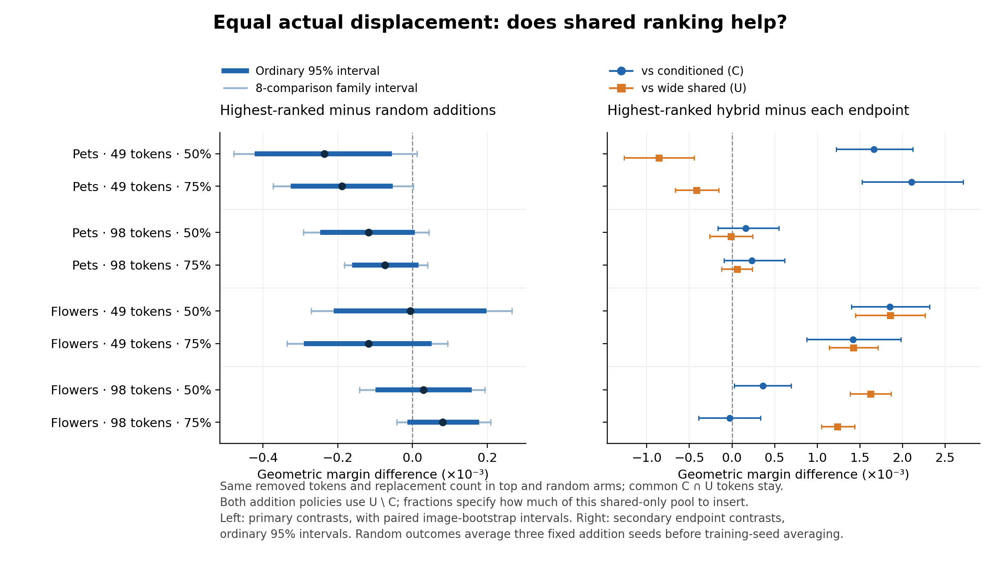

# Equal actual replacement: development results

Holding the changed-token count and removed positions fixed, none of the eight
primary top-versus-random margin contrasts excludes zero after the planned
eight-comparison adjustment. The earlier Flowers98 top-core advantage becomes
small under this stronger control. Meanwhile, combining shared and conditioned
selections still improves margin over both endpoints on Flowers49.

Here **random additions are sampled from `U minus C`**, the same pool of tokens
selected by the strong shared selector but omitted by the conditioned selector.
The experiment tests the ordering *within that shared-only pool*. It does not
compare shared selection with unrestricted random image tokens.

## Primary results

`C` and `U` are the conditioned and wide shared top-k masks. For each image/task,
`d = floor(fraction × |U minus C|)`. Both arms remove the identical `d`
lowest-conditioned-ranked positions from `C minus U`. They differ only in the
added positions from `U minus C`. Common positions remain; the total remains k.

All margin quantities below are multiplied by **1,000**. The actual replacement
count is averaged with the main task/class weights over all three training seeds.

| Setting | Fraction | Mean d | Top − random | Ordinary 95% interval | Eight-comparison interval |
| --- | ---: | ---: | ---: | --- | --- |
| Pets49 | 50% | 7.73 | −0.236 | [−0.416, −0.062] | [−0.478, +0.011] |
| Pets49 | 75% | 11.59 | −0.189 | [−0.319, −0.060] | [−0.373, +0.002] |
| Pets98 | 50% | 12.66 | −0.117 | [−0.240, +0.0002] | [−0.292, +0.044] |
| Pets98 | 75% | 18.99 | −0.074 | [−0.155, +0.009] | [−0.182, +0.041] |
| Flowers49 | 50% | 12.68 | −0.006 | [−0.204, +0.192] | [−0.271, +0.266] |
| Flowers49 | 75% | 19.03 | −0.117 | [−0.284, +0.045] | [−0.335, +0.094] |
| Flowers98 | 50% | 18.16 | +0.029 | [−0.092, +0.153] | [−0.142, +0.194] |
| Flowers98 | 75% | 27.25 | +0.081 | [−0.006, +0.172] | [−0.042, +0.209] |

Pets49 has negative margin differences in all three seeds at both fractions;
its ordinary intervals exclude zero but adjusted intervals include zero. The
other settings do not establish a top-ranked advantage. All eight primary
accuracy intervals include zero even before adjustment. These results do not
establish equivalence of the addition policies.

## Mixture gains remain a separate finding

For the **50% top-ranked hybrid**, secondary margin differences and ordinary 95%
intervals are:

| Setting | Hybrid − C (×1,000) | Hybrid − U (×1,000) |
| --- | --- | --- |
| Pets49 | +1.665 [1.222, 2.121] | −0.859 [−1.267, −0.447] |
| Pets98 | +0.160 [−0.164, +0.548] | −0.014 [−0.264, +0.240] |
| Flowers49 | +1.851 [1.398, 2.319] | +1.856 [1.448, 2.266] |
| Flowers98 | +0.361 [0.026, 0.695] | +1.625 [1.384, 1.867] |

Flowers49 improves both endpoint margins in every training seed at both tested
fractions. Flowers98's 50% hybrid also improves both endpoint margins in each
seed. These particular hybrid-versus-endpoint accuracy intervals include zero.
Every setting retains a positive margin benefit from using the correct task's
intervention mask rather than another task's mask; this effect decreases as more
tokens are replaced. The wide endpoint's task-exchange effect is exactly zero.

The original core-protection Flowers98 top-versus-random margin differences were
0.253 and 0.389 (×1,000); the matched-replacement values are 0.029 and 0.081.
The follow-up controls both replacement count and removal identity and preserves
the common set. It therefore narrows the earlier explanation: current evidence
supports useful mixtures in some settings, but does not establish that priority
within the shared-only candidate pool is the source of the gain. It does not
attribute the change uniquely to replacement count alone.

## Evidence, verification, and cost

All four settings use frozen CLIP ViT-B/16, block 6, existing validation images
and validation task pairs, training seeds 2041–2043, and random-addition seeds
2211–2213. Paired image bootstrap averages random outcomes and training seeds
before resampling. The eight primary contrasts were fixed for this follow-up;
endpoint and exchange comparisons are secondary.

`intervention-audit.json` independently reconstructs the masks from original
rankings with set operations. All 402,240 saved masks satisfy the required common
set, counts, identical removals, and addition identities. The 24 C/U endpoint
comparisons reproduce previous masks and cosine scores exactly.

The four evaluation scripts took 147.59 seconds in total, including model loading,
intervention construction, I/O, and saving. Timed new frozen-suffix replay totaled
59.34 seconds for 320,645 unique image/mask pairs; 51,146 further pairs reused
existing features. These costs reuse earlier selector training and prefix caches.

`primary-contrasts.csv` preserves means, ordinary and adjusted intervals, all
training-seed effects, displacement counts, and endpoint comparisons. Setting
directories contain row/image-level classification and task-exchange data. The
figure is reproducible with `python3 scripts/plot_matched_replacement.py`.
