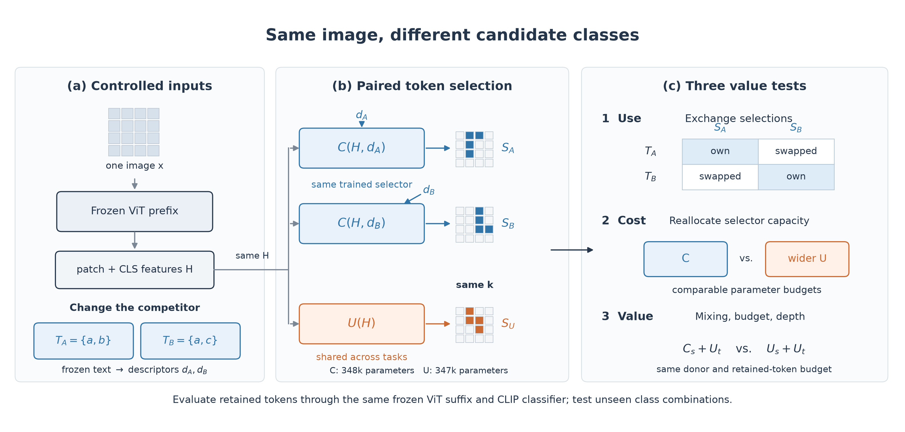
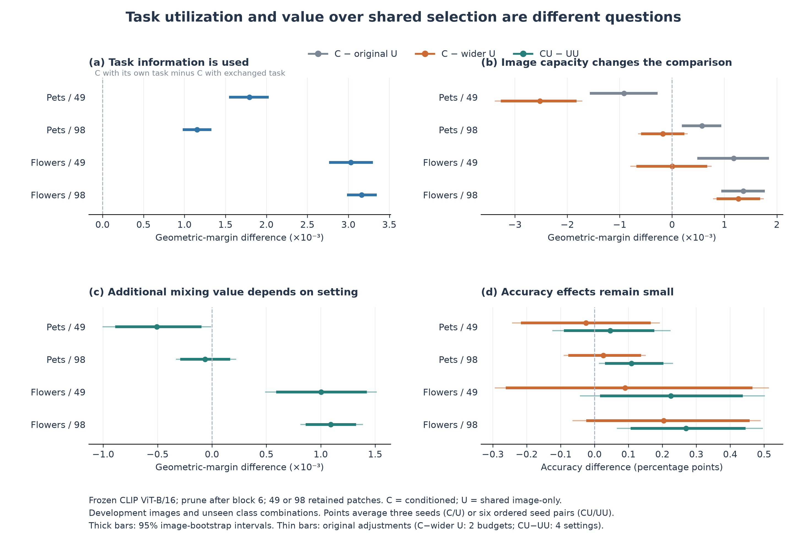

# Paper overview and core evidence

Created 2026-11-05 from the completed development analyses. No new model training or inference was needed.

## Framework figure



**Suggested caption.** Overview of the controlled study. The same image produces frozen patch and CLS features, while candidate sets change from `{a,b}` to `{a,c}`. The same trained conditional selector C receives the image features and the corresponding class-text descriptor; the shared selector U receives only image features. All masks retain the same number of patches. Three comparisons test task utilization (selection exchange), value relative to image capacity (C versus parameter-reallocated U), and complementarity (conditional/shared versus shared/shared mixing). Budget and pruning-depth interventions study when these comparisons change. Token grids are schematic. The final classification uses each evaluated task's original candidate set.

The pair descriptor concatenates the mean and absolute difference of the two frozen class-text embeddings. C has 348,033 parameters and the wide U has 347,399. Both are trained with the same underlying supervision and data schedule. The original constant-descriptor U remains an additional control in the numerical comparison.

Patch Ranking's **Figure 2 is a framework diagram**, showing golden-ranking construction, predictor training and prompt tuning. This figure borrows the idea of a compact study overview, with our own experimental structure. Our study does not include that paper's prompt-tuning stage. Figure numbering was checked against the [WACV 2025 final PDF](https://openaccess.thecvf.com/content/WACV2025/papers/Wu_Patch_Ranking_Token_Pruning_as_Ranking_Prediction_for_Efficient_CLIP_WACV_2025_paper.pdf), page 3.

- [Vector PDF](framework_overview.pdf)
- [Editable SVG](framework_overview.svg)

## Core evidence figure and tables



**Suggested caption.** Task utilization and incremental value under token compression. With frozen CLIP ViT-B/16, selection after block 6 and 49/98 retained patches, (a) exchanging the task-specific selection reduces geometric margins; (b) reallocating parameters to the image-only network changes the relative conditional advantage; (c) conditional/shared mixing outperforms shared/shared mixing in geometric margin on Flowers, with a different pattern on Pets; and (d) the corresponding accuracy changes are small. Points average three fixed seeds for single selectors and all six ordered distinct-seed pairs for mixtures. Thick bars show 95% paired image-bootstrap intervals; thin bars show the original comparison-family adjustments where applicable. Results use development images and unseen development class combinations.

The exchange panel averages task pairs within images, then images equally. Classification panels retain equal-task, equal-class-within-task weights. All mixing comparisons use the same donor and half-exclusive-pool replacement rule. The exchange and classification effects answer different questions; their sizes are not added or directly compared.

- [Vector PDF](core_evidence.pdf) and [editable SVG](core_evidence.svg)
- [Core result table](core_results.csv): absolute accuracy and geometric margin for C, original U, wide U, CU and UU in all four settings.
- [Contrast table](core_contrasts.csv): both metrics, ordinary intervals and original comparison-adjusted intervals, with source paths.

Sources: [paired selector ablations](../selector-ablations-v1/README.md) and [mixture specificity](../hybrid-specificity-v1/README.md). The depth intervention remains a separate supporting figure in [depth-intervention-v1](../depth-intervention-v1/README.md).

Regenerate both figures and both tables from the repository root:

```bash
python scripts/plot_paper_evidence.py
```

Requires Matplotlib; the script reads only saved JSON analyses. PNG, SVG and PDF versions share the same plotting code and values.
