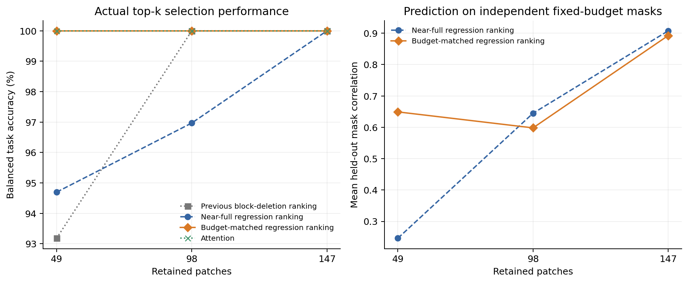

# Budget-context ranking: 36-image pipeline check

Completed 2026-10-18. Same frozen CLIP ViT-B/16/block-6 design as the [144-image main experiment](../pets-budget-ranking-v1/README.md). This subset has 36 images, 66 tasks and 132 balanced image/task examples per budget; the exchange panel has 31 images. Probe mask seed: 2031. The second-seed check changes only probe masks, not the image panel or candidate-bank randomization. It tests mask-seed sensitivity, not new-image generalization.

All task rankings use true labels offline. No selector was trained, and final test data remains unused.

| Patches | Near-full ranking | Budget-matched ranking | Near-full correlation | Budget-matched correlation |
| --- | ---: | ---: | ---: | ---: |
| 147 | 100.00% | 100.00% | 0.908 | 0.893 |
| 98 | 96.97% | 100.00% | 0.645 | 0.598 |
| 49 | 94.70% | 100.00% | 0.246 | 0.649 |

Same evidence layout as the main bundle. Keep-all matches native and saved CLIP exactly. Run source: `dee4d0c`; comparison analysis: `d413010`. Measured total wall time: 52.91 seconds on one RTX A6000; not a deployment latency measurement.

