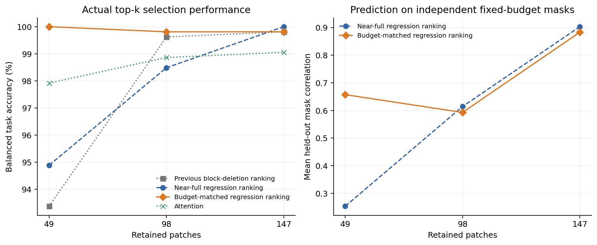

# Budget-context ranking: controlled development experiment

Completed 2026-10-18. This extends the proposal's offline ranking and supervision-generation stage after the first deletion-ranking pilot failed at 25% patch retention. See the [fixed design](../../docs/budget-ranking-pilot.md), [run record](../../docs/experiments/2026-10-18-budget-ranking.md), and [independent artifact audit](../../docs/experiments/2026-10-18-budget-ranking-audit.md).

## What changed

Both primary arms fit the same standardized additive ridge model from 512 actual CLIP evaluations per image/context. One estimates importance while retaining 192/196 patches; the other estimates it at the target budget. Both then execute their top-k selections. Another 128 independent target-budget masks assess prediction quality without choosing the selections. Model, block-6 boundary, image/task panel, fitting algorithm and probe count are fixed. Probe count is equal; runtime is not, since retained sequence lengths differ.

The main panel contains 144 validation images, 66 binary tasks and 528 balanced image/task examples per budget. Each class contributes four images where it occurs. Full CLIP accuracy on this panel is 99.05%. No final test images or test task pairs were used. The 36-image smoke panel is a subset, not an independent image replication; the second probe seed tests random-mask sensitivity on that same subset.

## Actual balanced task accuracy

The first three methods use the true label to define an offline task objective. Their scores are diagnostics, not deployable classifier performance. The attention reference does not use the true label.

| Retained patches | Previous block deletion | Near-full regression | Budget-matched regression | Attention |
| --- | ---: | ---: | ---: | ---: |
| 147 | 99.81% | 100.00% | 99.81% | 99.05% |
| 98 | 99.62% | 98.48% | 99.81% | 98.86% |
| 49 | 93.37% | 94.89% | 100.00% | 97.92% |

At 49 patches, budget matching improves on the same-algorithm near-full control by 5.11 percentage points in this balanced table. Averaging tasks within each image first gives a paired accuracy difference of +4.21 points (95% image-bootstrap CI +2.44 to +6.44). These are different weighting schemes. The corresponding geometric-margin gain is +0.04036 [0.03188, 0.04875]. All five full-model errors in these 528 examples are corrected by the label-informed ranking; that must not be read as a deployable 100% result.

At 147 patches there is no clear margin improvement over near-full estimation. Budget matching is therefore useful in this strongly compressed setting, not uniformly superior at every budget.

## Independent-mask prediction

Mean task-margin correlation, averaged within images and then across images:

| Retained patches | Near-full | Budget-matched | Paired difference, 95% image CI |
| --- | ---: | ---: | --- |
| 147 | 0.903 | 0.883 | -0.020 [-0.024, -0.016] |
| 98 | 0.614 | 0.593 | -0.021 [-0.037, -0.006] |
| 49 | 0.253 | 0.657 | +0.404 [+0.375, +0.433] |

At 49 patches both prediction and actual top-k selection improve. At 98 patches actual top-k selection improves despite slightly worse random-mask correlation and centered MSE. Predicting ordinary random subsets and choosing a high-performing optimized subset are distinct checks. Raw MSE improves at all budgets, but includes intercept shifts and cannot replace the centered/ranking metrics.



## Task specialization and the common shared reference

The exchange panel contains 124 images supporting at least two tasks with the same true class, with 868 exchange cases per budget. Its metrics average within images first and differ from the balanced table above. At 49 patches:

- Budget-matched own selection: 100.00% accuracy; exchanged selection: 99.03%.
- Exchange margin loss: 0.02101 [0.01880, 0.02325].
- Own minus shared-average ranking margin: +0.00709 [0.00600, 0.00814].
- Own minus representation-preserving ranking margin: +0.03951 [0.03633, 0.04269].
- Common shared mean-margin search: 100.00% accuracy. Own minus this reference margin remains negative: -0.02253 [-0.02461, -0.02053].

The common reference selects from the union of the previous and both new 64-slot banks (192 slots, possibly with duplicate sets). It knows the true label and both tasks and evaluates actual outcomes; it is an expanded privileged reference, not a deployable shared selector or proof of global optimality. Every arm uses the same union. Within-bank separate-task search is optimistic by construction.

Task specialization is better supported than in the first pilot, but superiority over strong shared selection remains unestablished. The exploratory H2 geometry analyses are retained in each arm's `analysis.json`; normalized-alignment results are not consistent enough to claim a settled mechanism. H3 has not yet been tested.

## Independent probe seed

On the 36-image subset, replacing mask seed 2031 with 2032 preserves the main 49-patch result: near-full accuracy 94.70% / 93.94%, budget-matched accuracy 100% / 100%; near-full correlation 0.246 / 0.243, budget-matched correlation 0.649 / 0.651. This supports sensitivity to compression context rather than one lucky mask design. It is not an independent dataset or final-test evaluation.

The [seed-stability measurements](../pets-budget-ranking-replication-v1/seed_stability.json) expose a useful follow-up: at 49 patches the two budget-matched selections overlap by 46.3% on average, while both reach 100% balanced task accuracy and their paired mean-margin difference has a confidence interval spanning zero. This is evidence of stable observed outcomes with non-unique selections on this panel, not a formal equivalence result. Exact imitation of one sampled hard mask should therefore not replace downstream performance as the selector-training success criterion.

## Proposal progress and next decision

This is a positive advance in the proposal's first experimental stage: it identifies and repairs one supervision-generation problem at strong compression. The additional insight is that the context in which token importance is estimated matters, building directly on the first pilot's 49-patch failure. The next experiment should test learnability at 49 patches: equal-capacity conditional and image-only selectors trained on the same task-target distribution, differing in access to candidate classes, with independent images and unseen class combinations for evaluation. More oracle optimization is not a prerequisite for that trial. An unknown-label selector has not been trained here.

## Saved evidence and reproduction

- `probes_k*.npz`: train masks, all 38 responses (37 class scores plus full-feature similarity), ridge coefficients/intercepts, and target-budget holdout masks/responses.
- `evidence.npz`: exact image IDs, full features/scores, text embeddings, attention scores and labels.
- `holdout_prediction_rows.csv`: paired image/task prediction diagnostics.
- `near_full/`, `budget_matched/`: every single-task/exchange outcome, selected positions, candidate banks, per-arm summaries and H2/search-depth analyses.
- `comparison.json`: shared-reference outcomes, paired contrasts and uncertainty; `budget_comparison.png/.pdf`: figure exports.
- `run_summary.json`: settings, source commit, identity checks and measured costs.

```bash
PYTHONPATH=src python3 scripts/compare_budget_ranking.py --results results/pets-budget-ranking-v1 --previous results/pets-selection-v1 --plot
PYTHONPATH=src python3 scripts/analyze_selection_pilot.py --results results/pets-budget-ranking-v1/near_full --search-depth
PYTHONPATH=src python3 scripts/analyze_selection_pilot.py --results results/pets-budget-ranking-v1/budget_matched --search-depth
```

All runs use source `dee4d0c`; comparison analysis uses `d413010`. The main run took 196.20 seconds on one RTX A6000, including loading, checks and file writing. This is not deployment latency. Per-image ridge fitting is included in supervision-generation cost; no cross-image selector training took place.
