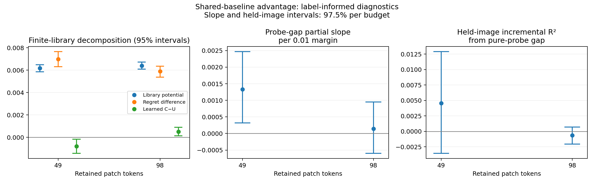

# Pets：任务专用空间与学习后收益的差距

**有限选择库中存在任务专用的 margin 空间，但它尚未成为稳定预测新图片上“条件化超过图像版多少”的指标。** 49-token 在控制难度与夹角后有正向样本内关联，98-token 的关联不明确；两个预算的留出图片预测增益区间都包含零。这轮诊断为下一步监督目标对照明确了问题，尚未给出性能差异的完整机制解释。

本轮对应 [聚焦补强方案](../../docs/conditioning-objective-followup.md) 的第一阶段，复用已有 B/16、block 6、49／98-token 的开发结果；没有重训、访问官方测试数据或选择新模型。

## 对齐的比较对象

两预算均使用相同的 **616 张图片、4,315 个同图无序任务对、三个训练种子 2041／2042／2043**。对每一任务对先平均两个任务的有符号几何 margin，再平均训练种子；统计时图片等权、图片内任务对等权，重采样以图片为单位。

这个面板和权重不同于原主分类表的 716 张图片、2,624 个图片／任务样本及任务／类别平衡权重。因此这里的条件化减图像版均值为 −0.000797／+0.000511，与原主表的 −0.000919／+0.000573 不相同，二者不是互相替换的结果。

## 有限库内的精确分解

对每张图片的两个任务，使用原先同一个增强选择库，其中包含 512 个随机探测 mask、教师、attention 及已有学习器的选择。记：

- \(O_T\)：两个任务各自选库内最优 mask 后的平均 margin；
- \(O_S\)：两个任务共同使用一个库内 mask 的最优平均 margin；
- \(C,U\)：实际条件化和图像版 selector 的平均 margin。

于是有精确恒等式：

\[
C-U=(O_T-O_S)-\big[(O_T-C)-(O_S-U)\big].
\]

| 指标 | 49 tokens | 98 tokens |
| --- | ---: | ---: |
| 库内任务专用空间 \(O_T-O_S\) | 0.006182 [0.005863, 0.006493] | 0.006406 [0.006095, 0.006726] |
| 两种学习器与对应参照的差距之差 | 0.006979 [0.006322, 0.007667] | 0.005895 [0.005385, 0.006363] |
| 实际条件化 − 图像版 \(C-U\) | −0.000797 [−0.001430, −0.000157] | +0.000511 [+0.000149, +0.000893] |

方括号为普通 95% 图片 bootstrap 区间；[完整结果](analysis.json) 同时保留两预算调整后的 97.5% 区间和逐种子结果。

两预算均有正的库内任务专用空间，但对应学习后的收益方向不同。这个表是**在同一口径下核算差距**，不是新定理，也不能凭恒等式把“额外学习误差”认定为已识别的因果原因。库内单独优化的平均 margin 不低于共享优化，本来就由优化目标保证。

这里的两个 oracle 均知道真实标签和两个任务。尤其 \(O_S\) 不等于部署时只看图片的 selector；它是一个有额外信息的离线共享参照。有限库中的最优值也不等于全部可能 token 集合上的全局最优值。

## 独立于学习器选择的 probe 诊断

增强库包含学习器自己的 mask，不能把其潜力与同一学习器收益的关系当成独立预测证据。因此预测分析只使用原先 **512 个随机 probe mask**，完全排除学习器及教师选出的额外 mask。

基线回归包含两个完整模型 margin 的对称二次项及文本方向夹角，再加入纯 probe 库的任务专用空间。预测目标是同图任务对上的实际 \(C-U\)，不是交换损失；避免把两项都含正确条件化表现的指标简单相关当成解释。该 probe 指标依然使用标签，是科研诊断量，不是无标签部署规则。

| 检验 | 49 tokens | 98 tokens |
| --- | ---: | ---: |
| 纯 probe 库平均任务专用空间 | 0.005516 | 0.003798 |
| 每增加 0.01 probe gap 的调整后收益斜率 | +0.001333 [+0.000319, +0.002470] | +0.000145 [−0.000599, +0.000948] |
| 加入 probe gap 的留出图片增量 R² | +0.004550 [−0.003559, +0.012903] | −0.000640 [−0.002059, +0.000712] |

本表区间为两预算调整后的 **97.5%** 区间。留出图片采用五折、按类别分层的固定图片划分；缩放与拟合只用训练折。R² 区间重采样固定折外预测，没有重新拟合每次 bootstrap 的模型。

49-token 的正向调整关联没有转化为本次可确立的留出图片预测增益；98-token 两者均不明确。因此，现有结果不支持“潜在任务专用空间已经足够解释条件化何时超过共享模型”。这也不是证明该空间没有价值或所有更复杂预测器都无效。

固定种子 2083 将 512 个 probe 分成两组各 256 个。两半估计的图片加权相关分别为 **0.645／0.612**，说明有限库估计并不完全稳定；两半均值差区间跨零不等于证明两种估计等效。每半仍使用同一批图片，不构成两份独立验证集。

## 核验与保存

[独立审计](scientific_audit.json)逐项核对了旧交换结果中的全部配对种子、旧共享库参照、CSV／NPZ 一致性、图片权重、均值与均值区间、恒等式和分半统计。另直接从服务器保存的原始 probe 响应及既有 49-token 补充响应重新计算三套 probe gap，最大差异小于 6×10⁻¹⁷。五折回归从原始逐例表独立重拟合，折外预测、增量 R² 及其区间均一致；完整回归系数的 bootstrap 没有重复执行。

- [49-token 逐例表](budget_49/cases.csv)／[统计](budget_49/analysis.json)
- [98-token 逐例表](budget_98/cases.csv)／[统计](budget_98/analysis.json)
- 各预算目录中的 `cases.npz` 和 `cross_fitted_predictions.npz` 保留复算数据。

对项目的推进是：把“存在更好的任务选择”和“学习后超过共享模型”分开，排除了仅凭库内潜力就声称已经解释实际收益的捷径。下一步按固定的 2×2 方案比较当前 KL 与预算感知 ranking 目标，让条件化及图像版同时使用新目标，检验监督目标是否改变二者的相对收益；这项因果干预的结果仍待完成。
