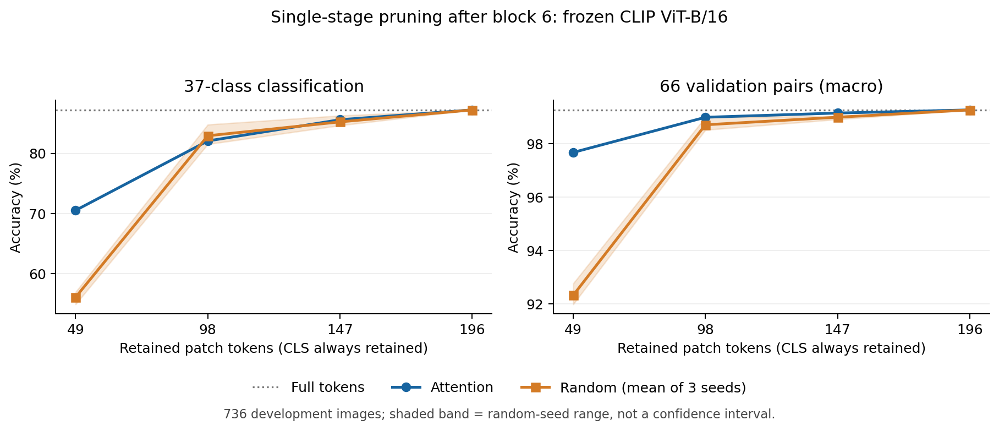

# Single-stage CLIP pruning pilot

Completed on 2026-10-16 using the [fixed pilot protocol](../../docs/pruning-pilot.md). The model is frozen CLIP ViT-B/16. Pruning occurs after block 6 of 12. All results use the same 736 development images; binary results below use the 66 validation pairs. Official test images and test pairs remain unevaluated.

## Keep-all verification

Keeping all 196 patch tokens through the actual prefix, gather and suffix path exactly reproduces both native CLIP and the saved original baseline: maximum normalized embedding and cosine-score errors are **0**, with **0 prediction disagreements** for 37-class and evaluated binary classification. See `identity.json`.

## Accuracy

Random results are means over seeds 2026/2027/2028. Parentheses give the observed seed range, not a confidence interval. CLS is retained in every setting.

| Retained patches | Attention: 37 classes | Random: 37 classes | Attention: binary macro | Random: binary macro |
| --- | ---: | ---: | ---: | ---: |
| 196 / 100% | 87.23% | 87.23% | 99.25% | 99.25% |
| 147 / 75% | 85.60% | 85.24% (84.65–86.28) | 99.14% | 98.98% (98.90–99.02) |
| 98 / 50% | 82.07% | 82.93% (81.52–84.78) | 98.98% | 98.70% (98.51–98.99) |
| 49 / 25% | 70.52% | 56.07% (54.89–56.93) | 97.66% | 92.33% (91.99–92.77) |

At 49 retained patches, attention introduces 43 binary errors on previously correct image/task examples, involving 31 distinct images and 28 tasks, and recovers 2 previous errors. The three random seeds introduce 188, 173 and 191 errors, respectively, recovering 5, 4 and 2. Both transitions are retained separately in the tables.

Of the attention baseline's 43 new errors, 33 fall in the lowest uncompressed-margin group, 7 in Q2, 3 in Q3 and 0 in Q4. Group boundaries were frozen before the pruning run. This describes where losses occur; it does not establish a task-angle effect or the value of task conditioning.

## Interpretation

- The original near-perfect binary accuracy does not eliminate measurable compression losses. Those losses become appreciable at the 25% retention setting.
- Patch selection affects performance, especially at the smallest budget. Attention does not dominate random selection in every metric: at 50% retention, its 37-class accuracy is below the random-seed mean.
- Random and attention are image-only baselines. No task-specific selection, strong jointly optimized shared ranking, cross-task exchange, or learned selector has been evaluated. These results do not establish H1, H2 or H3.
- Next, use the verified pruning interface for the planned task-specific versus strong shared-selection diagnostics. Keep the complete budget/task results and difficulty controls.

## Saved evidence

- `summary.json`: source commit, fixed configuration, definitions, complete metrics and experiment timing.
- `identity.json`: keep-all checks against native and saved baseline outputs.
- `keep_all.npz`, `attention_k*.npz`, `random_s*_k*.npz`: all 13 variants' image IDs, labels, image/text embeddings, complete class scores and retained zero-based original patch positions. Indices are stored in actual spatial order; CLS is implicit and always retained.
- `attention_scores.npz`: the 196 patch scores for each image.
- `metrics.csv`, `per_task.csv`, `margin_strata.csv`: aggregate, paired-task and fixed-difficulty-group metrics. Scores and the existing task manifests reconstruct individual image/task outcomes without duplicating them in large CSV files.
- `accuracy_by_budget.png` and `.pdf`: figure exports. Recreate with `python3 scripts/plot_pruning_pilot.py`; plotting requires NumPy and Matplotlib.

The result bundle is approximately 21.6 MB and is retained locally, on the server and in GitHub. Arrays and selection positions were checked after transfer. The pilot reused about 223 MB of prefix states in host RAM, released on exit. Its approximately 16.49-second wall time includes checks, cached-prefix evaluation and output generation; it is not an inference-speed measurement. No model training or offline supervision generation was performed.
