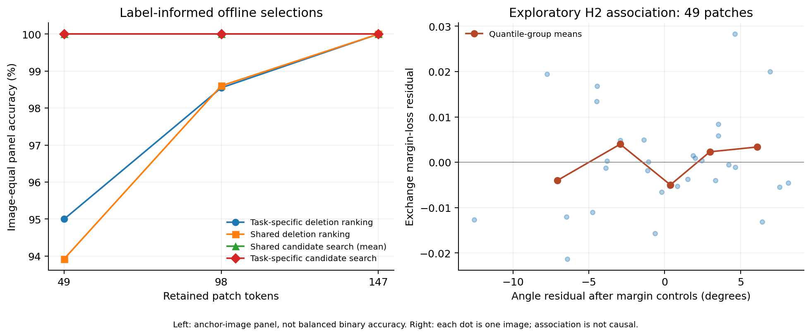

# Single-patch deletion sensitivity panel

Completed 2026-10-18. See the [fixed protocol](../../docs/selection-pilot.md) and [experiment record](../../docs/experiments/2026-10-18-selection-pilot.md).

The balanced single-task panel has 36 validation images and 66 validation tasks. Sliding deletion windows are 1 by 1. Official test images and tasks remain unused.

## Balanced single-task accuracy

Each task uses the same number of images from both candidate classes. Percentages below are task-macro averages. Task ranking uses the true label offline; attention and representation preservation do not.

| Patches | Full model | Task deletion ranking | Attention | Representation preservation |
| --- | ---: | ---: | ---: | ---: |
| 147 | 100.00% | 100.00% | 100.00% | 100.00% |
| 98 | 100.00% | 98.48% | 100.00% | 100.00% |
| 49 | 100.00% | 94.70% | 100.00% | 99.24% |

## Same-image two-task exchange

These results use only images supporting two validation tasks with a shared true class. Rows are averaged within each image, then images receive equal weight. They are not the balanced 66-task metric above.

| Patches | Images | Own task ranking | Exchanged ranking | Shared search (mean) | Exchange margin loss, 95% image CI |
| --- | ---: | ---: | ---: | ---: | --- |
| 147 | 31 | 100.00% | 99.46% | 100.00% | 0.01725 [0.01454, 0.01987] |
| 98 | 31 | 98.55% | 96.51% | 100.00% | 0.02082 [0.01735, 0.02466] |
| 49 | 31 | 95.00% | 90.33% | 100.00% | 0.01613 [0.01222, 0.02013] |

Shared search uses the true label and both tasks to choose one set from 64 evaluated candidates. It is a privileged reference, not a deployable selector or proof of global optimality. Same-bank task-specific search is an optimistic reference; its margin advantage is nonnegative by construction.

## Interpretation

- Exchanging proxy-derived task choices produces a positive average margin loss in this panel, so the proxy choices exhibit task specialization.
- The proxy choices do not establish a consistent advantage over searched shared choices. Strong compression exposes a mismatch between local deletion effects and final-budget selection performance.
- Angle predicts some exchange loss beyond full-model margins, but the exchange identity includes the difference of task directions. Consult normalized-alignment and feature-distance analyses before interpreting this as more than geometry; all H2 analyses are exploratory.
- No selector was trained. These results do not establish H3 or unseen-task generalization. Bootstrap intervals hold the current task collection fixed.



## Saved evidence

- `panel_images.csv`, `panel_tasks.csv`: exact fixed subsets.
- `deletion_evidence.npz`: window positions, deletion cosine scores, full embeddings/scores, text embeddings, attention and representation utilities.
- `candidate_bank_k*.npz`: all retained positions and scores; task A/B image embeddings; case keys index `image_ids` and record true class plus two competitors.
- `exchange_rows.csv`: every crossed/shared outcome and selected candidate indices.
- `single_task_rows.csv`, `single_task_positions.npz`: balanced task outcomes and row-aligned positions, padded with -1 beyond the retained count.
- `analysis.json`, `summary.csv`: image-clustered estimates, valid alignment summaries and exploratory H2 fits.
- `search_depth.csv`: 16/32/64 candidate diagnostics using saved scores.
- `selection_diagnostics.png/.pdf`: descriptive plots.
- `run_summary.json`: configuration, exact source commit, identity checks and computation records.

Run source: `3f3c79a80f00ebfce79316b900e8341520b5c675`; analysis source: `1948028`. Total measured run wall time: 23.33 seconds, including loading/checks, evaluation and file writes. This is not a deployment latency measurement. No training occurred.

Reanalyze from the repository root:

```bash
PYTHONPATH=src python3 scripts/analyze_selection_pilot.py --results results/pets-selection-single-patch-v1 --plot --search-depth
```
