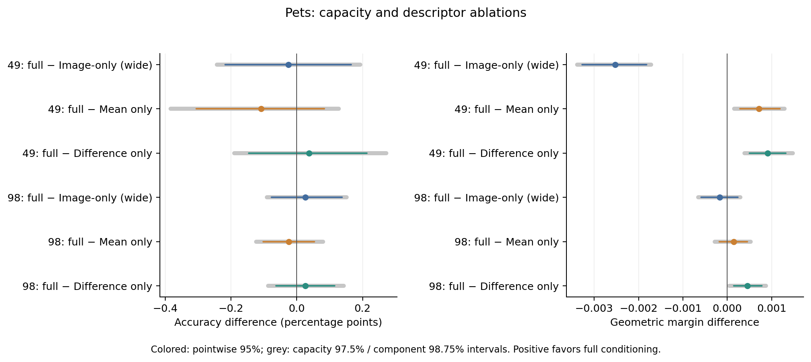
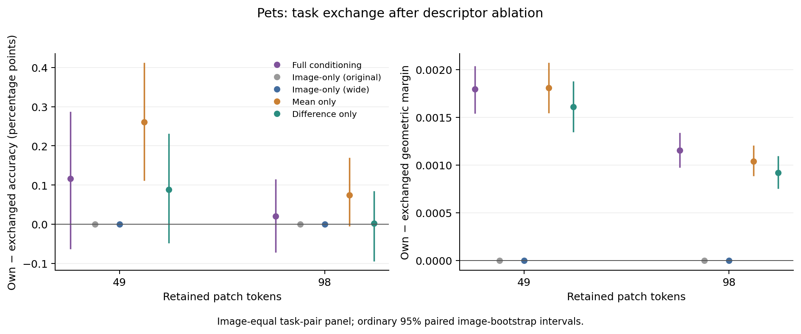

# Oxford Pets：图像版容量与任务描述成分消融

**更充分利用参数的图像版提高了分类间隔，原先 98-token 的条件化间隔领先没有超过这个新对照；与此同时，49-token 下完整任务描述优于只保留任一成分。** 两项结果把“条件信息对模型有用”和“条件化优于图像模型”区分得更清楚。

## 设置

冻结 CLIP ViT-B/16，在 block 6 后保留 49／98 个 patch。复用原 KL 教师与已有完整条件化、原图像版权重；新训练加宽图像版、仅均值、仅绝对差异三个变体，各保留 2041／2042／2043 三个种子，共 18 个新模型。每个模型使用全部 2,944 张训练图片、相同采样规则和 3,990 次更新。

加宽图像版去掉固定文本分支，宽度为 199，共 347,399 个参数；其余四种网络宽度为 128，共 348,033 个参数。成分消融将移除的 512 维半块替换为训练类别对的均值，保留原网络结构。完整方案见[预先固定的实验协议](../../docs/selector-component-ablations.md)。

分类评估包含 716 张开发图片、66 个未见类别组合、2,624 个图片／任务样本。先平均三个种子的逐例指标，再按任务等权、任务内类别等权汇总。图片区间使用 2,000 次配对 bootstrap，seed 2091。容量比较按两个预算调整，单项区间为 97.5%；成分比较按两成分 × 两预算调整，单项区间为 98.75%。预留测试未使用。

## 五种方法的分类表现

| 方法 | 49-token 准确率（%） | 49-token margin | 98-token 准确率（%） | 98-token margin |
| --- | ---: | ---: | ---: | ---: |
| 完整条件化 | 98.9919 | 0.114693 | 99.1481 | 0.125901 |
| 原图像版 | 98.9906 | 0.115612 | 99.1089 | 0.125328 |
| 加宽图像版 | 99.0171 | 0.117217 | 99.1221 | 0.126074 |
| 仅均值 | 99.1009 | 0.113979 | 99.1726 | 0.125752 |
| 仅差异 | 98.9540 | 0.113785 | 99.1215 | 0.125450 |

下表均为**完整条件化减对应对照**；正值表示完整条件化更好。准确率差使用百分点，margin 使用归一化几何间隔。

| 预算／对照 | margin 差 [调整区间] | 准确率差 [调整区间，百分点] |
| --- | --- | --- |
| 49／加宽图像版 | −0.002524 [−0.003385, −0.001714] | −0.0253 [−0.2435, +0.1925] |
| 49／仅均值 | +0.000714 [+0.000152, +0.001290] | −0.1090 [−0.3839, +0.1279] |
| 49／仅差异 | +0.000908 [+0.000383, +0.001474] | +0.0379 [−0.1900, +0.2721] |
| 98／加宽图像版 | −0.000173 [−0.000652, +0.000295] | +0.0259 [−0.0912, +0.1510] |
| 98／仅均值 | +0.000148 [−0.000285, +0.000529] | −0.0246 [−0.1231, +0.0801] |
| 98／仅差异 | +0.000451 [+0.000043, +0.000872] | +0.0266 [−0.0869, +0.1429] |

加宽图像版相对原图像版的 margin 提升为 49-token 的 +0.001605、98-token 的 +0.000746，辅助 95% 区间均为正。原先 98-token 的“完整条件化减原图像版”是 +0.000573；改用加宽对照后变为 −0.000173，差异不明确。49-token 则是加宽图像版明确领先。六项主准确率差的调整区间均包含零。

成分消融提供了另一项具体认识：49-token 下，保留两部分描述比仅均值、仅差异都保留了更大的分类间隔；98-token 下，完整描述优于仅差异，而相对仅均值的差异不明确。这三项正 margin 效应的逐种子方向均一致。

## 任务交换：两种单一成分仍能学到有用的任务依赖

固定同一图片及实际分类任务，交换 selector 接收的候选类别组合。两预算、全部变体共用 616 张图片、4,315 对任务；先平均同图任务对和三个种子，再使图片等权。这与上述任务／类别平衡的分类表分开汇总。

| 预算／任务输入 | 正确 − 交换描述 margin [95% 区间] | 正确 − 交换描述准确率（百分点） |
| --- | --- | ---: |
| 49／完整描述 | +0.001795 [+0.001545, +0.002029] | +0.1165 |
| 49／仅均值 | +0.001809 [+0.001550, +0.002064] | +0.2609 |
| 49／仅差异 | +0.001610 [+0.001353, +0.001870] | +0.0883 |
| 98／完整描述 | +0.001154 [+0.000980, +0.001330] | +0.0207 |
| 98／仅均值 | +0.001036 [+0.000891, +0.001198] | +0.0749 |
| 98／仅差异 | +0.000918 [+0.000761, +0.001085] | +0.0027 |

完整描述和两个单一成分在两预算下都得到正向交换 margin 效应。98-token 的完整描述交换效应比仅差异大 +0.000236，配对 95% 区间 [+0.000067, +0.000411]；其余完整描述减单一成分的交换效应差异不明确。两种图像版的选择和类别得分均不随任务改变，交换效应严格为零。

因此，明确输入“绝对差异”并非产生任务依赖的唯一方式：仅均值也能学到有用的任务选择。结合主分类表，49-token 的完整描述改善了相对单一成分的绝对 margin，但更大的任务交换效应并不自动对应更强的分类表现。

## 证据与 proposal 的推进

本轮补足 H3 的基线强度比较，并通过描述成分连接 H2 的任务几何分析。基线补强修正了此前 Pets98 小幅领先的解释；成分消融则确定了完整描述在哪些预算下带来额外 margin 收益。

原始数值、全部种子及区间在 [analysis.json](analysis.json)；[49-token](budget_49/) 与 [98-token](budget_98/) 中保留分类与交换逐例 CSV／NPZ。[训练与执行记录](execution/)包含采样、训练曲线、最终训练／验证 KL 和推理记录。分类使用 seed 2091，交换使用 seed 2092 的 2,000 次图片 bootstrap。独立[数值审计](scientific_audit.json)通过；两张图均生成 PNG／PDF 并完成视觉检查。
