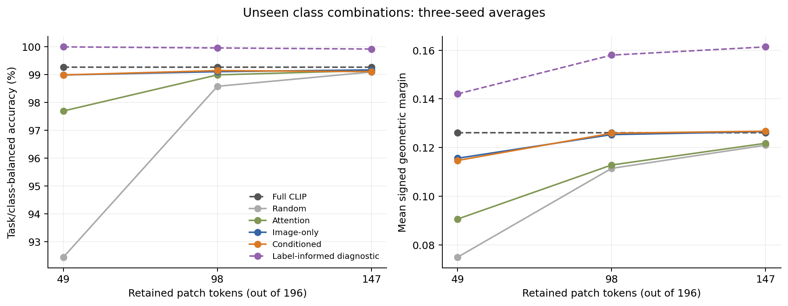
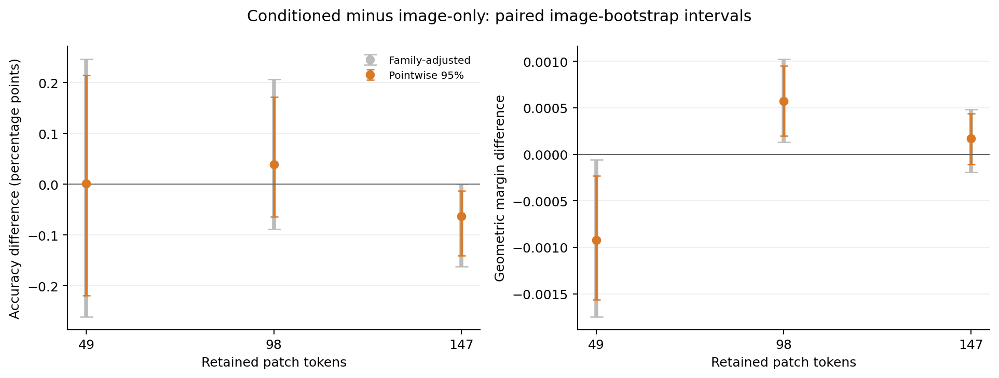
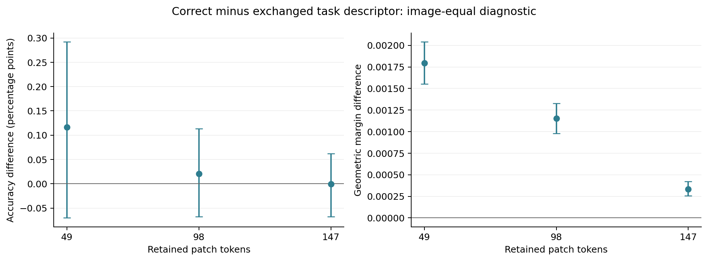
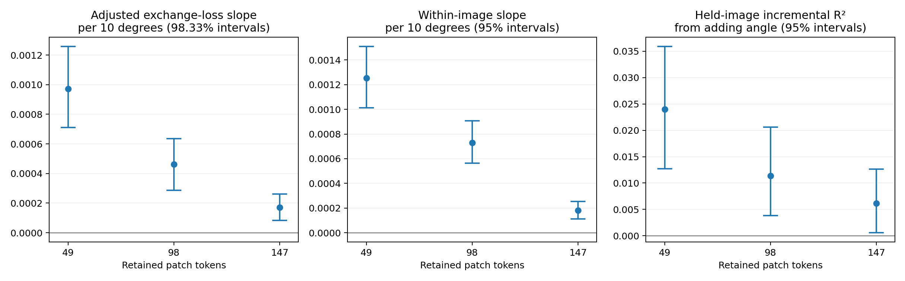

# 49／98／147 token：条件化收益与任务几何

**本轮得到两项明确进展：条件化的分类间隔收益随预算改变；控制原始任务难度后，文本分隔方向夹角仍能预测交换选择造成的损失。** 98-token 条件化版的平均间隔优于同容量图像版，49-token 则相反，147-token 尚不确定。三个预算都没有建立经过多重比较调整的准确率优势。因此，当前证据更适合支持“条件化何时有用”，而不是“条件化普遍更好”。

本轮完成 proposal 的三预算比较与 H2 主分析，并补齐强共享离线参考。方案在新增 98／147-token 结果产生前固定，49-token 的既有结果已经知道。见 [实验协议](../../docs/selector-budgets-h2.md) 与 [执行记录](../../docs/experiments/2026-10-27-selector-budgets-h2.md)。

## 比较条件

- 冻结 CLIP ViT-B/16，在 block 6 后分别保留 49、98、147 个 patch，CLS 始终保留；原图共有 196 个 patch。
- 使用全部 2,944 张训练图、532 个训练类别组合。同为 348,033 参数、hidden width 128 的条件化／图像版 selector，均采用 KL 软重要性监督、temperature 1、AdamW、学习率 0.0003、weight decay 0.01。
- 每次训练固定 3,990 次更新、batch size 128，三个种子为 2041、2042、2043；各预算共享任务、类别和图片采样序列，使用最终步权重。98／147 分别生成自己的 512-mask ridge 监督（ridge 0.01），各训练六个模型；49 复用之前完整覆盖的六个模型。共比较 18 个权重，本轮新增训练 12 个。
- 随机基线使用 2055、2056、2057 三个独立 seed；每张图片的排序在预算间相同，保留集合严格嵌套。其结果先在三个随机 seed 间平均。

736 张开发图全部进入评估。主要未见组合结果覆盖 **66 个类别组合、716 张可用图、2,624 个图片／任务样本**；已见组合覆盖 532 个组合、736 张图、21,162 个样本。这里的泛化是“已知类别的新组合”，不是新类别。最终 3,669 张测试图片及 68 个测试组合未使用。

## 主要结果：未见类别组合

每个任务等权，任务内两个类别各占一半，类别内部图片等权；学习模型先平均三个固定训练种子。间隔为正确类别与竞争类别的余弦分数差，除以两类别文本向量差的范数。

| 选择方式 | 49 tokens：准确率 / 间隔 | 98 tokens：准确率 / 间隔 | 147 tokens：准确率 / 间隔 |
| --- | ---: | ---: | ---: |
| 未剪枝 CLIP | 99.2644% / 0.126042 | 99.2644% / 0.126042 | 99.2644% / 0.126042 |
| 随机选择（三个 mask seed） | 92.4375% / 0.074961 | 98.5825% / 0.111462 | 99.0969% / 0.120990 |
| Attention | 97.6954% / 0.090628 | 98.9932% / 0.112841 | 99.1507% / 0.121771 |
| 图像版 selector | 98.9906% / 0.115612 | 99.1089% / 0.125328 | 99.1733% / 0.126570 |
| 条件化 selector | 98.9919% / 0.114693 | 99.1481% / 0.125901 | 99.1102% / 0.126743 |
| 使用标签的离线教师 | 100.0000% / 0.142052 | 99.9621% / 0.158005 | 99.9222% / 0.161374 |

未剪枝 CLIP 是同一条 196-patch 参考线，在三个预算列中重复展示。离线教师读取真实标签，用于观察潜在保留能力；它不是部署时可用的预测器。

| 保留 token | 条件化 − 图像版 | 均值 | 95% 区间 | 三预算调整后区间（98.333%） |
| --- | --- | ---: | ---: | ---: |
| 49 | 准确率（百分点） | +0.0013 | [-0.2186, +0.2141] | [-0.2603, +0.2464] |
| 49 | 分类间隔 | -0.000919 | [-0.001564, -0.000228] | [-0.001744, -0.000058] |
| 98 | 准确率（百分点） | +0.0392 | [-0.0636, +0.1720] | [-0.0882, +0.2063] |
| 98 | 分类间隔 | +0.000573 | [+0.000201, +0.000950] | [+0.000135, +0.001027] |
| 147 | 准确率（百分点） | -0.0631 | [-0.1407, -0.0125] | [-0.1617, +0.0000] |
| 147 | 分类间隔 | +0.000173 | [-0.000106, +0.000439] | [-0.000188, +0.000483] |

95% 区间来自 2,000 次配对图片聚类 bootstrap（seed 2052）。先平均训练种子，再重采样图片的加权分子／分母。98.333% 区间对每个指标的三个预算分别作 Bonferroni 调整；它不同时覆盖所有指标及后续探索。区间以当前任务和三个训练种子为条件。全部逐种子、已见组合和修复／新增错误结果见 [analysis.json](analysis.json)。

98-token 的间隔收益在三个 seed 中分别为 +0.000252、+0.000591、+0.000876，方向一致；准确率差则为 −0.0399、+0.0040、+0.1535 个百分点。49-token 的平均间隔差为负，147-token 的间隔区间跨零。147-token 准确率差的普通 95% 区间低于零，但三预算调整后的上界恰好为零，因此不把它写成通过本轮多重比较标准的下降。

98 相对 49 的“条件化 − 图像版”间隔差增加 0.001492，辅助 95% 区间 [0.000755, 0.002252]。这说明只看 49-token 会漏掉预算依赖；三个离散预算还不足以确定最优保留比例，也不能只保留 98-token 的正结果。





## 交换任务描述：模型确实学到了有用的任务依赖

在同一张图上保留实际分类任务，交换 selector 接收的另一个有效候选类别组合。使用 **616 张支持交换的图片、每个 seed 4,315 对任务**；先平均固定种子和图片内任务对，再使图片等权。它与上面的任务／类别平衡指标是不同的统计对象。

| 保留 token | 正确描述 − 交换描述：间隔（95% 区间） | 准确率差：百分点（95% 区间） | 两选择集合重合率 |
| --- | ---: | ---: | ---: |
| 49 | +0.001795 [+0.001552, +0.002042] | +0.1165 [-0.0703, +0.2923] | 76.54% |
| 98 | +0.001154 [+0.000978, +0.001328] | +0.0207 [-0.0677, +0.1137] | 86.44% |
| 147 | +0.000335 [+0.000255, +0.000421] | -0.0009 [-0.0676, +0.0622] | 91.37% |

三个预算的正确描述都比交换描述保留了更大的平均分类间隔，但交换造成的准确率变化均不明确。预算增加时，选择集合更接近，间隔交换效应也变小；这仍不等价于条件化超过图像版。图像版在交换任务描述后特征完全相同，交换效应严格为零。详情见 [exchange_analysis.json](exchange_analysis.json)。



## H2：夹角在任务难度之外仍有预测作用

对上述同一交换面板，先在每个图片／任务对内平均三个 seed 的交换损失。难度控制包含两个未压缩有符号间隔的较小值、较大值、各自平方及乘积，再加入每 10° 一个单位的夹角项。每张图片总权重相同；bootstrap 重采样整张图片（2,000 次，seed 2061）。

| 保留 token | 每增加 10° 的调整后交换损失斜率 | 三预算调整后区间（98.333%） | 留出图片预测的 ΔR²（95% 区间） |
| --- | ---: | ---: | ---: |
| 49 | +0.000971 | [+0.000711, +0.001258] | +0.0240 [+0.0127, +0.0359] |
| 98 | +0.000462 | [+0.000286, +0.000634] | +0.0114 [+0.0038, +0.0206] |
| 147 | +0.000171 | [+0.000083, +0.000261] | +0.0062 [+0.0006, +0.0126] |

三个预算的调整后斜率都为正，并通过三预算区间标准；九个逐种子斜率也均为正。加入图片固定效应后，斜率分别为 +0.001255、+0.000731、+0.000180，普通 95% 区间仍高于零。这支持 H2 在当前开发面板中的**条件关联**。

五折预测按图片划分，所有预处理和回归系数仅在训练折拟合。加上夹角后，留出图片的 ΔR² 约为 0.0240、0.0114、0.0062：方向稳定，但额外预测信息有限。该评估仍使用固定的开发任务集合；其区间重采样已得到的折外预测，未重新拟合每次 bootstrap 中的模型。完整结果见 [geometry/analysis.json](geometry/analysis.json)。

### 数学分解与进一步解释

令 `u_A`、`u_B` 为两个任务朝向正确类别的单位文本分隔方向，`z_A`、`z_B` 为对应选择产生的归一化 512 维图像特征。对称交换损失满足：

```text
L = 0.5 (z_A − z_B) · (u_A − u_B)
  = ||z_A − z_B|| sin(θ/2) cos(φ).
```

因此，夹角与交换损失之间本来就含有一个代数因子。这个恒等式帮助区分特征变化的大小、任务夹角和变化方向的对齐程度；恒等式本身不是新机制。

进一步将 `cos(φ)` 作为探索性结果，控制同样的难度变量后，它随夹角的斜率在三个预算中仍为正，分别为 +0.012743、+0.007772、+0.005252／10°，普通 95% 区间均高于零；图片固定效应分析方向一致。两个预定的小位移阈值均未排除样本。这里的对齐来自三个 seed 的平均特征位移，用于解释平均损失，不代表部署时使用了模型集成。这提示原始关联不只是显式的 `sin(θ/2)` 尺度变化，但还不能据此确定内部机制或给出因果解释。



## 强共享离线参考：潜在收益与可学到的收益分开看

对每张交换图片及两个任务，构造同一个 **524 条目候选库**：512 个预算匹配的探测 mask、两个任务教师选择、attention、三个图像版选择，以及三个 seed 各自针对两个任务的六个条件化选择。条目可能重复。所有候选都有实际测得的类别分数；分别搜索每个任务，或寻找使两任务平均间隔最大的一个共享选择，使用的是完全相同的库。

两种搜索都知道真实标签和两个任务，属于有额外信息的离线诊断。分别搜索在优化的平均间隔上不劣于共享搜索是定义直接保证的，因此正差值本身不构成学习方法的贡献。

| 保留 token | 分别搜索 − 共享搜索：间隔（95% 区间） | 离线教师 − 共享搜索：间隔（95% 区间） | 库内存在同时答对两任务的共享选择 |
| --- | ---: | ---: | ---: |
| 49 | +0.006182 [+0.005866, +0.006481] | -0.004338 [-0.005225, -0.003445] | 99.9459% |
| 98 | +0.006406 [+0.006066, +0.006719] | +0.001673 [+0.000779, +0.002564] | 99.9459% |
| 147 | +0.006893 [+0.006607, +0.007181] | +0.005527 [+0.004926, +0.006092] | 99.8918% |

最后一列是图片等权、图片内任务对等权的可行性比例。它接近 100%，说明在当前库中，单个共享选择通常已足以同时答对这两个任务；任务专用选择更多体现在间隔优化，并非普遍承担“没有它就会答错”的作用。最大平均间隔的共享选择不一定是同时答对两任务的那个选择，所以这里将目标最优值与分类可行性分开报告。

49-token 原有 144 张开发图缺失的原始探测响应已单独补回，重新拟合的 ridge 系数及截距与旧缓存误差均为零；原有教师与预测没有改写。三个预算的搜索库因此具有相同的构成和完整响应。新库不同于早期 192 候选 pilot，不能直接把两次离线差值当作同一指标的变化。结果见 [49](shared/budget_49/summary.json)、[98](shared/budget_98/summary.json)、[147](shared/budget_147/summary.json)。

## 成本、核验与证据

单张 RTX A6000。新增预算准备、12 次训练、实际 CLIP 评估及 49-token 随机补充评估的阶段进程时间合计 **1,574.26 秒**；共享诊断另外 **27.69 秒**，总计 **1,601.95 秒，约 0.445 单卡小时的阶段占用估计**。这些时间含阶段内 CPU/I/O，部分共享搜索完全在 CPU 上执行，不能视为纯 GPU kernel 小时或部署延迟；外部传输、归档及独立 CPU 统计分析另计。49-token 已有训练／评估和不依赖预算的冻结前缀成本未重复计入。

- [准备与训练核验](preparation_training_audit.json)：98／147 的全部监督均按新预算生成，冻结前缀和完整特征正确复用；独立重建 mask 与采样序列，抽样重新求解 ridge 系数／截距，12 个最终权重均可加载且更新数相同。
- [评估核验](evaluation_audit.json)：全部 856,296 行的图片、任务、分数、位置及 CSV 对齐通过；三预算完整 CLIP 分数与基线精确一致。独立重算主效应及区间的最大差异在浮点误差内。三个随机 seed 的排序可精确重建，49 ⊂ 98 ⊂ 147，候选类别顺序不变性测试通过。
- 几何分析使用完整 512 维特征；恒等式最大误差小于 9×10⁻¹⁷，图像版特征交换差为零。三预算回归均满秩，2,000 次 bootstrap 中没有降秩拟合。

本目录保存汇总统计、图表、交换样本、几何数据和执行记录。较大文件保存为本地 `../artifacts/pets-selector-budgets-v1/`（相对于仓库根目录）中的 **5 个 ZIP，合计 2,569,188,841 字节，约 2.393 GiB**，并已上传 [GitHub Release `pets-selector-budgets-v1`](https://github.com/NathanTong0921/ViT-token-compression/releases/tag/pets-selector-budgets-v1)；服务器保留原始目录。复用的 49-token 基础监督、权重和预测沿用 [上一轮归档](../pets-selector-scale-v1/README.md)。可重算的冻结前缀只保留在服务器，需要重训时可由公开数据、固定模型和已保存划分重新生成。

五个 ZIP 都通过与 GitHub 上传内容的匹配检查及完整解压／加载验证；其中 98-token 监督 ZIP 另外实际从 GitHub 重新下载并核对，其余四个从本地长期归档恢复。恢复后 12 个新模型均可在 CPU 加载并前向，98／147 的主要表格及区间独立重算一致。两个额外的重复下载因传输停滞取消，下载与恢复临时文件已清理，长期归档完整保留。见 [资产记录](release_assets.json) 与 [恢复核验](github_recovery_verification.json)。

## 对 proposal 的推进与下一步

| 研究目标 | 本轮证据 | 目前的判断 |
| --- | --- | --- |
| H1：改变候选类别会改变有用的 token 选择 | 同图交换在三个预算中均损失平均间隔；共同候选库揭示专用与共享选择的差别 | 支持任务依赖，但共享选择通常也能同时分类正确，尚不能宣称专用选择普遍必要 |
| H2：夹角在原始难度之外预测交换损失 | 三预算调整后斜率、图片固定效应和留出图片预测方向一致 | 获得开发集支持；解释力有限，机制解释仍属探索 |
| H3：轻量 selector 学到优势并推广至未见组合 | 98-token 间隔优势跨三个 seed 为正；49 为负，147 不明确；准确率优势未建立 | 获得预算相关的部分支持，尚未形成普遍性能领先 |

本轮对项目目标是正面的：它增加了具体的适用条件与 H2 证据，也保留了不支持普遍改进的结果。下一步完成 **Flowers102 与 ViT-L/14 的定向验证**，检验预算依赖和几何关联能否复现；同时进行包含 selector、排序、索引和分支开销的实际推理计时。先固定这些验证方案，再将最终测试集用于确认。后续可以据本轮结果研究监督目标与有效判别信息之间的差别，单独定义新的受控实验，并继续完整报告全部预算和 seed。
