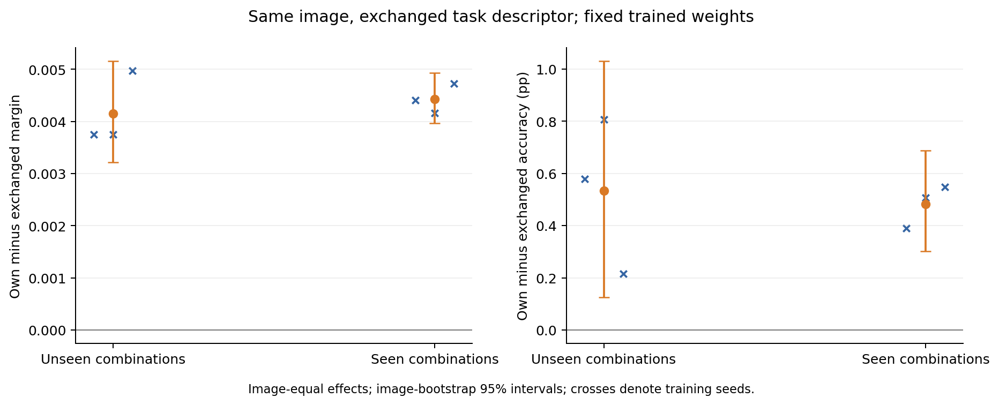

# Fixed learned-selector task exchange

The learned selector uses candidate-class information usefully: with weights, image, pruning location and token count fixed, the correct descriptor outperforms another valid task descriptor for the same image. This result extends the offline exchange study to the trained models. It does not establish a reliable advantage over the separately trained image-only selector.

## Design

Use the six final checkpoints from the [paired selector pilot](../pets-selector-pilot-v1/README.md): frozen CLIP ViT-B/16, pruning after block 6, 49/196 patches, seeds 2041–2043. For tasks A and B sharing the image's true class, evaluate both selected sets on both tasks. Only the selector's descriptor changes; classification is scored on the original task in each direction. No new training or outcome-based task selection is performed.

The primary panel contains 124 development images, 868 unordered image/task pairs per seed and 2,604 case rows across three seeds. Each row has two directed contrasts. The secondary seen-combination panel contains 144 images and 53,904 pairs per seed. These repeated pairs and seeds do not increase the number of independent images.

Average pairs and seeds within images, then weight images equally. Intervals resample images 2,000 times, conditional on these task collections and checkpoints. The exchange panel is a shared-anchor diagnostic, distinct from the original balanced binary benchmark. Official test images and test pairs are unused. The [protocol](../../docs/selector-exchange-pilot.md) was fixed before inspecting crossed outcomes.

## Primary result: unseen combinations

| Comparison | Margin difference | 95% interval | Accuracy difference (percentage points) | 95% interval |
| --- | ---: | --- | ---: | --- |
| Correct minus exchanged descriptor | +0.004155 | [0.003219, 0.005160] | +0.533 | [0.125, 1.030] |
| Correct descriptor minus image-only | -0.001148 | [-0.002397, 0.000059] | +0.484 | [-0.027, 1.075] |
| Image-only descriptor exchange | 0 | [0, 0] | 0 | [0, 0] |

Correct-descriptor, exchanged-descriptor and image-only accuracy on this panel are 98.938%, 98.405% and 98.454%, respectively. Do not substitute these for the balanced benchmark's 99.116%, 98.737% conditioned/image-only accuracies: the eligible images, repeated-task weights and estimand differ.

| Training seed | Correct minus exchanged margin | Accuracy difference (percentage points) |
| --- | ---: | ---: |
| 2041 | +0.003746 | +0.578 |
| 2042 | +0.003746 | +0.806 |
| 2043 | +0.004974 | +0.215 |

All three margin intervals exclude zero; only seed 2042's accuracy interval individually excludes zero. After averaging pairs and seeds, 102/124 images have positive margin effects. The two descriptor-specific selections overlap by 72.6% on average, where overlap is intersection size divided by 49. Changed positions alone are not the evidence of benefit; the paired classification outcomes provide that evidence.

Restricting both tasks to the same pre-existing full-model margin band leaves 108 images and 265 pairs per seed. The margin effect is +0.003340 [0.002345, 0.004361] and accuracy effect is +0.787 percentage points [0.236, 1.528]. This is a coarse difficulty restriction, not exact margin matching. The original pruning experiment's boundaries are reused, without adjusting them to current outcomes.

The secondary seen-combination panel also has positive exchange effects: margin +0.004430 [0.003962, 0.004931], accuracy +0.482 percentage points [0.303, 0.687]. Seen/unseen differences are descriptive because task composition differs.



## Difficulty and changed cases

Each directed contrast is assigned by the evaluated task's own uncompressed margin. On the unseen panel, the correct-descriptor margin advantage is positive in all four reference bands. Accuracy gains concentrate in the lowest-margin band; higher bands have few errors. This does not imply that only difficult tasks benefit in margin.

Separately, the original balanced unseen benchmark's conditioned-versus-image-only transitions are:

| Seed | Errors repaired | New errors | Net correct examples |
| --- | ---: | ---: | ---: |
| 2041 | 3 | 1 | +2 |
| 2042 | 4 | 2 | +2 |
| 2043 | 2 | 0 | +2 |

These events involve seven distinct image/task cases. No case is repaired in all three seeds, and one case reverses direction across seeds. All nine repair events are in the lowest reference margin band; the three new-error events include two in that band and one in the third. Full records, including unfavorable changes, are in [changed_cases.csv](error_analysis/changed_cases.csv). These small-count diagnostics suggest where to investigate; they do not establish a stable difficult-task advantage over image-only.

## Meaning for the proposal

The result connects H1's task-dependent selections to H3's learned models: task information is useful within the trained selector on unseen combinations of known classes. It strengthens the evidence beyond the previous small conditioned-versus-image-only accuracy difference. Whether conditioning reliably outperforms a strong shared selector remains open. The positive within-model exchange effect and uncertain between-model advantage are compatible.

H2 is not resolved here. The geometric angle/exchange relation has an algebraic component, and saved scores against 37 texts cannot recover the norm of the full 512-dimensional feature displacement. This analysis makes no new normalized mechanism claim. The next controlled training study should investigate the earlier teacher-imitation generalization gap by varying distinct training-image coverage while controlling optimizer-step budget.

## Evidence and reproduction

- `exchange_cases.npz`: all 164,316 cases, source row references, four conditioned and four image-only outcomes, full-model margins, task geometry and overlap.
- `unseen_exchange_cases.csv`: readable primary case table.
- `analysis.json`: image-equal estimates, intervals, per-seed results, difficulty strata and same-band sensitivity.
- `error_analysis/`: original benchmark transitions, strata and seed patterns; a separate estimand from exchange.
- `replay/`: independent GPU rerun of selected existing predictions, not an independent statistical replication.
- `run_record.json`: source version, commands and measured analysis time.
- `raw_audit.json`: independent reconstruction checks.

The earlier evaluation retained all 37 class scores under every descriptor. The CLIP suffix receives no task descriptor after token selection, so crossed outcomes can be reconstructed exactly from those scores. A predetermined eight-image GPU replay across all seeds and both arms reproduced positions, logits, all-class scores and crossed predictions exactly. All 55 server tests passed. An independent audit reconstructed every saved case from the parent predictions and reproduced the image-bootstrap statistics.

CPU exchange and error analyses took 2.624 s and 0.379 s. The GPU replay took 4.693 s including loading and checks, with 96 logical examples and 384 fixed-batch physical examples. These are re-analysis/replay costs, not new training or deployment latency. Approximately 3.9 MB of additional scientific evidence is retained in ordinary Git; the previous release already contains the reused weights and training supervision.

From the repository root:

```bash
PYTHONPATH=src python3 scripts/analyze_selector_exchange.py --config configs/pets_selector_exchange.json --output results/pets-selector-exchange-v1 --plot --unseen-csv
PYTHONPATH=src python3 scripts/analyze_selector_errors.py --source results/pets-selector-pilot-v1 --pruning-summary results/pets-pruning-v1/summary.json --output results/pets-selector-exchange-v1/error_analysis
```

The recorded analysis version is `171db3c`; the GPU replay ran at `b38e13f`, and the fixed protocol was committed at `b4d2390`. Regeneration records the current version in its output, so provenance fields may differ when rerun from the completed milestone.
