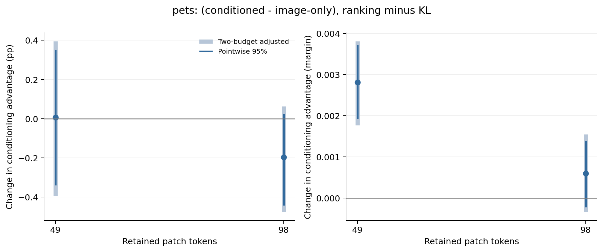

# Oxford Pets：任务信息 × 监督目标

**49-token 下，换用 top-k 边界排序监督后，条件化的分类间隔优势由负转正；准确率优势仍不明确。98-token 没有同样明确的交互收益。** 这说明原有 KL 结果不足以代表任务条件化在其他训练目标下的表现，也不能据此把 ranking 称为普遍更好的方法。Flowers 的同方案验证见[对应结果](../flowers-selector-objectives-v1/README.md)。

## 比较范围

按照[固定方案](../../docs/conditioning-objective-followup.md)，保留原有 KL 最终权重，新增 ranking 条件化版与图像版。两种监督均使用原有 ridge teacher；ranking 训练 teacher top-k 边界两侧的严格排序关系，边界相等的 token 对称处理，相等效用的 pair 不参与损失。它没有直接优化剪枝后 CLIP 的分类损失。

- 冻结 CLIP ViT-B/16，在 block 6 后保留 49 或 98／196 个 patch；同一 348,033 参数 selector。
- 使用全部 2,944 张训练图，3,990 次更新，batch 128；学习率、权重衰减、配对初始化与采样流均与 KL 相同。
- 三个固定种子 2041／2042／2043；每预算新增六次训练，均使用最终步权重。
- 未见验证组合：716 张图片、66 个二分类任务、2,624 个图片／任务样本。这里的泛化指已知类别的未见组合；预留测试未使用。

主效应为 `[(条件化−图像版)_ranking − (条件化−图像版)_KL]`。逐图片／任务／种子配对，先平均三个种子，沿用任务等权、任务内类别等权的主统计权重。图片聚类 bootstrap 为 2,000 次、seed 2085。以下主效应区间为每个指标分别对两预算调整后的 97.5% 区间；不表示所有指标共同校正。辅助对比的普通 95% 区间及逐种子值完整保留在 [analysis.json](analysis.json)。推断以这些固定任务与训练种子为条件。

## 主结果

| 保留 token | KL：条件化−图像版间隔 | Ranking：条件化−图像版间隔 | 间隔交互效应与调整区间 |
| --- | ---: | ---: | ---: |
| 49 | −0.000919 | +0.001893 | **+0.002812 [+0.001771, +0.003808]** |
| 98 | +0.000573 | +0.001171 | +0.000598 [−0.000338, +0.001550] |

| 保留 token | KL：条件化−图像版准确率（百分点） | Ranking：条件化−图像版准确率（百分点） | 准确率交互效应与调整区间（百分点） |
| --- | ---: | ---: | ---: |
| 49 | +0.0013 | +0.0080 | +0.0066 [−0.3932, +0.3954] |
| 98 | +0.0392 | −0.1575 | −0.1967 [−0.4753, +0.0631] |

49-token 的三个间隔交互分别为 +0.003605、+0.002200、+0.002631，方向一致。它来自条件化版更换监督后的间隔增加 +0.002336，以及图像版的 −0.000476；不是两种 selector 同幅改善。准确率接近 99%，当前面板未确认额外的准确率收益。

98-token 中，两种 selector 更换监督后间隔都下降，分别为条件化版 −0.001185、图像版 −0.001783。因此，较小的正交互点估计不代表 ranking 提高了绝对分类表现。

浅色为两预算调整区间，深色为普通 95% 区间。四种条件的绝对表现见 [performance 图](objective_performance.png)；该图展示点估计，配对不确定性以上面的交互分析为准。

## 共同 teacher 诊断

所有条件用同一预算的 teacher 重新评分。Overlap 是选中集合与 teacher top-k 的重合比例；utility regret 是 teacher 的加性效用差，不能替代实际 CLIP 分类效用。

| Token | 监督／selector | 验证 teacher KL | Top-k overlap（%） | Utility regret |
| --- | --- | ---: | ---: | ---: |
| 49 | KL／条件化 | 0.4995 | 44.1004 | 0.147004 |
| 49 | KL／图像版 | 0.5506 | 44.7835 | 0.144439 |
| 49 | Ranking／条件化 | 1.0796 | 42.4660 | 0.151452 |
| 49 | Ranking／图像版 | 1.2124 | 42.1400 | 0.153856 |
| 98 | KL／条件化 | 0.9659 | 55.1317 | 0.106898 |
| 98 | KL／图像版 | 0.9748 | 55.0221 | 0.107313 |
| 98 | Ranking／条件化 | 1.6830 | 54.1168 | 0.110923 |
| 98 | Ranking／图像版 | 1.6583 | 53.7466 | 0.112474 |

Ranking 的绝对 overlap 在两个预算、两个 selector 中都低于 KL。但在 49-token，条件化相对图像版的 overlap 差由 −0.6831 转为 +0.3260 个百分点，交互为 +1.0092 个百分点，95% 区间 [+0.7411, +1.2962]；utility regret 差也由 +0.002566 转为 −0.002404。这个相对变化与实际分类间隔的反转一致，但不构成“ranking 更好地模仿 teacher”的普遍证据，也没有单独识别唯一原因。

初始八个 minibatch 上，ranking／KL 梯度 L2 比值为 49-token 的 0.117–0.126、98-token 的 0.135–0.137；同预算两种 selector 的尺度接近。没有重缩放损失或调整学习率。因此，本研究检验的是固定训练方案下更换目标的效果，不是两个目标各自充分调参后的最优比较。所有 ranking 训练损失都下降；98-token 的验证 ranking 损失却由约 0.694 升至 0.802–0.822，提示训练目标的拟合未完整推广到验证组合。原始 KL loss 与 ranking loss 不作数值大小比较。

## 保存与对 proposal 的推进

[49-token 配对样本](budget_49/paired_cases.csv)、[98-token 配对样本](budget_98/paired_cases.csv)及同目录 NPZ 保存三种子信息、四条件预测、主效应与共同诊断。独立按 CSV 权重复算的主效应与 JSON 一致，最大绝对差约 1.1×10⁻¹⁷；两张科学图已生成 PNG／PDF 并检查。

本轮是 H3 及此前“离线潜力与学到的收益不同”的延伸：**条件化优势确实可以对监督目标敏感，49-token 的原有不利间隔结果能在同模型、同数据、同预算下改变。** 对研究深度是正面推进；对“普遍提高准确率”的方法主张没有新增支持。预算差异与 Flowers 的反向证据一起限制结论范围，之后仍需预留测试确认。
