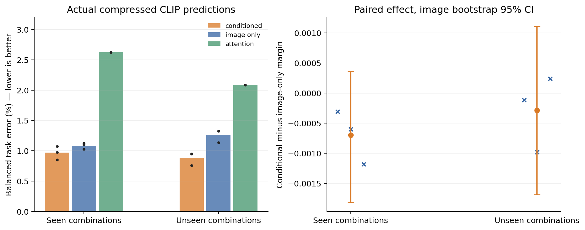
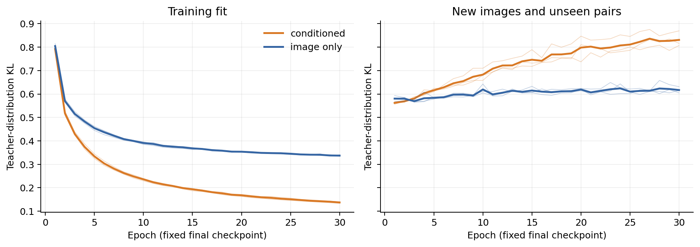

# First paired selector training pilot

Completed 2026-10-18. This is the first H3 experiment: learn from the budget-matched teacher, then evaluate actual compressed CLIP on new images and unseen combinations of known classes. See the [fixed protocol](../../docs/selector-pilot.md) and [run record](../../docs/experiments/2026-10-18-selector-pilot.md).

## Main result

Both selectors learn useful selections. Candidate conditioning gives a small, consistent accuracy advantage in this pilot, but no average margin advantage. The accuracy evidence is sparse and does not yet establish a reliable general advantage over the learned image-only baseline.

Frozen CLIP ViT-B/16, one pruning boundary after block 6, 49 of 196 patches retained. Train on 592 images and 532 pairs; evaluate on 144 disjoint development images. Both models have the same 348,033-parameter architecture, initialization within seed, example order, optimizer and fixed 30-epoch schedule. Only the candidate descriptor varies versus stays fixed. This matches nominal parameter count, not identical effective function capacity.

| Method | Seen combinations: accuracy | Unseen combinations: accuracy | Seen mean margin | Unseen mean margin |
| --- | ---: | ---: | ---: | ---: |
| Full CLIP (196 patches) | 98.90% | 99.05% | 0.12461 | 0.12468 |
| Attention (49 patches) | 97.38% | 97.92% | 0.08933 | 0.08810 |
| Learned image-only | 98.92% | 98.74% | 0.11399 | 0.11382 |
| Learned conditioned | 99.03% | 99.12% | 0.11335 | 0.11290 |
| Label-informed teacher (diagnostic) | 99.93% | 100.00% | 0.14015 | 0.14135 |

Learned rows average three seeds; references are evaluated once. Seen pairs: 500 tasks / 4,000 balanced image-task rows. Unseen pairs: 66 tasks / 528 balanced rows. All classes are known during training. The teacher uses the true label and is not deployable. The slight accuracy difference from full CLIP is not a claim that compression generally improves CLIP.

| Seed | Unseen conditioned correct | Unseen image-only correct | Difference |
| --- | ---: | ---: | ---: |
| 2041 | 523 / 528 | 521 / 528 | +2 |
| 2042 | 524 / 528 | 522 / 528 | +2 |
| 2043 | 523 / 528 | 521 / 528 | +2 |

The balanced unseen accuracy gain is **+0.379 percentage points**. Averaging tasks and seeds within each image first yields +0.417 points, with 95% image-bootstrap interval **[0.000, 0.945]**. These weighting schemes differ. The image-equal margin difference is **-0.000285**, interval **[-0.001691, 0.001110]**. Seen-pair accuracy and margin intervals also include zero. Intervals are conditional on the current tasks and three seeds; repeat seeds do not create independent images. The final test split remains untouched.



Left: actual error rates (lower is better), dots show individual seeds. Right: image-equal margin differences with image-bootstrap intervals; crosses show per-seed effects. All methods use the same development image panel.

## Learning behavior and new insight

The conditioned model fits the training teacher more closely: final training KL averages about 0.133 versus 0.329 for image-only. On unseen-pair validation, the corresponding final KL is about 0.831 versus 0.617, and worsens over later epochs. This is a generalization gap in teacher imitation, not a failed optimizer: both improve greatly from their initial losses around 2.5–2.6.

Despite worse validation teacher fit, the conditioned model has slightly better downstream accuracy. Its teacher utility correlation is also slightly lower on unseen tasks (about 0.572 versus 0.573), and its mean margin is not higher. Therefore, stronger teacher imitation, accurate classification and larger margins are not interchangeable success criteria. This extends the prior observation that predicting token importance or reproducing one mask does not guarantee better selected-set behavior. It does not establish why the metrics diverge.



Fine lines show individual seeds; thick lines show their mean. Training loss is the within-epoch average, validation loss is measured after each epoch. The final checkpoint was fixed before outcomes; no best-epoch substitution was made.

## Proposal status and next decision

H3 now has a working learned selector and initial evidence of transfer to unseen combinations, including a modest conditioned-versus-image-only accuracy signal. It is not yet strong evidence that task information is necessary or systematically better. H1 superiority over the privileged shared-search reference and H2 mechanism claims remain unresolved; this run does not replace those questions.

The next focused diagnostic should compare correct versus altered task descriptors **within the same trained conditioned model**, and examine the small number of repaired/new errors and harder full-model-margin strata. This can separate useful task information from incidental training differences. Later expansion should address the teacher-imitation generalization gap using an explicitly fixed training/data comparison, with final confirmation reserved for untouched test data. More epochs alone are not indicated by these curves.

## Cost, artifacts and reproduction

On one RTX A6000: preparation 101.49 s, six training runs including loss evaluation/output 166.11 s, actual-model evaluation 12.86 s; total **280.46 s = 0.07791 single-GPU process hours**. The training loops themselves total 158.23 s. This small cached-feature MLP trial does not train CLIP; these timings exclude coding, transfer and backup, and are not deployment latency or an estimate of the remaining full project.

- `supervision/`: panels, pair manifests, full/attention evidence, validation teacher and preparation cost record. The larger training teacher is in the release bundle below.
- `training/`: all epoch losses, final fit statistics, paired-seed and cost metadata.
- `evaluation/`: complete per-example records, all 37 class scores, selection scores and retained positions for all methods/seeds.
- `analysis.json`: paired estimates, image-bootstrap intervals, seed tables and descriptive seen/unseen comparison.
- PNG/PDF plots and `scripts/analyze_selector_pilot.py`: figure exports and reproducible analysis.

Final weights and training teacher: [versioned artifact release](https://github.com/NathanTong0921/ViT-token-compression/releases/tag/pets-selector-pilot-v1). Extract `pets-selector-pilot-v1-artifacts.zip` at the repository root to recover the original `runs/` paths for these files. Prefix caches remain reproducible server working data.

```bash
PYTHONPATH=src python3 scripts/analyze_selector_pilot.py --results results/pets-selector-pilot-v1 --plot
```

Preparation source `94f83fd`; training source `ae6d57f`; evaluation source `bee5abb`. The fixed protocol and complete command sequence are in the run record. The prior 144-image panel has informed development choices, so these are development results rather than a final generalization claim.
