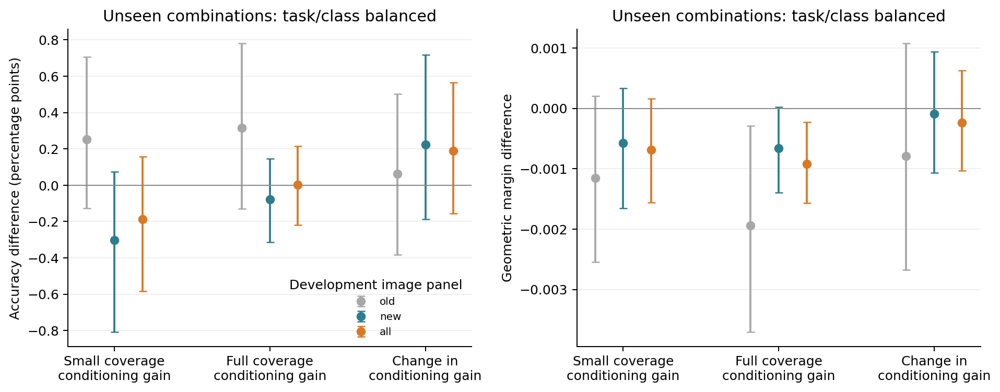
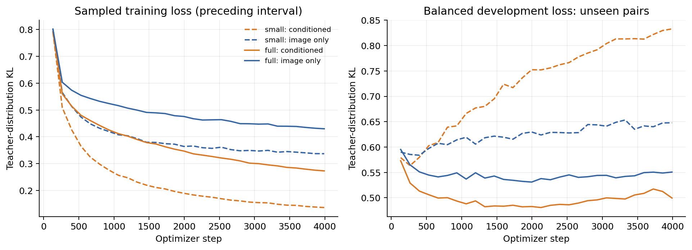

# 固定训练步数下扩大训练图片覆盖

**结论：更多不同训练图片明显改善了条件化 selector 对教师分数的泛化，但还没有建立它相对图像版 selector 的分类优势。** 在完整开发评估中，两者准确率几乎相同，条件化版的平均分类间隔反而略低。此前小面板上的正向差值没有在新增图片上稳定重现。

这是 proposal H3 的受控扩展，起点是 I4 的教师拟合泛化差距和 I5 的有用任务依赖。预先固定的方案见 [实验协议](../../docs/selector-data-coverage.md)，执行记录见 [实验日志](../../docs/experiments/2026-10-18-selector-data-coverage.md)。

## 受控比较

- 冻结 CLIP ViT-B/16，在 block 6 后保留 49/196 个 patch；同一 348,033 参数的 selector 架构，hidden width 128。
- 训练图片由原有 **592 张**扩展到 **2,944 张**，小集合严格包含在大集合内。两组均使用原来的 532 个训练类别组合。
- 两种覆盖 × 条件化／图像版 × 三个种子（2041、2042、2043），共 12 次训练。每次固定 **3,990 次更新、batch size 128、510,720 次样本呈现**；每个任务的每个类别恰好出现 480 次。
- 同一种子下四次训练具有相同初始参数，以及相同的任务、类别和类内图片分位数序列；每种覆盖的两种模型看到完全相同的图片序列。类内有放回均匀采样，覆盖增加时每张图的重复次数相应减少。
- AdamW，学习率 0.0003、weight decay 0.01，监督为原有 512-mask、49-patch ridge 软重要性分布，KL temperature 1。使用最终第 3,990 步模型，不按验证结果挑选 checkpoint。
- 小集合也在本轮重新训练，因为采样方式由旧实验的逐 epoch 打乱改成了固定任务／类别序列。旧模型不充当本轮主要训练规模对照。

736 张开发图片全部参与评估；未见的 66 个组合实际涉及其中 **716 张图、2,624 个图片／任务样本**。原有面板为 144 张图／528 个样本；新增面板为 572 张可用于未见组合的图片／2,096 个样本。另有 20 张开发图片的类别没有进入这 66 个组合。最终测试图片和 68 个测试组合未使用。

## 主要分类结果：未见类别组合

每个任务等权，每个任务中的两个类别各占一半权重，类别内部图片等权；以下为三个种子的平均。分类间隔为正确类别与竞争类别的余弦分数差，除以两类别文本向量之差的范数。

| 训练覆盖 | 选择方式 | 准确率 | 平均分类间隔 |
| --- | --- | ---: | ---: |
| — | 未剪枝 CLIP | 99.2644% | 0.126042 |
| — | Attention | 97.6954% | 0.090628 |
| — | 使用标签的离线教师 | 100.0000% | 0.142052 |
| 592 张 | 条件化 | 98.7912% | 0.114351 |
| 592 张 | 图像版 | 98.9786% | 0.115034 |
| 2,944 张 | 条件化 | 98.9919% | 0.114693 |
| 2,944 张 | 图像版 | 98.9906% | 0.115612 |

离线教师使用真实标签，是可供诊断的潜在空间，不能视为可部署模型的表现。

| 配对效应 | 平均值 | 95% 图片聚类 bootstrap 区间 |
| --- | ---: | ---: |
| 大覆盖下，条件化 − 图像版：准确率 | +0.0013 个百分点 | [−0.2186, +0.2141] |
| 大覆盖下，条件化 − 图像版：间隔 | −0.000919 | [−0.001564, −0.000228] |
| 扩大覆盖后，条件化优势的变化：准确率 | +0.1887 个百分点 | [−0.1559, +0.5645] |
| 扩大覆盖后，条件化优势的变化：间隔 | −0.000236 | [−0.001028, +0.000627] |

“条件化优势的变化”是预定的主要对照：`(条件化 − 图像版)_大覆盖 − (条件化 − 图像版)_小覆盖`。准确率区间跨零；不能宣称扩大覆盖可靠地增加了条件化的分类优势。大覆盖下，条件化相对图像版的准确率差在三个种子中分别为 +0.0359、+0.0837、−0.1156 个百分点。

置信区间使用 2,000 次图片聚类重采样、seed 2052；每次四个模型条件共用图片重采样，保留任务／类别权重，先平均固定的三个训练种子。区间以这些任务和训练种子为条件，不表示任意新任务或训练种子的全部不确定性。完整逐种子结果及图片等权敏感性分析见 [analysis.json](analysis.json)。

## 教师拟合明显改善，但没有直接变成分类优势

KL 越低，模型越接近教师的软重要性分布。训练和验证 KL 均按任务／类别平衡计算。

| 训练覆盖 | 选择方式 | 最终训练 KL | 最终验证 KL |
| --- | --- | ---: | ---: |
| 592 张 | 条件化 | 0.14183 | 0.83297 |
| 592 张 | 图像版 | 0.33493 | 0.64781 |
| 2,944 张 | 条件化 | 0.26957 | **0.49949** |
| 2,944 张 | 图像版 | 0.42853 | 0.55063 |

更广的训练覆盖使条件化版的验证 KL 从 0.833 降至 0.499，并在三个种子中都低于图像版。与此同时，实际分类准确率并没有稳定超过图像版。这进一步支持分开衡量“拟合教师分数”与“保留分类所需信息”，而不能用前者代替后者。当前两种覆盖的对照也不构成普遍的数据规模规律。

曲线中 step 0 的训练 KL 是完整训练面板评估；后续训练点是前 133 步的在线平均损失，表中的最终训练 KL 则重新在完整允许面板上评估。验证曲线始终使用相同的完整开发面板。

## 原有与新增面板

以下仍使用任务／类别平衡准确率，仅列条件化相对图像版的差值。这些是预定的面板敏感性分析。

| 训练覆盖 | 原有 144 张图 | 新增 572 张可用图 |
| --- | ---: | ---: |
| 592 张 | +0.2525 个百分点 | −0.3020 个百分点 |
| 2,944 张 | +0.3157 个百分点 | −0.0779 个百分点 |

上述四个差值的区间均跨零。原有面板的正向均值仍在，但新增面板没有重复该方向，说明不宜把小面板收益外推到整个开发集。新增图片现在属于开发证据；它们不是最终独立测试。两类面板的任务内权重各自归一化，不能简单按图片数混合这两列来重算总分。

## 任务描述交换：有用的依赖仍在，强度变小

这是另一种评估：固定已训练模型和图片，交换 selector 接收的有效候选类别，最终回答原任务。**只在支持两种任务的 616 张图、每个种子 4,315 对任务上进行，并按图片等权**，与上面的任务平衡分类指标不同。

| 训练覆盖 | 正确描述 − 交换描述：间隔 | 正确描述 − 交换描述：准确率 |
| --- | ---: | ---: |
| 592 张 | +0.003699 [0.003326, 0.004079] | +0.1844 pp [0.0419, 0.3346] |
| 2,944 张 | +0.001795 [0.001552, 0.002042] | +0.1165 pp [−0.0703, 0.2923] |

更广覆盖下，正确描述相对交换描述的间隔收益仍为正，但较小覆盖减少了 **0.001904**，区间 [−0.002304, −0.001542]。跨任务选择的平均重合率由 73.43% 增至 76.54%；图像版的交换效应严格为零。原有 124 张交换图片与新增 492 张交换图片上，间隔效应都保持正向。

这不说明“任务信息无用”，也不能仅凭变化方向断言模型采用了什么内部机制。它说明更好的教师拟合没有使候选信息的影响更强；在当前条件下，有用的任务依赖与优于共享模型仍是两个不同问题。详情见 [exchange_analysis.json](exchange_analysis.json)。本轮没有完成 H2 中控制未压缩分类间隔后的文本分隔方向夹角分析。

## 计算成本与验证

单张 RTX A6000；三个 GPU 阶段的进程 wall-clock 分别为：监督／特征准备 224.823 秒，12 次训练及其监测 362.477 秒，实际 CLIP 分类评估 83.019 秒。合计 **670.319 秒，约 0.1862 单卡小时**。这是本轮阶段内的占用时间估计，包含其 CPU/I/O 工作，不含外部传输、备份和 CPU 统计分析，也不代表部署延迟。此前已完成、在本轮复用的监督成本不重复计入。

监督生成复用了 592 张训练图片和 144 张开发图片的已有结果，为新增 2,352 张训练图片和 592 张开发图片生成监督。图像版 selector 和 attention 的实际前向在每张图片上只计算一次，再用于各个候选任务；条件化版按图片／任务前向。这种缓存复用用于研究评估，不能据此声称部署速度更快。

- [准备数据核验](preparation_audit.json)：划分不交叉，旧缓存对齐，抽样重新求解 ridge 系数一致；旧开发图片缺失的原始探测响应明确标记为不可用。
- [训练核验](training_audit.json)：独立 CPU 重建三个种子的全部采样序列与图片曝光次数；12 个权重可加载、数值有限、更新预算相同。实际曝光覆盖全部 592／2,944 张图片。
- [评估核验](evaluation_audit.json)：独立复核全部 356,790 行分数、任务与图片对应关系，重新计算分类结果、加权统计和配对区间；结果在浮点精度内一致。两张汇总图也已人工检查。
- 本轮保存完整 37 类分数、选中位置和图像嵌入，为后续交换与 H2 分析保留证据。

小型结果、图表和统计源数据保存在本目录。较大监督、12 个权重及完整逐样本评估保存为本地 `../artifacts/pets-selector-scale-v1/`（相对于仓库根目录）中的两个 ZIP，服务器保留原始运行目录；[GitHub Release](https://github.com/NathanTong0921/ViT-token-compression/releases/tag/pets-selector-scale-v1) 已发布并完成目的地恢复核验：重新下载两个归档，34 个文件与原始数据一致，12 个模型均可加载，并从恢复的数据重算主要结果。见 [发布记录](release_assets.json) 和 [恢复核验](github_recovery_verification.json)。恢复用下载与解压目录已清理。

## 对项目的影响与下一步

本轮对研究判断是有价值的推进，但对“条件化稳定优于强共享选择”没有新增正面证据。它把问题从单纯的训练图片不足，推进到监督拟合与实际保留判别信息之间的差异。接下来完成 49／98／147 token 的受控比较和 H2 几何分析，检验这种差异是否依赖压缩程度与任务关系；之后用 Flowers102 和已列为必做的 ViT-L/14 定向验证关键结论。扩大覆盖本身不应成为继续盲目增加训练时长的理由。
