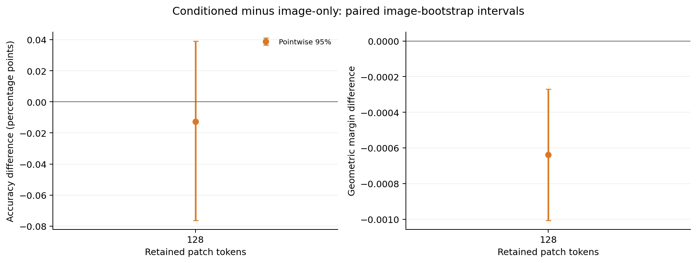
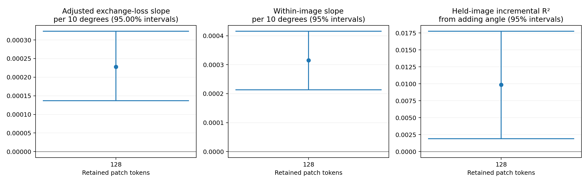

# Oxford Pets：ViT-L/14 的 50% patch 定向验证

**H2 的正向关联得到复现，但条件化 selector 在本设置下没有超过同容量图像版：平均分类间隔更低，准确率差异区间跨零。** 正确任务描述仍比交换描述保留更多分类间隔，因此“任务信息确实影响选择”和“条件化方法优于共享方法”在这组实验中给出了不同答案。

本轮遵循预测产生前固定的[验证方案](../../docs/vitl-and-latency-validation.md)。这是在完成 B/16 开发实验后开展的定向验证，官方测试图片及保留测试组合仍未用于训练和预测。

## 范围与核验

- 冻结 OpenAI CLIP ViT-L/14，输入 224×224，在第 12／24 个 block 后保留 128／256 个 patch，始终保留 CLS；视觉宽度 1,024，输出维度 768。
- 沿用 2,944 张训练图片、736 张验证图片和 532／66 对训练／验证组合。未见组合主面板包括 716 张图片、2,624 个图片／任务样本；同图交换要求至少两个有效任务，包括 616 张图片、4,315 个无序任务对。
- 全部 3,680 张训练／验证图片的 keep-all 路径与原始 CLIP 特征完全一致，预测分歧为零。[特征准备记录](execution/features.json)
- 每个 selector 为 480,641 参数；三个配对种子 2041／2042／2043，各训练 3,990 步，batch 128，hidden width 128，使用最终步权重。监督使用每图 512 个固定预算 mask、ridge 0.01。[监督记录](execution/prepare.json)／[训练记录](execution/train.json)
- 主指标按任务等权、任务内类别等权计算；先平均三个训练种子，再进行 2,000 次图像聚类 bootstrap。每个数据集仅一个新预算，因此这里使用普通 95% 区间，条件为固定任务图和三个训练种子。

## 未见类别组合

| 方法 | 准确率 | 平均有符号分类间隔 |
| --- | ---: | ---: |
| 未剪枝 CLIP | 99.4557% | 0.133314 |
| 随机选择 | 99.3049% | 0.122188 |
| Attention | 99.3042% | 0.126141 |
| 图像版 selector | 99.4172% | 0.136776 |
| 条件化 selector | 99.4046% | 0.136138 |
| 使用真实标签的离线教师 | 99.9621% | 0.167409 |

离线教师仅用于诊断。主要比较为条件化减图像版：

| 指标 | 均值 | 95% 区间 |
| --- | ---: | ---: |
| 准确率差（百分点） | −0.0126 | [−0.0763, +0.0392] |
| 分类间隔差 | −0.000638 | [−0.001006, −0.000270] |

| 训练种子 | 准确率差（百分点） | 分类间隔差 |
| --- | ---: | ---: |
| 2041 | +0.0379 | −0.000030 |
| 2042 | +0.0020 | −0.000921 |
| 2043 | −0.0778 | −0.000963 |

三个种子的间隔差均为负，准确率方向不一致。[完整主结果、已见组合及逐种子结果](analysis.json)

## 任务交换与 H2

正确描述相对交换描述的间隔收益为 **+0.000361**，95% 区间 **[+0.000272, +0.000455]**；准确率差为 −0.0135 个百分点，区间 [−0.0568, +0.0162]。选择集合平均重合率为 83.97%；图像版的交换效应严格为零。交换统计按图片等权，与主分类指标的任务／类别权重不同。[交换结果](exchange_analysis.json)

| H2 检验 | 估计 | 95% 区间 |
| --- | ---: | ---: |
| 难度控制后，角度每增加 10° 的交换损失斜率 | +0.000228 | [+0.000137, +0.000323] |
| 图片固定效应斜率／10° | +0.000315 | [+0.000213, +0.000415] |
| 五折留出图片的增量 R² | +0.009865 | [+0.001915, +0.017745] |

三个种子的难度调整斜率分别为 +0.000164、+0.000271、+0.000250，普通 95% 区间均为正。768 维特征上的交换恒等式误差小于 4×10⁻¹⁷。留出图片的预处理和拟合只使用训练折；R² 区间重采样固定折外预测，不包含重新拟合的变异。[完整几何结果](geometry/analysis.json)

## 训练拟合与 B/16 结果的关系

| selector | 最终训练 KL（三种子均值） | 最终验证 KL（三种子均值） |
| --- | ---: | ---: |
| 条件化 | 0.4828 | 1.1267 |
| 图像版 | 0.6254 | 1.1379 |

六次训练均完成固定更新，损失较初始化下降。条件化版的平均训练及验证 KL 更低，但下游分类间隔更差；教师模仿损失不能直接代替 top-k 分类效用。[完整训练曲线](execution/training_history.csv)

B/16、98／196 patch 的间隔优势为 +0.000573，原三预算调整后区间为正；L/14、128／256 patch 的对应差值为负。因此，**H2 和正向的描述交换间隔效应得到复现，条件化相对图像版的正间隔收益没有复现**。两设置同时改变了 patch 大小、深度、宽度、文本表示和 selector 输入维度，不能把差异单独归因于模型大小。这里也没有搜索 L/14 的最优预算。

[独立科学核验](scientific_audit.json)已从原始预测重新计算主效应与图像 bootstrap 区间、完整特征交换关系、H2 点估计和留出图片拟合；H2 区间核对了水平与判断一致性，没有重新执行斜率 bootstrap。小型结果、图表及执行摘要保存在本目录；大型原始证据由本轮统一归档管理。实际推理延迟单独测量，不使用训练／缓存评估时间代替。
