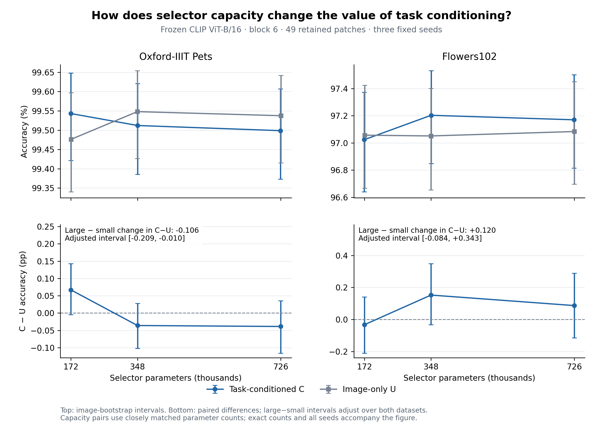
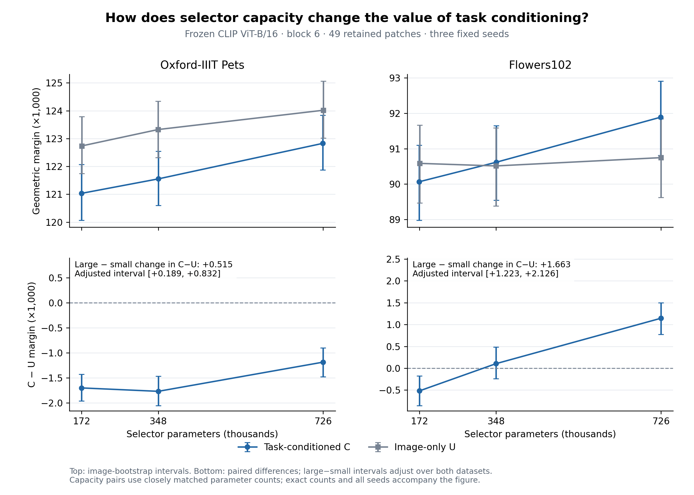
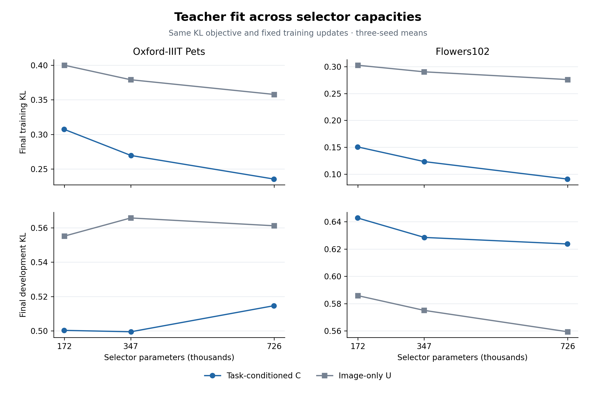

# Selector capacity and the value of task conditioning

Expanding the selector from about 172k to 726k parameters does not produce a common accuracy trend: the **C−U accuracy difference** decreases by 0.106 percentage points on Pets, while its 0.120-point increase on Flowers remains uncertain. The C−U geometric-margin difference increases on both datasets, with Flowers' mean difference changing from negative to positive. Capacity therefore changes the relative score margins, without establishing a general accuracy benefit from enlarging the conditioned selector.

C receives the image and candidate classes. U receives the image and uses a wider image network to match C's total parameter budget. Both learn the same teacher targets with the original KL objective. The comparison changes the available capacity while preserving the training images, tasks, updates, and 49-patch budget.

## Main test results

Frozen CLIP ViT-B/16, pruning after block 6, three seeds (2041–2043). Pets contains 13,529 image–task rows from 3,569 images and 68 tasks; Flowers contains 24,596 rows from 6,149 images and 204 tasks. These are the existing test panels, with images and class combinations held out from selector training.

| Dataset | Capacity | C / U parameters | C accuracy (%) | U accuracy (%) | C−U accuracy (pp) | C−U geometric margin ×1,000 |
|---|---|---:|---:|---:|---:|---:|
| Pets | Small | 171,713 / 172,409 | 99.543 | 99.476 | +0.067 | −1.703 |
| Pets | Medium | 348,033 / 347,399 | 99.512 | 99.548 | −0.036 | −1.771 |
| Pets | Large | 725,249 / 726,163 | 99.499 | 99.537 | −0.039 | −1.188 |
| Flowers | Small | 171,713 / 172,409 | 97.024 | 97.057 | −0.033 | −0.520 |
| Flowers | Medium | 348,033 / 347,399 | 97.203 | 97.051 | +0.152 | +0.104 |
| Flowers | Large | 725,249 / 726,163 | 97.170 | 97.084 | +0.086 | +1.144 |

The main contrast is **(C−U at large capacity) − (C−U at small capacity)**. It directly tests whether increasing capacity changes the relative value of conditioning.

| Dataset | Accuracy change (pp), adjusted interval | Geometric-margin change ×1,000, adjusted interval | Raw-gap change | CE change |
|---|---:|---:|---:|---:|
| Pets | −0.106 [−0.209, −0.010] | +0.515 [+0.189, +0.832] | +0.000491 | +0.001346 |
| Flowers | +0.120 [−0.084, +0.343] | +1.663 [+1.223, +2.126] | +0.001464 | −0.007245 |

Accuracy was the primary metric. The geometric-margin result provides complementary evidence about class separation. On Flowers, C's margin improvement exceeds U's, and all three seeds have a positive large-minus-small margin interaction. On Pets, C's margin disadvantage narrows at large capacity but remains negative at every capacity; the three seed interactions have mixed signs. Raw cosine gaps support the same margin trends. Lower CE is better, so its Flowers change also favors C.

The intervals resample images, keeping each image's tasks together, and describe the mean of the three fixed trained seeds. The main contrast uses two-dataset-adjusted intervals; ordinary endpoint and secondary intervals are in the tables. The per-seed large-minus-small accuracy changes are −0.067 / −0.251 / +0.001 pp on Pets and +0.190 / +0.284 / −0.115 pp on Flowers. This seed variation accompanies the aggregate estimate.

## What the training curves add

| Dataset | Model | Training KL, small → medium → large | Development KL, small → medium → large |
|---|---|---|---|
| Pets | C | 0.307 → 0.270 → 0.236 | 0.500 → 0.499 → 0.515 |
| Pets | U | 0.400 → 0.379 → 0.358 | 0.555 → 0.566 → 0.561 |
| Flowers | C | 0.151 → 0.123 → 0.091 | 0.643 → 0.628 → 0.624 |
| Flowers | U | 0.303 → 0.290 → 0.276 | 0.586 → 0.575 → 0.559 |

Larger networks fit the training teacher more closely in every case. That improvement has different consequences after token selection. On Pets, C's better training fit accompanies a wider training/development KL gap and no accuracy gain. On Flowers, C's test margins improve despite its development KL remaining worse than U's. Thus the capacity result cannot be summarized by teacher-fit quality alone: fitting the full ranking distribution, preserving the selected subset, and crossing the classification boundary measure different outcomes.

Development-panel results are included as a diagnostic. Their large-minus-small geometric-margin changes have the same signs as test (+0.548 ×1,000 on Pets; +2.244 ×1,000 on Flowers). Their accuracy changes are +0.055 and +0.114 pp, respectively. Main conclusions above use test.

## Relation to the project question and H2

This study extends the resource-allocation comparison from one matched parameter budget to three. It shows a specific condition under which task conditioning changes its relative margin performance, particularly on Flowers. It does not locate a universal capacity threshold or establish an accuracy-optimal allocation between image and task processing.

H2 remains auxiliary evidence about **exchanging selections between tasks**. Its exact margin decomposition contains both a text-direction angle and the resulting feature displacement. Earlier image-held-out regressions found predictive information in the text angle beyond full-model margins, but their target was swap loss, not C−U improvement. The shared selector U is absent from the decomposition. Consequently, H2 cannot by itself predict which capacity or which input favors C over U. This capacity experiment answers that comparison directly; it does not rerun H2.

## Execution and available data

Twenty-four small/large models were trained and twelve medium models reused. All 36 models were evaluated on both panels with the same FP32 CLIP suffix, native token deletion, and batch size 32. Training used 3,990 updates for Pets and 3,978 for Flowers. Analysis uses the original equal-task/equal-class-side weighting and 2,000 image-cluster bootstrap draws (seed 2721).

New training took 751.5 seconds; evaluation took 321.0 seconds. Including preparation and validation, the two dataset processes used a combined 1,268.7 seconds (0.352 GPU-hours). This incremental cost reuses cached features and supervision; it excludes their earlier generation and the reused medium training.

- `summary.json`, `test/*/methods.csv`, `test/*/contrasts.csv`: all absolute metrics and paired comparisons, including raw gaps and CE.
- `test/*/per_seed.csv`, `dev/*/`: individual seeds and development diagnostics.
- `training_fit.csv`, `training_fit_summary.csv`, `training_history.csv`: final fits and the existing learning curves for all capacities.
- `figures/`: exportable PNG/PDF figures.
- `execution/`, `execution_check.json`: source configuration, checkpoint reuse, execution checks, and costs.

Raw predictions, cached evaluation evidence, and new checkpoints remain at `/data4/zhao.tong/experiments/selector-capacity-v1`. The analysis and figure entry points are `scripts/analyze_selector_capacity.py` and `scripts/plot_selector_capacity.py`.
