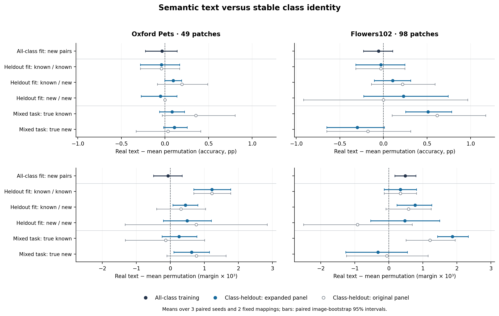

# 语义文本还是稳定的类别身份？

冻结 CLIP ViT-B/16，在 Pets49、Flowers98 上比较真实文本、两套固定类别—文本置换和加宽图像基线。共48次配对训练：两数据集×两种训练类别范围×四个模型×三个既定种子。置换只改变 selector 输入；教师与最终分类始终使用正确文本。没有新教师查询。

**主要认识：新类别组合上的准确率，未显示出真实语义相对于稳定身份编码的优势；Flowers 的语义收益更集中于已见真实类别，并没有直接转化为识别未见真实类别的能力。** 这是关于条件化泛化证据的区别，不是“语义无用”的结论。

## 真实文本相对两套置换均值

以下是准确率差，单位为百分点；括号为配对图片 bootstrap 95%区间。每项包含全部三个训练种子与两套映射。

| 评估条件 | Pets49 | Flowers98 |
|---|---:|---:|
| 全类别训练，未见组合 | −0.033 [−0.226, 0.139] | −0.057 [−0.229, 0.106] |
| 留出类别训练，已知／已知 | −0.042 [−0.281, 0.167] | −0.030 [−0.318, 0.246] |
| 留出类别训练，已知／新类别（扩展） | +0.094 [−0.004, 0.190] | +0.106 [−0.105, 0.312] |
| 留出类别训练，新／新类别（扩展） | −0.052 [−0.273, 0.138] | +0.230 [−0.226, 0.743] |

真实文本在 Flowers 全类别训练下仍有小幅 margin 优势：+0.000480 [0.000172, 0.000795]，六个种子—映射配对均为正。Pets 对应 margin 差接近零。因此“准确率没有明显优势”不能替换成表示或预测完全相同，也不构成统计等效检验。

## Flowers 的混合任务呈现方向性差异

同一批已知／新类别对，按图片的真实类别分开：

| 扩展混合任务的真实类别 | 真实文本−置换准确率 | 真实文本−加宽图像准确率 |
|---|---:|---:|
| 已知 | +0.512 [0.254, 0.782] | +0.580 [0.191, 0.990] |
| 新类别 | −0.300 [−0.651, 0.010] | −0.528 [−0.982, −0.167] |

真实文本相对置换的“真实新类别−真实已知类别”交互为 −0.813 pp [−1.244, −0.421]，margin 交互为 −0.002189 [−0.003255, −0.001261]。已知真实类别上的准确率与 margin 优势，在两映射×三种子的六个配对中全部为正；真实新类别的准确率仅一个配对为正，且三个种子都低于加宽图像版。原始验证面板的准确率交互同向：−0.794 pp [−1.551, −0.117]。

Pets 没有重现这一方向性差异：扩展混合任务的准确率交互 +0.026 pp [−0.160, 0.224]。Flowers 的真实已知／新类别完整 CLIP 准确率分别为95.994%／98.261%，两侧难度不同；目前结果定位了可重复的分组差异，还未把它归因于特定机制。

## 强共享基线与证据覆盖

强共享对照改变结论的分量。Pets 的真实文本在所有主要面板上 margin 均低于加宽图像版。Flowers 全类别训练时，两套身份编码平均也高于加宽图像版准确率 +0.261 pp [0.065, 0.462]，说明这里的任务编码收益并不专属于正确语义。Flowers 扩展新／新任务上，真实文本仍低于加宽图像版 −0.496 pp [−0.976, −0.036]，三个种子同向；不能把真实文本相对置换的正点估计解释成条件化优于强共享。

原始面板全部保留。扩展面板只加入因类别留出而从该模型训练中删除的原训练类别对：Pets 新／新从2对增至40对（2+38），混合从26增至240对；Flowers 新／新从10对增至47对（10+37），混合从84增至322对。已知／已知任务未改变。扩展在查看类别留出结果之前按覆盖数确定，不重新选择模型、种子或映射。

已核对训练／评估图片及任务无交集，留出类别未进入训练图片，新增类别对全部含留出类别；原始验证类别对完整保留。两套记录均标记未使用正式测试图片／任务。核查见 `verification.json`。区间条件于这一次固定类别划分、任务面板和训练结果，不能代替跨类别划分的复现。

## 文件与复现



`pets/`、`flowers/` 保留原始两种训练范围的协议、训练记录、面板与汇总；`*-expanded/` 保留扩展清单、面板与汇总。`class_novelty_details.json` 包含真实类别分组、映射及种子级结果；PNG/PDF 的原始数字见 `plot_data.csv`。完整检查点与逐例特征另行备份，未放入本目录。

```bash
python scripts/plot_semantic_identity.py --results-root results/semantic-identity-v1
```
