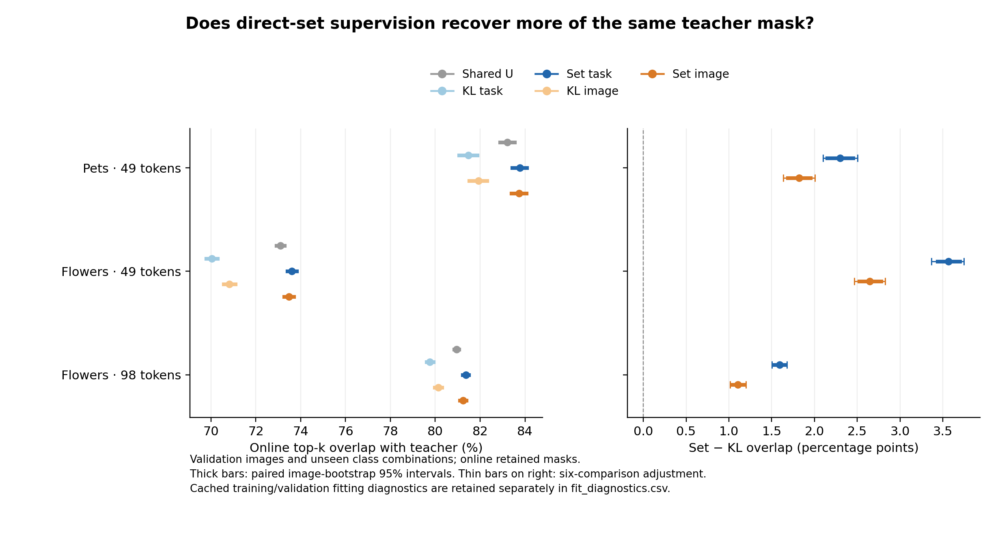
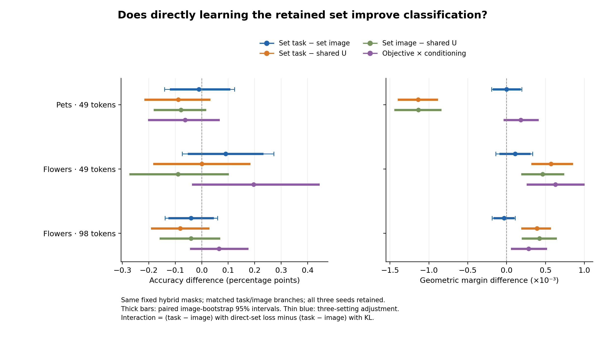

# Direct supervision of the retained set

Completed 2026-11-04: **all six setting/arm comparisons recover more of the fixed teacher mask than their matched KL-trained counterparts. This does not establish an accuracy advantage over the strong shared base, or a task-conditioned advantage over the equally sized image correction.** The new objective improves the earlier training route, but most of its recovery gain restores overlap that KL training had lost relative to the frozen shared starting point.

This is the planned H3 follow-up to I28/I29: hybrid-target KL improved without improving the chosen set, and much of that KL difference was removable by score scaling. The [fixed protocol](../../docs/direct-set-supervision.md) changes the objective while keeping the teacher masks, student architecture and training schedule unchanged. The separate pruning-depth experiment is not part of this intervention.

## Same teacher, different objective

There are 18 new branch fits: Pets49, Flowers49 and Flowers98, each with seeds 2041/2042/2043 and task/image arms. All use frozen CLIP ViT-B/16, block6 selection, the same width199 shared U, and zero-output residual initialization. The task branch has 9,801 learned parameters and the image branch 9,850, around the same 347,399 frozen parameters. The old 18 hybrid-KL fits, masks and C/U teachers are reused. Image/task order, initialization rules, AdamW settings, update counts and final-step evaluation are fixed.

For standardized scores `z = (s − mean(s)) / max(std(s), 1e−6)` and the fixed teacher set S of k patches, the new objective is

```
L_set = [sum TopK(z + 1[outside S], k) − sum_{i in S} z_i] / k.
```

It upper-bounds the missed-member fraction `1 − |TopK(z) ∩ S|/k` and is invariant to positive global scaling and shifts of a score row above the numerical floor. Classification still uses the student's ordinary top-k positions. This is a structured set surrogate, not a claim of a new loss family.

## Absolute outcomes

Accuracy values are percentages, averaged over the three fixed seeds with the existing task/class weights. The full model is shown as a reference; teacher classification uses the same historical masks whose identity was checked.

| Method | Pets49 accuracy (%) | Flowers49 accuracy (%) | Flowers98 accuracy (%) |
|---|---|---|---|
| Shared U | 99.017 | 96.732 | 96.912 |
| KL task correction | 98.941 | 96.487 | 96.683 |
| KL image correction | 98.888 | 96.593 | 96.789 |
| Set task correction | 98.928 | 96.732 | 96.830 |
| Set image correction | 98.939 | 96.642 | 96.871 |
| Conditioned teacher C | 98.992 | 96.822 | 97.116 |
| Hybrid teacher | 98.981 | 96.936 | 97.026 |
| Uncompressed CLIP | 99.264 | 96.740 | 96.740 |

Online validation overlap is intersection with the same teacher mask divided by k, expressed as a percentage. U is the frozen initial selector, before any residual training. Teacher overlap with its own target is 100% by definition.

| Method | Pets49 overlap (%) | Flowers49 overlap (%) | Flowers98 overlap (%) |
|---|---|---|---|
| Shared U / initial | 83.215 | 73.098 | 80.950 |
| KL task correction | 81.467 | 70.039 | 79.763 |
| KL image correction | 81.919 | 70.825 | 80.135 |
| Set task correction | 83.766 | 73.604 | 81.358 |
| Set image correction | 83.740 | 73.473 | 81.240 |

The new task/image students exceed their frozen starting U in overlap by only Pets49: +0.551/+0.525 pp; Flowers49: +0.507/+0.375 pp; Flowers98: +0.408/+0.290 pp. These are descriptive point differences from the initial selector. The larger 1.1–3.6 pp improvements over KL below must not be read as gains of that size over U.

## Primary outcome 1: held-out set recovery

All intervals in this table use the six-comparison adjustment across the three settings and two arms. Every one of the 18 setting/arm/seed recovery changes is positive.

| Setting | Student | Set − KL overlap, pp [adjusted CI] |
|---|---|---|
| Pets49 | task | +2.300 [+2.101, +2.503] |
| Pets49 | image | +1.821 [+1.636, +2.005] |
| Flowers49 | task | +3.566 [+3.369, +3.748] |
| Flowers49 | image | +2.648 [+2.468, +2.825] |
| Flowers98 | task | +1.595 [+1.502, +1.680] |
| Flowers98 | image | +1.105 [+1.015, +1.197] |



## Primary outcome 2: task versus image correction

Accuracy differences are percentage points; margin differences are geometric-margin units ×10⁻³. The following intervals use the three-setting adjustment separately for each metric. All include zero.

| Setting | Set task − set image accuracy, pp [adjusted CI] | Margin ×10⁻³ [adjusted CI] |
|---|---|---|
| Pets49 | -0.011 [-0.140, +0.123] | -0.003 [-0.194, +0.196] |
| Flowers49 | +0.090 [-0.074, +0.272] | +0.109 [-0.142, +0.333] |
| Flowers98 | -0.041 [-0.139, +0.060] | -0.034 [-0.189, +0.111] |

## Secondary objective and classification comparisons

All following intervals are ordinary paired 95% intervals, without the primary-family adjustment. The objective interaction is `(task − image)_set − (task − image)_KL`.

| Setting | Objective interaction accuracy, pp [95% CI] | Margin ×10⁻³ [95% CI] |
|---|---|---|
| Pets49 | -0.063 [-0.199, +0.064] | +0.182 [-0.025, +0.397] |
| Flowers49 | +0.196 [-0.033, +0.441] | +0.628 [+0.270, +0.988] |
| Flowers98 | +0.065 [-0.041, +0.172] | +0.282 [+0.069, +0.504] |

The margin interaction is positive on both Flowers budgets. Its practical interpretation is that the task branch's disadvantage under KL is reduced; the new task branch has not established a lead over the new image branch. Accuracy interactions remain uncertain.

Each student's change from its own historical KL fit:

| Setting | Student | Set − KL accuracy, pp [95% CI] | Margin ×10⁻³ [95% CI] |
|---|---|---|---|
| Pets49 | task | -0.013 [-0.101, +0.076] | +0.555 [+0.312, +0.794] |
| Pets49 | image | +0.051 [-0.051, +0.154] | +0.373 [+0.138, +0.611] |
| Flowers49 | task | +0.245 [+0.008, +0.490] | +0.930 [+0.558, +1.320] |
| Flowers49 | image | +0.049 [-0.139, +0.237] | +0.302 [-0.037, +0.659] |
| Flowers98 | task | +0.147 [+0.025, +0.270] | +0.317 [+0.120, +0.513] |
| Flowers98 | image | +0.082 [-0.008, +0.180] | +0.035 [-0.130, +0.201] |

Flowers' task students recover some accuracy lost under KL, with positive ordinary intervals at both budgets. Neither exceeds the frozen U in mean accuracy: Flowers49 ties U, while Flowers98 remains below it. This is improvement over the earlier training route, not an established improvement over the strong starting model.

Student comparisons with the frozen shared U and hybrid teacher:

| Setting | Student | Reference | Accuracy difference, pp [95% CI] | Margin ×10⁻³ [95% CI] |
|---|---|---|---|---|
| Pets49 | task | U | -0.089 [-0.213, +0.028] | -1.138 [-1.387, -0.898] |
| Pets49 | image | U | -0.078 [-0.178, +0.013] | -1.135 [-1.432, -0.854] |
| Pets49 | task | hybrid teacher | -0.053 [-0.160, +0.041] | -0.279 [-0.643, +0.083] |
| Pets49 | image | hybrid teacher | -0.043 [-0.169, +0.086] | -0.276 [-0.653, +0.111] |
| Flowers49 | task | U | +0.000 [-0.180, +0.180] | +0.572 [+0.330, +0.838] |
| Flowers49 | image | U | -0.090 [-0.270, +0.098] | +0.463 [+0.201, +0.724] |
| Flowers49 | task | hybrid teacher | -0.204 [-0.425, -0.008] | -1.285 [-1.686, -0.897] |
| Flowers49 | image | hybrid teacher | -0.294 [-0.523, -0.065] | -1.394 [-1.796, -1.002] |
| Flowers98 | task | U | -0.082 [-0.188, +0.025] | +0.389 [+0.201, +0.555] |
| Flowers98 | image | U | -0.041 [-0.155, +0.065] | +0.423 [+0.206, +0.630] |
| Flowers98 | task | hybrid teacher | -0.196 [-0.343, -0.041] | -1.236 [-1.445, -1.021] |
| Flowers98 | image | hybrid teacher | -0.155 [-0.302, +0.008] | -1.202 [-1.439, -0.962] |

Both Flowers students have a small positive margin difference from U, but both still trail the hybrid teacher in margin. Pets students remain below U in margin; its hybrid teacher itself is below U, so better recovery of this target does not establish better task performance. Raw cosine-gap results are retained in every summary and the exported tables.



## Corrections and newly introduced errors

These are weighted percentage-point contributions relative to U, averaged over the fixed seeds. Net accuracy equals corrected errors minus new errors; these are not unweighted image counts.

| Setting | Student | Corrected errors, pp | New errors, pp | Net accuracy, pp |
|---|---|---|---|---|
| Pets49 | task | 0.079 | 0.168 | -0.089 |
| Pets49 | image | 0.091 | 0.169 | -0.078 |
| Flowers49 | task | 0.408 | 0.408 | 0.000 |
| Flowers49 | image | 0.408 | 0.498 | -0.090 |
| Flowers98 | task | 0.114 | 0.196 | -0.082 |
| Flowers98 | image | 0.155 | 0.196 | -0.041 |

Flowers49 task correction repairs and introduces equal weighted error mass. In the other five student/settings, newly introduced error mass is slightly greater. The intervals for each student's accuracy difference from U include zero; no claim of an accuracy advantage follows from the overlap gains.

## Training and validation diagnostics

The following recovery values use the cached fitting path. Its validation selected sets exactly match the online evaluation sets for every retained seed, arm and setting. Training rows use training images and tasks; validation rows use held-out images and unseen candidate combinations.

| Setting | Student | Train KL overlap (%) | Train set overlap (%) | Val KL overlap (%) | Val set overlap (%) |
|---|---|---|---|---|---|
| Pets49 | task | 81.835 | 84.145 | 81.467 | 83.766 |
| Pets49 | image | 82.327 | 84.161 | 81.919 | 83.740 |
| Flowers49 | task | 71.396 | 75.623 | 70.039 | 73.604 |
| Flowers49 | image | 72.117 | 75.665 | 70.825 | 73.473 |
| Flowers98 | task | 81.100 | 83.222 | 79.763 | 81.358 |
| Flowers98 | image | 81.588 | 83.430 | 80.135 | 81.240 |

Set recovery improves in training and validation, rather than appearing only as a change in validation selection. Both student arms still have a training–validation gap on Flowers. No validation example exactly reproduces the complete teacher set under either new branch.

Both losses evaluated on the same fixed hybrid targets:

| Setting | Student | KL-trained: KL | Set-trained: KL | KL-trained: set loss | Set-trained: set loss |
|---|---|---|---|---|---|
| Pets49 | task | 0.5769 | 0.8632 | 0.4802 | 0.3823 |
| Pets49 | image | 0.5677 | 0.8144 | 0.4723 | 0.3734 |
| Flowers49 | task | 0.8619 | 1.0118 | 0.7366 | 0.6275 |
| Flowers49 | image | 0.8462 | 1.0838 | 0.7213 | 0.6076 |
| Flowers98 | task | 0.4698 | 0.5004 | 0.4900 | 0.4487 |
| Flowers98 | image | 0.4634 | 0.4959 | 0.4819 | 0.4443 |

All six setting/arm averages have higher hybrid-target KL but lower set loss and better overlap than the matched KL-trained models. This directly continues I28/I29's separation of probability fitting and retained-set quality. It does not make teacher-mask recovery a substitute for the actual classification comparisons.

On the first fixed training minibatch, the new branch-gradient norm is 0.060–0.381 times its corresponding KL norm across the 18 runs. These are initial observations, not a gradient-matched comparison. The learning rate and optimizer were unchanged. The population-standard-deviation floor is inactive in all recorded training and validation diagnostics.

## Research consequence

The H3 chain can now be stated more precisely: changing the complete objective can improve recovery of a fixed hybrid set on unseen images and candidate pairs; most of the gain restores damage introduced by KL relative to the strong shared initialization; the recovered selection does not yet produce a task-specific classification advantage. The Flowers margin interactions and the task students' gains over their old KL counterparts describe where this training route improved, while U and the equally resourced image branch establish the remaining gap.

The planned 18-fit matrix ends here. This round provides no new method accuracy or inference-speed claim. It does not add depths, seeds, targets or hyperparameters after inspecting the results. Reserved final-test data remains unused.

## Verification, cost and artifacts

The [training check](training_check.json) passed for all 18 checkpoints, paired configurations and sample streams, target identities, per-row diagnostics and retained-mask CPU replay. The [independent raw-output audit](independent_check.json) also passed on all three settings, reproducing saved point estimates, intervals, seed summaries and case arrays; maximum numerical discrepancy is below 6e-14. See [Pets](pets_b16_49/summary.json), [Flowers49](flowers_b16_49/summary.json) and [Flowers98](flowers_b16_98/summary.json) for every seed, ordinary and adjusted intervals, and raw-gap results. Paired case arrays, image contributions and all exported tables support independent reconstruction.

| Setting | Six new fits, s | Diagnostics, s | Online selector + suffix, s | Process wall, s |
|---|---|---|---|---|
| Pets49 | 150.59 | 25.82 | 1.44 | 196.62 |
| Flowers49 | 135.44 | 5.90 | 2.43 | 161.64 |
| Flowers98 | 148.63 | 8.12 | 3.91 | 177.27 |

New branch fitting totals **434.67 seconds (0.121 hours)**. Summed GPU-assigned process wall time is **0.149 hours**, including the listed stages and setup/I/O. Do not add process time to its components. Frozen prefix features, teacher generation and old KL fitting were reused; newly generated teacher cost is zero. These are incremental training/evaluation costs, not device utilization or a fresh end-to-end latency benchmark. Details are in [costs.json](costs.json).

The complete 210,999,734-byte archive is verified locally, on the server and as a GitHub draft-release asset. It contains all new row-level outputs, 18 residual weights, nine frozen shared bases and three prefix replay examples. The [backup manifest](backup_manifest.json) records locations and historical teacher/KL dependencies; [archive verification](archive_check.json) covers all 110 members. Curated statistics and plots are versioned in the repository.

Implementation: [set objective](../../src/token_compression/set_objective.py), [training](../../scripts/run_set_distillation.py), [paired analysis](../../scripts/analyze_set_distillation.py), [figures](../../scripts/plot_set_distillation.py), [fixed protocol](../../docs/direct-set-supervision.md).
