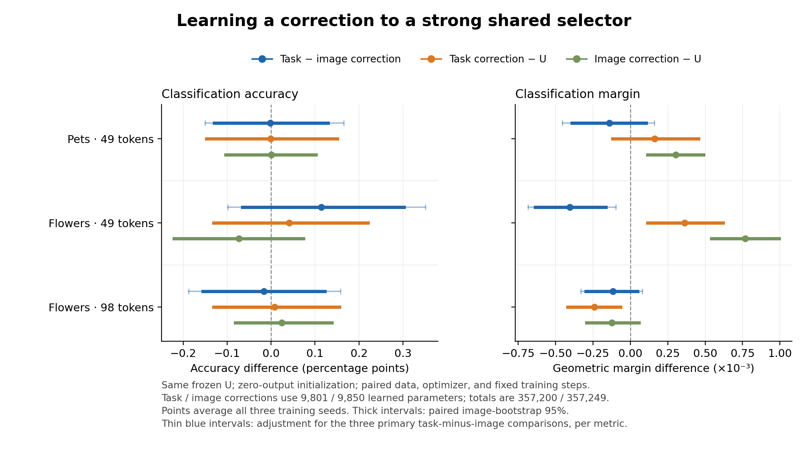

# Learned shared-score correction

Adding a small task-conditioned correction to the strong shared selector did not
improve the primary margin comparison over an equally budgeted image-only
correction. The correction uses candidate information: exchanging task descriptors
reduces its margin in all three settings. These two observations again separate
*using* task information from gaining more than additional image processing.

## Fixed comparison

Both arms freeze the same trained width-199 shared selector U (347,399 parameters)
and start with an exactly zero output correction. The task branch learns 9,801
parameters; the image-only branch learns 9,850. Total counts are 357,200 and
357,249. Training uses the original teacher KL objective and paired image/task
streams, optimizer settings, and fixed update counts. All three seeds
(2041–2043) are retained. Evaluation uses unseen validation combinations, with
716 Pets images / 66 tasks and 1,020 Flowers images / 204 tasks. The final test
set remains unused.

This is a learned score correction, not a fixed protected token core. The frozen
mask mixtures in the preceding experiments motivated the method; their favorable
results do not establish that this learned architecture will reproduce them.

## Primary results

Margin is geometric classification margin. Differences below are task correction
minus image correction; accuracy differences are percentage points. Intervals
adjust for the three primary settings separately for each metric. They bootstrap
images after averaging the three fixed training seeds.

| Setting | Margin difference | Adjusted 95% interval | Accuracy difference | Adjusted 95% interval |
| --- | ---: | --- | ---: | --- |
| Pets, 49 tokens | −0.000141 | [−0.000455, +0.000160] | −0.0020 pp | [−0.1504, +0.1652] |
| Flowers, 49 tokens | −0.000405 | [−0.000684, −0.000098] | +0.1144 pp | [−0.0980, +0.3513] |
| Flowers, 98 tokens | −0.000116 | [−0.000331, +0.000078] | −0.0163 pp | [−0.1879, +0.1580] |

Flowers49 has lower task-branch margin in every seed (−0.000118, −0.000578,
−0.000520). Its accuracy difference favors the task branch in every seed but
remains uncertain across validation images. The two metrics should be reported
together; the experiment did not establish a task-conditioned improvement.

## Comparison with U and use of task information

Secondary margin contrasts use ordinary 95% paired intervals.

| Setting | Task correction − U | Image correction − U | Correct − exchanged task descriptor |
| --- | --- | --- | --- |
| Pets49 | +0.000162 [−0.000118, +0.000456] | +0.000303 [+0.000114, +0.000488] | +0.000232 [+0.000128, +0.000349] |
| Flowers49 | +0.000364 [+0.000114, +0.000621] | +0.000769 [+0.000542, +0.000995] | +0.000098 [+0.000005, +0.000192] |
| Flowers98 | −0.000240 [−0.000419, −0.000066] | −0.000124 [−0.000293, +0.000059] | +0.000174 [+0.000107, +0.000242] |

U and its image-only correction have exactly zero task-exchange effect. No
secondary accuracy contrast with U has an ordinary interval excluding zero.
The Flowers49 correction does capture a modest margin improvement over U, but
the image-only correction improves it more. The stronger frozen-mask mixture
result has therefore not transferred into a task-specific method advantage
under this architecture and objective.

## What the correction learned

| Setting | Changed tokens: task / image | Residual patch standard deviation: task / image | U score standard deviation |
| --- | ---: | ---: | ---: |
| Pets49 | 5.32 / 2.59 | 0.1649 / 0.0791 | 0.7621 |
| Flowers49 | 5.62 / 3.67 | 0.1584 / 0.0682 | 0.7367 |
| Flowers98 | 6.71 / 6.46 | 0.1295 / 0.1006 | 0.6237 |

The task branch changes about 7–11% of U's retained positions on average.
Residual RMS is preserved in the raw diagnostics, but patch standard deviation
is more informative for ranking: a common score offset changes RMS without
changing token order or softmax teacher KL.

| Setting | Initial validation KL (both arms) | Final training KL: task / image | Final validation KL: task / image |
| --- | ---: | ---: | ---: |
| Pets49 | 0.5657 | 0.2858 / 0.3629 | 0.5754 / 0.5700 |
| Flowers49 | 0.5750 | 0.1995 / 0.2819 | 0.6534 / 0.5821 |
| Flowers98 | 0.8307 | 0.3096 / 0.3474 | 0.8605 / 0.8397 |

Task conditioning improves training-target fit but increases validation KL,
especially on Flowers49. This provides a concrete generalization issue to
investigate if the method is developed further. It does not identify whether
regularization, supervision, or branch capacity is responsible by itself.

## Cost, audit, and artifacts

The 18 new branch fits took **237.85 seconds (0.066 GPU-hours)** in measured
training loops. This excludes the reused U training, CLIP/teacher feature
generation, new hidden-feature caching, analysis, and queue time. Cached frozen
features explain the short fitting time. Selector/suffix replay measurements
are saved; they are not end-to-end latency or an acceleration claim.

All nine historical U endpoints reproduce retained masks and class scores
exactly, as do the full-model reference scores. The initial teacher loss is
identical within each paired fit. Unit/integration checks establish zero-output
parity, unchanged frozen weights during branch optimization, equivalent online
and cached scoring, and correct task swapping.

The independent local audit reconstructs all classification and task-exchange
means, ordinary intervals, and adjusted primary intervals directly from the
backed-up per-image contributions. Every value matches exactly (maximum error
0). These contributions already average the three seeds. A second independent
audit reads the original class scores and reconstructs all 27 seed/method means
with independently rebuilt task/class weights (maximum error 1.59×10⁻¹⁴). It
also verifies exact top-k masks, unique retained positions, actual replacement
counts, and residual patch standard deviations. See `independent-audit.json`.

Each setting directory contains the protocol, all seed-level training/evaluation
records, training curves, sampling audit, analysis summary, and per-image
contributions. `method-contrasts.csv` retains both ordinary and adjusted intervals
and every seed. `shared_residual.pdf` is the vector version of the figure.
All **18 fits and all three analyses are confirmed complete**. Complete masks,
class scores, and correction checkpoints remain in the server run directories.
The small results above have been copied locally and can be versioned in Git.
Self-contained packaging is complete: nine unchanged frozen-base checkpoints
(12,548,256 bytes) and three validation-prefix/text/expected-output examples
(867,679 bytes) accompany the correction checkpoints. The mapping and exact-copy
verification are recorded in `base-checkpoint-manifest.json`. The complete bundle is archived on the server, locally, and in the GitHub draft
Release. Direct GitHub restoration of seed2041 for all three settings recovered
the three bases, six correction checkpoints and saved input examples; CPU logits
match within 1e-5 and retained positions match exactly. See the
[archive and restore records](../familiarity-residual-v1/README.md). `scripts/package_shared_residual.py`
recreates the bundle, and `scripts/audit_shared_residual.py` repeats either audit.

This development round supports a bounded result: a small task correction can
use candidate information without outperforming equal additional image-only
capacity. A future attempt should test an explicit change in supervision or
generalization, rather than assume that a residual architecture alone converts
the earlier mixture gain into a deployable advantage.
